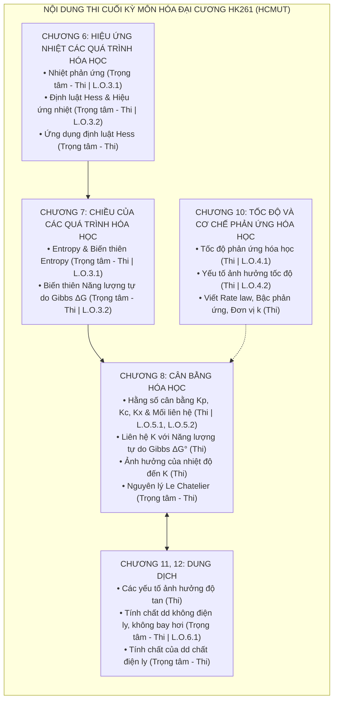
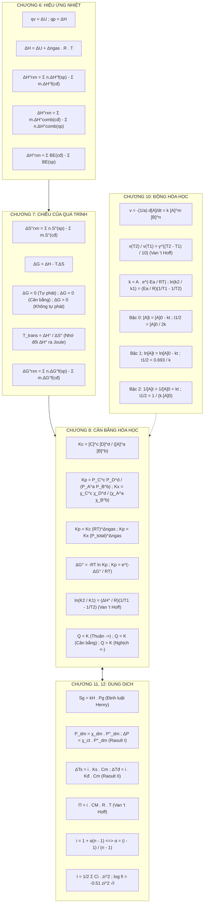

# TỔNG HỢP TOÀN DIỆN KIẾN THỨC ÔN THI CUỐI KỲ HÓA HỌC ĐẠI CƯƠNG (HK261)
## HƯỚNG DẪN ÔN TẬP VÀ ĐỐI CHIẾU CHUẨN ĐẦU RA (FINAL EXAM COMPREHENSIVE GUIDE)

> **Môn học:** Hóa học Đại cương (General Chemistry) – Học kỳ HK261  
> **Trường:** Trường Đại học Bách Khoa, ĐHQG TP.HCM (HCMUT) – Khoa Kỹ thuật Hóa học  
> **Khung chương trình chuẩn:** Lớp Hóa Đại cương PRO K26 – Giảng viên: **ThS. Nguyễn Quốc Vương** (HCMUT CNCP / bachkhoacncp.com)  
> **Tài liệu tham khảo cốt lõi:**  
> 1. *Giáo trình Hóa học Đại cương* – Bộ môn Hóa vô cơ & Đại cương, Khoa Kỹ thuật Hóa học, NXB Đại học Quốc gia TP.HCM.  
> 2. *Chemistry: The Central Science* – Brown, LeMay, Bursten, Murphy, Woodward (Pearson).  
> 3. Hệ thống bài giảng & Đề cương ôn tập chính thức lớp PRO K26 (ThS. Nguyễn Quốc Vương).  
> **Thư mục tài liệu:** `C:\Users\Admin\Documents\K261\Finals\General Chemistry\`  
> **Phân định phạm vi thi cử môn Hóa Đại cương Bách Khoa:**  
> - ⚠️ **Thi Giữa kỳ (đã thi):** Cấu tạo chất (Chương 1: Cấu trúc điện tử nguyên tử, Chương 2: Bảng tuần hoàn & tính tuần hoàn, Chương 3: Cấu trúc phân tử & thuyết liên kết hóa học). *(Phần này được lưu trữ cô đọng tại Phụ lục để tra cứu)*.  
> - 🎯 **THI CUỐI KỲ HK261 (100% PHẠM VI RA ĐỀ):** Tập trung tuyệt đối vào **5 Chuyên đề Nhiệt động, Động học, Cân bằng và Dung dịch** theo bảng chuẩn đầu ra chính thức của ThS. Nguyễn Quốc Vương.

---

## 🗺️ 1. KHUNG ĐỀ CƯƠNG & MA TRẬN CHUẨN ĐẦU RA THI CUỐI KỲ HK261

Bảng phân loại chi tiết theo đúng văn bản chỉ đạo ôn tập của **ThS. Nguyễn Quốc Vương (Lớp Hóa Đại cương PRO K26 - HK261)**:

### Bảng Ma trận Phân loại Mức độ & Chuẩn đầu ra (Course Learning Outcomes)

| Chương theo Giáo trình ĐHBK | Slide tương ứng trong thư mục | Nội dung chi tiết theo Đề cương HK261 | Mức độ thi | Chuẩn đầu ra (L.O) | Trọng số & Dạng câu hỏi trong đề |
| :--- | :--- | :--- | :---: | :---: | :--- |
| **Chương 6: Hiệu ứng nhiệt của các quá trình hóa học** | `Chapter 4 (thermochemistry)-print.pdf` | - Các khái niệm cơ bản ($U, q, w$, hệ, môi trường) - **Nhiệt phản ứng ($q_v = \Delta U, q_p = \Delta H, \Delta H = \Delta U + \Delta n RT$)** - **Định luật Hess. Hiệu ứng nhiệt các quá trình hóa học** - **Ứng dụng định luật Hess ($\Delta H^\circ_f, \Delta H^\circ_{comb}$, năng lượng liên kết, chu trình Born-Haber)** | ⚪ *Tự đọc* 🔴 **Trọng tâm – Thi** 🔴 **Trọng tâm – Thi** 🔴 **Trọng tâm – Thi** |  **L.O.3.1** **L.O.3.2**  | **15 - 20%** Tính hiệu ứng nhiệt phản ứng từ sinh nhiệt, thiêu nhiệt, năng lượng liên kết; chu trình nhiệt động; quan hệ $\Delta H$ và $\Delta U$. |
| **Chương 7: Chiều của các quá trình hóa học** | `Chapter 4 (thermochemistry)-print.pdf` | - **Entropy: tính chất của entropy. Biến thiên entropy trong phản ứng** - **Biến thiên năng lượng tự do Gibbs ($\Delta G = \Delta H - T\Delta S$)** | 🔴 **Trọng tâm – Thi** 🔴 **Trọng tâm – Thi** | **L.O.3.1** **L.O.3.2** | **15 - 20%** Dự đoán dấu $\Delta S^\circ$, tính $\Delta S^\circ_{rxn}$; xét chiều tự phát phản ứng qua dấu $\Delta G$; xác định nhiệt độ đảo chiều phản ứng $T_{trans} = \Delta H^\circ / \Delta S^\circ$. |
| **Chương 10: Tốc độ và cơ chế phản ứng hóa học** | `Chapter 6-Kinetic-print.pdf` | - Các khái niệm cơ bản (tốc độ tức thời, trung bình) - **Tốc độ phản ứng hóa học** - **Các yếu tố ảnh hưởng đến tốc độ phản ứng (nhiệt độ, nồng độ, xúc tác)** - Cơ chế phản ứng (phân tử số, giai đoạn sơ cấp, RDS) - **Viết rate law, bậc phản ứng, đơn vị của $k$, tốc độ trung bình** | 🟡 **Thi** 🟡 **Thi** 🟡 **Thi** ⚪ *Tự đọc* 🟡 **Thi** |  **L.O.4.1** **L.O.4.2**   | **15 - 20%** Thiết lập định luật tốc độ bằng phương pháp tốc độ đầu; tính chu kỳ bán hủy $t_{1/2}$ bậc 0, 1, 2; tính năng lượng hoạt hóa $E_a$ theo Arrhenius; quy tắc nhiệt độ Van 't Hoff. |
| **Chương 8: Cân bằng hóa học** | `Chapter 5 Equilibrium-print.pdf` | - Phản ứng một chiều và phản ứng thuận nghịch - **Hằng số cân bằng: định luật tác dụng khối lượng. Các hằng số cân bằng $K_p, K_c, K_x$. Mối liên hệ giữa $K_p$ và $K_c$** - **Mối quan hệ giữa hằng số cân bằng với năng lượng tự do Gibbs** - **Ảnh hưởng của nhiệt độ đến hằng số cân bằng (Van 't Hoff)** - **Nguyên lý Le Chatelier** | ⚪ *Tự đọc* 🟡 **Thi** 🟡 **Thi** 🟡 **Thi** 🔴 **Trọng tâm – Thi** |  **L.O.5.1, L.O.5.2**    | **20 - 25%** Biểu thức và chuyển đổi giữa $K_p, K_c, K_x$; tính hằng số cân bằng qua $\Delta G^\circ = -RT \ln K_p$; tính $K$ ở nhiệt độ mới bằng Van 't Hoff; giải thích chuyển dịch cân bằng (đặc biệt nạp khí trơ). |
| **Chương 11, 12: Dung dịch** | `Chapter 7-Solution-print.pdf` | - Một số khái niệm cơ bản (nồng độ dung dịch) - **Các yếu tố ảnh hưởng đến độ tan (nhiệt độ, áp suất Henry)** - **Tính chất dung dịch nồng độ thấp, chất tan không điện ly, không bay hơi (Raoult, $\Delta T_s, \Delta T_đ, \Pi$)** - **Tính chất của dung dịch chất điện ly (hệ số Van 't Hoff $i = 1 + \alpha(n-1)$)** - Hoạt độ ($a_i = f_i \cdot C_i$, lực ion $I$) | ⚪ *Tự đọc* 🟡 **Thi** 🔴 **Trọng tâm – Thi** 🔴 **Trọng tâm – Thi** ⚪ *Tự đọc* |   **L.O.6.1**  **L.O.6.2** | **20 - 25%** Bài toán tính $\Delta T_s, \Delta T_đ, \Pi$ của dung dịch không điện ly và điện ly; xác định khối lượng mol chất tan; tính độ điện ly $\alpha$; định luật Henry. |

> **Quy ước mức độ học tập:**  
> - ⚪ **Tự đọc:** Không thi, đọc để hiểu bản chất lý thuyết nền.  
> - 🟡 **Thi:** Nội dung có trong đề thi, cần nắm vững định nghĩa, công thức và phương pháp tính cơ bản.  
> - 🔴 **Trọng tâm – Thi:** Nội dung then chốt chiếm tỷ trọng điểm số lớn nhất, thường xuất hiện trong các câu hỏi vận dụng cao và bài toán phân loại điểm 8, 9, 10.

---

## 📑 2. MỤC LỤC TỔNG QUAN

1. [Khung đề cương & Ma trận chuẩn đầu ra thi cuối kỳ HK261](#1-khung-đề-cương--ma-trận-chuẩn-đầu-ra-thi-cuối-kỳ-hk261)
2. [Mục lục tổng quan](#2-mục-lục-tổng-quan)
3. [Chương 6 (ĐHBK): Hiệu ứng nhiệt của các quá trình hóa học](#3-chương-6-đhbk-hiệu-ứng-nhiệt-của-các-quá-trình-hóa-học)
   - [3.1. [TỰ ĐỌC] Các khái niệm cơ bản nhiệt động](#31-tự-đọc-các-khái-niệm-cơ-bản-nhiệt-động)
   - [3.2. [TRỌNG TÂM – THI | L.O.3.1] Nhiệt phản ứng](#32-trọng-tâm--thi--lo31-nhiệt-phản-ứng)
   - [3.3. [TRỌNG TÂM – THI | L.O.3.2] Định luật Hess & Hiệu ứng nhiệt các quá trình hóa học](#33-trọng-tâm--thi--lo32-định-luật-hess--hiệu-ứng-nhiệt-các-quá-trình-hóa-học)
   - [3.4. [TRỌNG TÂM – THI] Ứng dụng định luật Hess](#34-trọng-tâm--thi-ứng-dụng-định-luật-hess)
4. [Chương 7 (ĐHBK): Chiều của các quá trình hóa học](#4-chương-7-đhbk-chiều-của-các-quá-trình-hóa-học)
   - [4.1. [TRỌNG TÂM – THI | L.O.3.1] Entropy: Tính chất & Biến thiên Entropy trong phản ứng hóa học](#41-trọng-tâm--thi--lo31-entropy-tính-chất--biến-thiên-entropy-trong-phản-ứng-hóa-học)
   - [4.2. [TRỌNG TÂM – THI | L.O.3.2] Biến thiên Năng lượng tự do Gibbs](#42-trọng-tâm--thi--lo32-biến-thiên-năng-lượng-tự-do-gibbs)
5. [Chương 10 (ĐHBK): Tốc độ và cơ chế phản ứng hóa học](#5-chương-10-đhbk-tốc-độ-và-cơ-chế-phản-ứng-hóa-học)
   - [5.1. [THI] Các khái niệm cơ bản về tốc độ phản ứng](#51-thi-các-khái-niệm-cơ-bản-về-tốc-độ-phản-ứng)
   - [5.2. [THI | L.O.4.1] Tốc độ phản ứng hóa học](#52-thi--lo41-tốc-độ-phản-ứng-hóa-học)
   - [5.3. [THI | L.O.4.2] Các yếu tố ảnh hưởng đến tốc độ phản ứng](#53-thi--lo42-các-yếu-tố-ảnh-hưởng-đến-tốc-độ-phản-ứng)
   - [5.4. [TỰ ĐỌC] Cơ chế của phản ứng hóa học](#54-tự-đọc-cơ-chế-của-phản-ứng-hóa-học)
   - [5.5. [THI] Viết Rate Law, xác định Bậc phản ứng, Đơn vị k & Tốc độ trung bình](#55-thi-viết-rate-law-xác-định-bậc-phản-ứng-đơn-vị-k--tốc-độ-trung-bình)
6. [Chương 8 (ĐHBK): Cân bằng hóa học](#6-chương-8-đhbk-cân-bằng-hóa-học)
   - [6.1. [TỰ ĐỌC] Phản ứng một chiều và phản ứng thuận nghịch](#61-tự-đọc-phản-ứng-một-chiều-và-phản-ứng-thuận-nghịch)
   - [6.2. [THI | L.O.5.1, L.O.5.2] Hằng số cân bằng: Định luật tác dụng khối lượng, Kp, Kc, Kx & Mối liên hệ](#62-thi--lo51-lo52-hằng-số-cân-bằng-định-luật-tác-dụng-khối-lượng-kp-kc-kx--mối-liên-hệ)
   - [6.3. [THI] Mối quan hệ giữa Hằng số cân bằng với Năng lượng tự do Gibbs](#63-thi-mối-quan-hệ-giữa-hằng-số-cân-bằng-với-năng-lượng-tự-do-gibbs)
   - [6.4. [THI] Ảnh hưởng của nhiệt độ đến hằng số cân bằng (Van 't Hoff)](#64-thi-ảnh-hưởng-của-nhiệt-độ-đến-hằng-số-cân-bằng-van-t-hoff)
   - [6.5. [TRỌNG TÂM – THI] Nguyên lý chuyển dịch cân bằng Le Chatelier](#65-trọng-tâm--thi-nguyên-lý-chuyển-dịch-cân-bằng-le-chatelier)
7. [Chương 11, 12 (ĐHBK): Dung dịch](#7-chương-11-12-đhbk-dung-dịch)
   - [7.1. [TỰ ĐỌC] Một số khái niệm cơ bản về dung dịch](#71-tự-đọc-một-số-khái-niệm-cơ-bản-về-dung-dịch)
   - [7.2. [THI] Các yếu tố ảnh hưởng đến độ tan & Định luật Henry](#72-thi-các-yếu-tố-ảnh-hưởng-đến-độ-tan--định-luật-henry)
   - [7.3. [TRỌNG TÂM – THI | L.O.6.1] Tính chất dung dịch nồng độ thấp, chất tan không điện ly, không bay hơi](#73-trọng-tâm--thi--lo61-tính-chất-dung-dịch-nồng-độ-thấp-chất-tan-không-điện-ly-không-bay-hơi)
   - [7.4. [TRỌNG TÂM – THI] Tính chất của dung dịch chất điện ly](#74-trọng-tâm--thi-tính-chất-của-dung-dịch-chất-điện-ly)
   - [7.5. [TỰ ĐỌC | L.O.6.2] Hoạt độ (Activity) & Lực ion](#75-tự-đọc--lo62-hoạt-độ-activity--lực-ion)
8. [Phụ lục tham khảo: Nội dung thi Giữa kỳ (Chương 1, 2, 3 ĐHBK)](#8-phụ-lục-tham-khảo-nội-dung-thi-giữa-kỳ-chương-1-2-3-đhbk)
9. [Bộ câu hỏi trắc nghiệm & Bài tập tự luận mẫu thi cuối kỳ HK261](#9-bộ-câu-hỏi-trắc-nghiệm--bài-tập-tự-luận-mẫu-thi-cuối-kỳ-hk261)
10. [Bảng tra cứu công thức & Ma trận bẫy phòng thi HK261](#10-bảng-tra-cứu-công-thức--ma-trận-bẫy-phòng-thi-hk261)

---

## 3. CHƯƠNG 6 (ĐHBK): HIỆU ỨNG NHIỆT CỦA CÁC QUÁ TRÌNH HÓA HỌC

---

### 3.1. [TỰ ĐỌC] Các khái niệm cơ bản nhiệt động

> **Mục tiêu tự học:** Nắm vững các khái niệm cơ sở của Nhiệt động lực học để làm nền tảng hiểu đúng bản chất năng lượng (phần này không ra câu hỏi thi trực tiếp nhưng là tiên đề cho các chuẩn đầu ra L.O.3.1 và L.O.3.2).

1. **Hệ nhiệt động và môi trường:**
   - **Hệ (System):** Phần vật chất cụ thể đang được khảo sát (ví dụ: các chất tham gia phản ứng trong bình cầu).
   - **Môi trường (Surroundings):** Toàn bộ phần không gian và vật chất còn lại xung quanh hệ.
   - **Phân loại hệ:**
     - *Hệ hở:* Trao đổi cả vật chất và năng lượng với môi trường.
     - *Hệ kín:* Chỉ trao đổi năng lượng, không trao đổi vật chất.
     - *Hệ cô lập:* Hoàn toàn không trao đổi cả năng lượng lẫn vật chất với môi trường.

2. **Hàm trạng thái và hàm quá trình:**
   - **Hàm trạng thái:** Đại lượng chỉ phụ thuộc vào trạng thái ban đầu và trạng thái cuối cùng của hệ ($P, V, T, U, H, S, G$), biến thiên không phụ thuộc vào con đường biến đổi: $\Delta X = X_{\text{cuối}} - X_{\text{đầu}}$.
   - **Hàm quá trình:** Đại lượng phụ thuộc trực tiếp vào con đường tiến hành cụ thể. Hai hàm quá trình điển hình là **Nhiệt ($q$)** và **Công ($w$)**.

3. **Nguyên lý I Nhiệt động lực học & Quy ước dấu:**
   - Biểu thức bảo toàn năng lượng:
     $$\mathbf{\Delta U = q + w}$$
   - **Quy ước dấu:**
     - $q > 0$: Hệ nhận nhiệt từ môi trường (quá trình thu nhiệt).
     - $q < 0$: Hệ tỏa nhiệt ra môi trường (quá trình tỏa nhiệt).
     - $w > 0$: Hệ nhận công từ môi trường (môi trường nén hệ).
     - $w < 0$: Hệ sinh công lên môi trường (hệ giãn nở đẩy piston).
   - Công giãn nở thể tích chống lại ngoại áp $P_{ext}$ không đổi:
     $$\mathbf{w = -P_{ext} \cdot \Delta V = -P_{ext}(V_{\text{cuối}} - V_{\text{đầu}})}$$

---

### 3.2. [TRỌNG TÂM – THI | L.O.3.1] Nhiệt phản ứng

#### 1. Định nghĩa Nhiệt phản ứng:
Nhiệt phản ứng (Hiệu ứng nhiệt của phản ứng hóa học) là lượng nhiệt lượng ($q$) mà hệ trao đổi với môi trường xung quanh khi phản ứng diễn ra trong điều kiện nhiệt độ của sản phẩm bằng nhiệt độ ban đầu của chất phản ứng và chỉ sinh công giãn nở thể tích ($w = -P\Delta V$).

#### 2. Hiệu ứng nhiệt đẳng tích ($q_v$) và Hiệu ứng nhiệt đẳng áp ($q_p$):
- **Trong điều kiện thể tích không đổi ($V = const \implies \Delta V = 0 \implies w = 0$):**
  $$\mathbf{q_v = \Delta U}$$
  *(Nhiệt phản ứng đo trong bom nhiệt lượng kế đẳng tích chính là biến thiên nội năng $\Delta U$ của phản ứng).*
- **Trong điều kiện áp suất không đổi ($P = const$):**
  $$q_p = \Delta U - w = \Delta U + P\Delta V = \Delta(U + PV)$$
  Người ta định nghĩa hàm nhiệt động **Enthalpy ($H$)**:
  $$\mathbf{H = U + PV}$$
  Khi đó:
  $$\mathbf{q_p = \Delta H}$$
  *(Nhiệt phản ứng đo trong điều kiện áp suất khí quyển không đổi chính là biến thiên Enthalpy $\Delta H$ của phản ứng).*

#### 3. Mối liên hệ cốt lõi giữa $\Delta H$ và $\Delta U$ (Chuẩn đầu ra L.O.3.1):
Đối với các phản ứng có sự tham gia hoặc tạo thành của các chất khí (coi là khí lý tưởng $PV = nRT$):
$$P\Delta V = \Delta(n_{gas}RT) = \Delta n_{gas} \cdot RT$$
Thay vào biểu thức liên hệ ta được công thức kinh điển trong đề thi:

$$\mathbf{\Delta H = \Delta U + \Delta n_{gas} R T \iff \Delta U = \Delta H - \Delta n_{gas} R T}$$
Trong đó:
- $\mathbf{\Delta n_{gas} = \sum n_{gas}(\text{sản phẩm}) - \sum n_{gas}(\text{chất đầu})}$ (chỉ đếm số mol của các chất ở pha khí $(g)$, **tuyệt đối không tính chất rắn $(s)$ và chất lỏng $(l)$**).
- $\mathbf{R = 8.314\text{ J}/(\text{mol}\cdot\text{K}) = 8.314 \times 10^{-3}\text{ kJ}/(\text{mol}\cdot\text{K})}$.
- $T$: Nhiệt độ tuyệt đối theo Kelvin ($T = t(^\circ\text{C}) + 273.15$).

#### 4. Phân loại phản ứng theo dấu của $\Delta H$:
- **Phản ứng tỏa nhiệt (Exothermic):** $\mathbf{\Delta H < 0}$ (hệ giải phóng nhiệt ra môi trường, làm nóng bình phản ứng).
- **Phản ứng thu nhiệt (Endothermic):** $\mathbf{\Delta H > 0}$ (hệ hấp thụ nhiệt từ môi trường, làm lạnh bình phản ứng).

---

### 3.3. [TRỌNG TÂM – THI | L.O.3.2] Định luật Hess & Hiệu ứng nhiệt các quá trình hóa học

#### 1. Định luật Hess (1840):
> **Nội dung:** Hiệu ứng nhiệt của một phản ứng hóa học chỉ phụ thuộc vào bản chất và trạng thái của các chất đầu và sản phẩm cuối, hoàn toàn không phụ thuộc vào con đường đi hay số lượng các giai đoạn trung gian nối tiếp nhau.

#### 2. Trạng thái chuẩn (Standard State - Ký hiệu $^\circ$):
- Áp suất chuẩn: $P^\circ = 1\text{ bar} = 10^5\text{ Pa} \approx 1\text{ atm}$.
- Nhiệt độ quy ước chuẩn: $T = 298.15\text{ K}$ ($25^\circ\text{C}$).
- Nồng độ chuẩn của dung dịch: $1\text{ M} = 1\text{ mol/L}$.
- Trạng thái tập hợp bền vững nhất của chất ở điều kiện đó.

#### 3. Sinh nhiệt chuẩn (Nhiệt tạo thành chuẩn - $\Delta H^\circ_{298, tt}$ hay $\Delta H^\circ_f$):
- **Định nghĩa:** Là hiệu ứng nhiệt của phản ứng tạo thành **1 mol chất đó từ các đơn chất bền nhất** ở trạng thái chuẩn ($25^\circ\text{C}, 1\text{ bar}$).
- **Quy ước chuẩn bắt buộc:**
  $$\mathbf{\Delta H^\circ_f \text{ của các đơn chất bền ở điều kiện chuẩn} \equiv 0\text{ kJ/mol}}$$
  *(Ví dụ: $\Delta H^\circ_f(O_2, g) = 0, \Delta H^\circ_f(H_2, g) = 0, \Delta H^\circ_f(C_{\text{graphite}}) = 0, \Delta H^\circ_f(N_2, g) = 0, \Delta H^\circ_f(Fe, s) = 0$).*

#### Công thức tính hiệu ứng nhiệt phản ứng từ Sinh nhiệt (Chuẩn L.O.3.2):
Đối với phản ứng tổng quát: $aA + bB \longrightarrow cC + dD$
$$\mathbf{\Delta H^\circ_{rxn} = \sum n \Delta H^\circ_f(\text{sản phẩm}) - \sum m \Delta H^\circ_f(\text{chất đầu})}$$
$$\Delta H^\circ_{rxn} = [c\Delta H^\circ_f(C) + d\Delta H^\circ_f(D)] - [a\Delta H^\circ_f(A) + b\Delta H^\circ_f(B)]$$

#### 4. Thiêu nhiệt chuẩn (Nhiệt đốt cháy chuẩn - $\Delta H^\circ_{298, c}$ hay $\Delta H^\circ_{comb}$):
- **Định nghĩa:** Là hiệu ứng nhiệt của phản ứng **đốt cháy hoàn toàn 1 mol chất đó bằng khí oxy ($O_2$)** ở điều kiện chuẩn để tạo thành các sản phẩm cháy bền vững ở mức oxy hóa cao nhất ($CO_2(g), H_2O(l), SO_2(g), N_2(g)...$).
- Vì sản phẩm cháy bền không thể cháy tiếp:
  $$\mathbf{\Delta H^\circ_{comb}(CO_2, g) = 0; \quad \Delta H^\circ_{comb}(H_2O, l) = 0}$$

#### Công thức tính hiệu ứng nhiệt phản ứng từ Thiêu nhiệt (Chuẩn L.O.3.2):
> [!WARNING]
> **Quy tắc đảo ngược dấu giữa Sinh nhiệt và Thiêu nhiệt:**
> - Tính theo **Sinh nhiệt ($\Delta H_f$):** $\Delta H^\circ_{rxn} = \mathbf{\text{Sản phẩm} - \text{Chất đầu}}$
> - Tính theo **Thiêu nhiệt ($\Delta H_{comb}$):** $\Delta H^\circ_{rxn} = \mathbf{\text{Chất đầu} - \text{Sản phẩm}}$

$$\mathbf{\Delta H^\circ_{rxn} = \sum m \Delta H^\circ_{comb}(\text{chất đầu}) - \sum n \Delta H^\circ_{comb}(\text{sản phẩm})}$$

---

### 3.4. [TRỌNG TÂM – THI] Ứng dụng định luật Hess

#### 1. Kỹ thuật tổ hợp đại số các phương trình nhiệt hóa học:
- **Đảo chiều phản ứng:** Đổi dấu $\Delta H$ ($\Delta H' = -\Delta H$).
- **Nhân hệ số $k$:** Nhân $\Delta H$ với hệ số $k$ ($\Delta H' = k \cdot \Delta H$).
- **Cộng các phương trình phản ứng:** Cộng đại số các giá trị $\Delta H$ tương ứng.

#### 2. Tính hiệu ứng nhiệt qua Năng lượng liên kết ($BE$ hay $E_{lk}$):
Áp dụng cho các phản ứng diễn ra hoàn toàn ở thể khí:
$$\mathbf{\Delta H^\circ_{rxn} \approx \sum BE(\text{liên kết bị bẻ gãy / chất đầu}) - \sum BE(\text{liên kết mới tạo thành / sản phẩm})}$$

#### 3. Chu trình Born – Haber tính Năng lượng mạng tinh thể ($U_0$):
Đối với tinh thể muối ion $MX(s)$:
$$\Delta H^\circ_f(MX) = \Delta H_{sub}(M) + IE_1(M) + \frac{1}{2}BE(X_2) + EA(X) - U_0(MX)$$
$$\implies \mathbf{U_0 = \Delta H_{sub}(M) + IE_1(M) + \frac{1}{2}BE(X_2) + EA(X) - \Delta H^\circ_f(MX)}$$

---

### 3.5. Bài tập mẫu Chương 6 theo chuẩn đề thi HK261

#### Bài 1 (Tính quan hệ $\Delta H$ và $\Delta U$ - Chuẩn L.O.3.1):
**Đề bài:** Đốt cháy hoàn toàn $1\text{ mol}$ khí metan ở $25^\circ\text{C}$ ($298.15\text{ K}$) theo phương trình:
$$CH_4(g) + 2O_2(g) \longrightarrow CO_2(g) + 2H_2O(l)$$
Biết hiệu ứng nhiệt đẳng áp của phản ứng là $\Delta H^\circ = -890.3\text{ kJ}$. Hãy tính biến thiên nội năng $\Delta U^\circ$ của phản ứng ở $25^\circ\text{C}$.

**Lời giải chi tiết:**
- Xác định biến thiên số mol khí $\Delta n_{gas}$ (lưu ý $H_2O$ ở thể lỏng không được tính vào):
  $$\Delta n_{gas} = n_{\text{khí}}(CO_2) - [n_{\text{khí}}(CH_4) + n_{\text{khí}}(O_2)] = 1 - (1 + 2) = \mathbf{-2\text{ mol}}$$
- Áp dụng công thức liên hệ giữa $\Delta H$ và $\Delta U$:
  $$\Delta U^\circ = \Delta H^\circ - \Delta n_{gas} R T$$
- Đổi đơn vị đồng nhất sang $\text{kJ}$:
  $$\Delta n_{gas} R T = (-2\text{ mol}) \times (8.314 \times 10^{-3}\text{ kJ}/(\text{mol}\cdot\text{K})) \times 298.15\text{ K} = -4.958\text{ kJ}$$
- Tính $\Delta U^\circ$:
  $$\Delta U^\circ = -890.3\text{ kJ} - (-4.958\text{ kJ}) = -890.3 + 4.958 = \mathbf{-885.34\text{ kJ}}$$

#### Bài 2 (Tính $\Delta H^\circ_{rxn}$ từ Thiêu nhiệt chuẩn - Chuẩn L.O.3.2):
**Đề bài:** Cho thiêu nhiệt chuẩn ở $298\text{ K}$ của các chất:
- $\Delta H^\circ_{comb}(C_2H_5OH, l) = -1366.8\text{ kJ/mol}$
- $\Delta H^\circ_{comb}(CH_3COOH, l) = -874.2\text{ kJ/mol}$
Tính hiệu ứng nhiệt của phản ứng lên men giấm:
$$C_2H_5OH(l) + O_2(g) \longrightarrow CH_3COOH(l) + H_2O(l)$$

**Lời giải chi tiết:**
- Áp dụng công thức tính nhiệt phản ứng theo thiêu nhiệt chuẩn:
  $$\Delta H^\circ_{rxn} = \sum \Delta H^\circ_{comb}(\text{chất đầu}) - \sum \Delta H^\circ_{comb}(\text{sản phẩm})$$
- Các chất đầu gồm $C_2H_5OH(l)$ và $O_2(g)$ (thiêu nhiệt của $O_2$ bằng 0).
- Các sản phẩm gồm $CH_3COOH(l)$ và $H_2O(l)$ (thiêu nhiệt của $H_2O$ bằng 0).
- Do đó:
  $$\Delta H^\circ_{rxn} = \Delta H^\circ_{comb}(C_2H_5OH) - \Delta H^\circ_{comb}(CH_3COOH)$$
  $$\Delta H^\circ_{rxn} = (-1366.8\text{ kJ}) - (-874.2\text{ kJ}) = \mathbf{-492.6\text{ kJ}}$$
*(Phản ứng tỏa nhiệt mạnh $\Delta H^\circ < 0$).*

---

## 4. CHƯƠNG 7 (ĐHBK): CHIỀU CỦA CÁC QUÁ TRÌNH HÓA HỌC

---

### 4.1. [TRỌNG TÂM – THI | L.O.3.1] Entropy: Tính chất & Biến thiên Entropy trong phản ứng hóa học

Nhiệt động lực học chỉ ra rằng phản ứng hóa học không chỉ chịu sự chi phối của xu hướng giảm năng lượng (yếu tố Enthalpy $\Delta H < 0$), mà còn chịu sự chi phối mạnh mẽ của xu hướng tăng mức độ phân tán vật chất và năng lượng (yếu tố Entropy $S$).

#### 1. Định nghĩa & Ý nghĩa vi mô của Entropy ($S$):
- **Entropy ($S$):** Là thước đo mức độ hỗn loạn (disorder / randomness) của hệ vi mô, hoặc chính xác hơn theo Cơ học thống kê Boltzmann:
  $$\mathbf{S = k_B \ln W}$$
  - $k_B = 1.3806 \times 10^{-23}\text{ J/K}$: Hằng số Boltzmann.
  - $W$: Số vi trạng thái (microstates) ứng với một trạng thái vĩ mô. Trạng thái nào càng có nhiều vi trạng thái (mức độ tự do chuyển động càng lớn) thì entropy của trạng thái đó càng cao.

#### 2. Các tính chất quan trọng của Entropy:
- **Entropy là một hàm trạng thái:** Biến thiên entropy $\Delta S = S_2 - S_1$ chỉ phụ thuộc vào trạng thái đầu và trạng thái cuối của hệ.
- **Quy luật so sánh Entropy theo trạng thái tập hợp của cùng một chất:**
  $$\mathbf{S_{\text{rắn}} \ll S_{\text{lỏng}} \ll S_{\text{khí}}}$$
  *(Ở thể rắn, các hạt bị giam giữ chặt trong mạng tinh thể trật tự cao $\implies S$ nhỏ nhất. Ở thể khí, các phân tử chuyển động hỗn loạn không gian 3D tự do $\implies S$ lớn nhất).*
- **Ảnh hưởng của nhiệt độ:** Khi tăng nhiệt độ, động năng phân tử tăng $\implies$ mức độ hỗn loạn tăng $\implies \mathbf{S \text{ tăng theo } T}$.
- **Ảnh hưởng của khối lượng và độ phức tạp phân tử:** Các chất có khối lượng mol phân tử càng lớn, cấu trúc càng phức tạp, liên kết càng lỏng lẻo thì entropy càng lớn.

#### 3. Nguyên lý II và Nguyên lý III Nhiệt động lực học:
- **Nguyên lý II:** Trong một quá trình tự phát (spontaneous process), tổng entropy của toàn vũ trụ luôn luôn tăng:
  $$\mathbf{\Delta S_{univ} = \Delta S_{sys} + \Delta S_{surr} \ge 0}$$
  với $\Delta S_{surr} = -\frac{\Delta H_{sys}}{T}$ (nhiệt tỏa ra từ hệ làm tăng entropy môi trường).
- **Nguyên lý III (Định lý Nernst):** Entropy của một tinh thể hoàn hảo không khuyết tật ở không độ tuyệt đối ($0\text{ K}$) bằng đúng $0$ ($S_{0\text{ K}} = 0$).
  - Nhờ có mốc $0\text{ K}$, ta xác định được **Entropy tuyệt đối chuẩn ($S^\circ_{298}$)** của mọi chất.
  - **Lưu ý đặc biệt:** Giá trị $S^\circ_{298}$ của mọi chất **luôn luôn mang giá trị dương ($S^\circ_{298} > 0$)**, kể cả các đơn chất bền nhất (khác với $\Delta H^\circ_f$ có thể bằng 0).

#### 4. Sự biến thiên Entropy trong một phản ứng hóa học (Chuẩn L.O.3.1):
Đối với phản ứng: $aA + bB \longrightarrow cC + dD$
$$\mathbf{\Delta S^\circ_{rxn} = \sum n S^\circ(\text{sản phẩm}) - \sum m S^\circ(\text{chất đầu})}$$
$$\Delta S^\circ_{rxn} = [c S^\circ(C) + d S^\circ(D)] - [a S^\circ(A) + b S^\circ(B)]$$
- **Đơn vị của Entropy:** $\mathbf{\text{J}/(\text{mol}\cdot\text{K})}$ (rất hay bị bẫy nhầm với $\text{kJ}$!).

#### 5. Quy tắc định tính dự đoán dấu của $\Delta S^\circ_{rxn}$ (Exam Tips):
- **Nếu phản ứng làm tăng số mol khí ($\Delta n_{gas} > 0$):** Hệ chuyển sang trạng thái hỗn loạn hơn $\implies \mathbf{\Delta S^\circ > 0}$.  
  *(Ví dụ: $CaCO_3(s) \longrightarrow CaO(s) + CO_2(g)$ có $\Delta n_{gas} = +1 \implies \Delta S^\circ > 0$).*
- **Nếu phản ứng làm giảm số mol khí ($\Delta n_{gas} < 0$):** Hệ chuyển sang trạng thái trật tự hơn $\implies \mathbf{\Delta S^\circ < 0}$.  
  *(Ví dụ: $N_2(g) + 3H_2(g) \longrightarrow 2NH_3(g)$ có $\Delta n_{gas} = 2 - 4 = -2 \implies \Delta S^\circ < 0$).*
- **Nếu phản ứng không đổi số mol khí ($\Delta n_{gas} = 0$):** Biến thiên entropy thường rất nhỏ ($\Delta S^\circ \approx 0$).

---

### 4.2. [TRỌNG TÂM – THI | L.O.3.2] Biến thiên Năng lượng tự do Gibbs

Để kết hợp đồng thời cả hai yếu tố **Enthalpy** (năng lượng) và **Entropy** (độ hỗn loạn) trong điều kiện đẳng áp và đẳng nhiệt thông thường ($T, P = const$), J. Willard Gibbs đưa ra hàm trạng thái **Năng lượng tự do Gibbs (Gibbs Free Energy - $G$)**:

$$\mathbf{G = H - TS}$$
Biến thiên năng lượng tự do Gibbs ở nhiệt độ không đổi:
$$\mathbf{\Delta G = \Delta H - T\Delta S}$$

#### 1. Tiêu chuẩn tự diễn biến của phản ứng hóa học (Chuẩn L.O.3.2):
- $\mathbf{\Delta G < 0}$: Phản ứng **tự phát (Spontaneous / Exergonic)** theo chiều thuận ở nhiệt độ đang xét.
- $\mathbf{\Delta G = 0}$: Hệ ở trạng thái **cân bằng động (Equilibrium)**.
- $\mathbf{\Delta G > 0}$: Phản ứng **không tự phát (Non-spontaneous / Endergonic)** theo chiều thuận (phản ứng tự phát theo chiều nghịch).

#### 2. Ma trận 4 trường hợp xét dấu $\Delta H$ và $\Delta S$ (Trọng tâm đề thi):

| TH | Dấu $\Delta H$ | Dấu $\Delta S$ | Dấu $-T\Delta S$ | Biểu thức $\Delta G = \Delta H - T\Delta S$ | Kết luận về Tính tự phát của phản ứng |
| :---: | :---: | :---: | :---: | :---: | :--- |
| **1** | **$\Delta H < 0$** (Tỏa nhiệt) | **$\Delta S > 0$** (Tăng hỗn loạn) | **$-$** | **Luôn luôn âm ($\Delta G < 0$) ở mọi nhiệt độ** | **TỰ PHÁT Ở MỌI NHIỆT ĐỘ** |
| **2** | **$\Delta H > 0$** (Thu nhiệt) | **$\Delta S < 0$** (Giảm hỗn loạn) | **$+$** | **Luôn luôn dương ($\Delta G > 0$) ở mọi nhiệt độ** | **KHÔNG TỰ PHÁT Ở MỌI NHIỆT ĐỘ** (Chiều nghịch luôn tự phát) |
| **3** | **$\Delta H < 0$** (Tỏa nhiệt) | **$\Delta S < 0$** (Giảm hỗn loạn) | **$+$** | Âm ở $T$ thấp, Dương ở $T$ cao | **TỰ PHÁT Ở NHIỆT ĐỘ THẤP** ($T < T_{trans}$) (Ở $T$ thấp, yếu tố tỏa nhiệt $\Delta H$ thắng) |
| **4** | **$\Delta H > 0$** (Thu nhiệt) | **$\Delta S > 0$** (Tăng hỗn loạn) | **$-$** | Dương ở $T$ thấp, Âm ở $T$ cao | **TỰ PHÁT Ở NHIỆT ĐỘ CAO** ($T > T_{trans}$) (Ở $T$ cao, yếu tố hỗn loạn $T\Delta S$ thắng) |

#### 3. Nhiệt độ chuyển tiếp đảo chiều phản ứng ($T_{trans}$):
Nhiệt độ mà tại đó phản ứng chuyển từ trạng thái không tự phát sang tự phát (ứng với $\Delta G^\circ = 0$):
$$\Delta G^\circ = \Delta H^\circ - T_{trans}\Delta S^\circ = 0 \implies \mathbf{T_{trans} = \frac{\Delta H^\circ}{\Delta S^\circ}}$$
> [!CAUTION]
> **Quy đổi thứ nguyên khi tính $T_{trans}$:**
> Luôn đổi $\Delta H^\circ$ ra đơn vị **Joule** (nhân $1000$) trước khi chia cho $\Delta S^\circ$ (đơn vị $\text{J/K}$), vì $\Delta H^\circ$ thường đề bài cho theo $\text{kJ}$!

#### 4. Biến thiên Năng lượng tự do Gibbs chuẩn ($\Delta G^\circ_{298, rxn}$):
- Tính qua thế đẳng áp tạo thành chuẩn ($\Delta G^\circ_f$):
  $$\mathbf{\Delta G^\circ_{rxn} = \sum n \Delta G^\circ_f(\text{sản phẩm}) - \sum m \Delta G^\circ_f(\text{chất đầu})}$$
  *(Quy ước: $\Delta G^\circ_f$ của các đơn chất bền ở điều kiện chuẩn bằng $0$).*
- Tính qua phương trình Gibbs – Helmholtz:
  $$\mathbf{\Delta G^\circ_T \approx \Delta H^\circ_{298} - T \cdot \Delta S^\circ_{298}}$$
  (với giả thiết $\Delta H^\circ$ và $\Delta S^\circ$ biến đổi không đáng kể theo nhiệt độ).

---

### 4.3. Bài tập mẫu Chương 7 theo chuẩn đề thi HK261

#### Bài 1 (Tính $\Delta S^\circ_{rxn}$ và dự đoán dấu - Chuẩn L.O.3.1):
**Đề bài:** Cho phản ứng: $N_2(g) + 3H_2(g) \longrightarrow 2NH_3(g)$ ở $298\text{ K}$.  
Biết: $S^\circ(N_2, g) = 191.5\text{ J}/(\text{mol}\cdot\text{K})$, $S^\circ(H_2, g) = 130.6\text{ J}/(\text{mol}\cdot\text{K})$, $S^\circ(NH_3, g) = 192.3\text{ J}/(\text{mol}\cdot\text{K})$.  
a) Tính $\Delta S^\circ_{rxn}$ của phản ứng.  
b) Giải thích dấu của $\Delta S^\circ_{rxn}$ dựa trên sự thay đổi số mol khí.

**Lời giải chi tiết:**
a) Tính $\Delta S^\circ_{rxn}$:
$$\Delta S^\circ_{rxn} = 2 \cdot S^\circ(NH_3) - [S^\circ(N_2) + 3 \cdot S^\circ(H_2)]$$
$$\Delta S^\circ_{rxn} = (2 \times 192.3) - [191.5 + 3 \times 130.6] = 384.6 - [191.5 + 391.8] = 384.6 - 583.3 = \mathbf{-198.7\text{ J}/(\text{mol}\cdot\text{K})}$$
b) Giải thích: Phản ứng có $\Delta n_{gas} = 2 - (1 + 3) = -2 < 0$. Từ $4\text{ mol}$ khí ban đầu chuyển hóa chỉ còn $2\text{ mol}$ khí sản phẩm, số lượng phân tử tự do giảm đi một nửa $\implies$ mức độ hỗn loạn của hệ giảm $\implies \Delta S^\circ < 0$.

#### Bài 2 (Xét chiều tự phát và tìm nhiệt độ đảo chiều - Chuẩn L.O.3.2):
**Đề bài:** Xét phản ứng phân hủy nhiệt khí $NO_2$:
$$2NO_2(g) \longrightarrow 2NO(g) + O_2(g)$$
Biết ở $298\text{ K}$: $\Delta H^\circ_{rxn} = +114.2\text{ kJ/mol}$, $\Delta S^\circ_{rxn} = +146.5\text{ J}/(\text{mol}\cdot\text{K})$.
a) Tính $\Delta G^\circ_{298}$ và cho biết phản ứng có tự phát ở $25^\circ\text{C}$ không?  
b) Xác định khoảng nhiệt độ (theo $^\circ\text{C}$) để phản ứng bắt đầu tự phát xảy ra.

**Lời giải chi tiết:**
a) Tính $\Delta G^\circ_{298}$:
$$\Delta G^\circ_{298} = \Delta H^\circ - T\Delta S^\circ = 114.2\text{ kJ} - (298.15\text{ K}) \times (146.5 \times 10^{-3}\text{ kJ/K})$$
$$\Delta G^\circ_{298} = 114.2 - 43.68 = \mathbf{+70.52\text{ kJ/mol}}$$
Vì $\Delta G^\circ_{298} > 0 \implies$ **Phản ứng không thể tự phát ở $25^\circ\text{C}$**.

b) Xác định nhiệt độ tự phát:
Phản ứng có $\Delta H^\circ > 0$ và $\Delta S^\circ > 0$ (Trường hợp 4), phản ứng sẽ tự phát ở nhiệt độ cao khi $T\Delta S^\circ > \Delta H^\circ$:
$$T > T_{trans} = \frac{\Delta H^\circ}{\Delta S^\circ} = \frac{114.2 \times 1000\text{ J}}{146.5\text{ J/K}} \approx \mathbf{779.5\text{ K}}$$
Đổi sang độ C:
$$t > 779.5 - 273.15 \approx \mathbf{506.4^\circ\text{C}}$$
*Kết luận:* Ở nhiệt độ trên $506.4^\circ\text{C}$, phản ứng phân hủy $NO_2$ mới bắt đầu tự phát diễn ra theo chiều thuận.

---

## 5. CHƯƠNG 10 (ĐHBK): TỐC ĐỘ VÀ CƠ CHẾ PHẢN ỨNG HÓA HỌC

---

### 5.1. [THI] Các khái niệm cơ bản về tốc độ phản ứng

Động hóa học (Chemical Kinetics) nghiên cứu về tốc độ diễn biến nhanh hay chậm của các phản ứng hóa học và cơ chế chi tiết mà phản ứng trải qua:

1. **Tốc độ trung bình ($\bar{v}$ hay $\bar{\text{Rate}}$):**
   - Là độ biến thiên nồng độ của chất phản ứng hoặc sản phẩm trong một khoảng thời gian hữu hạn $\Delta t = t_2 - t_1$:
     $$\bar{v} = \left| \frac{\Delta C}{\Delta t} \right| = \frac{|C_2 - C_1|}{t_2 - t_1}$$
2. **Tốc độ tức thời ($v_t$ hay $v_{\text{inst}}$):**
   - Là tốc độ phản ứng tại một thời điểm $t$ cụ thể, được định nghĩa bằng giới hạn của tốc độ trung bình khi khoảng thời gian $\Delta t$ tiến dần về $0$ (chính là đạo hàm của nồng độ theo thời gian):
     $$v = \lim_{\Delta t \to 0} \left| \frac{\Delta C}{\Delta t} \right| = \pm \frac{dC}{dt}$$
   - Trên đồ thị biểu diễn nồng độ theo thời gian, tốc độ tức thời chính là **độ dốc (hệ số góc tiếp tuyến)** của đường cong nồng độ tại thời điểm $t$.

---

### 5.2. [THI | L.O.4.1] Tốc độ phản ứng hóa học

Xét phản ứng hóa học tổng quát:
$$aA + bB \longrightarrow cC + dD$$
Vì các chất phản ứng $A, B$ bị tiêu hao theo thời gian ($\frac{d[A]}{dt} < 0, \frac{d[B]}{dt} < 0$) trong khi các sản phẩm $C, D$ được tạo thành ($\frac{d[C]}{dt} > 0, \frac{d[D]}{dt} > 0$), và tốc độ phản ứng quy ước luôn luôn là một đại lượng **dương**, ta có biểu thức tỉ lượng chuẩn mực:

$$\mathbf{v = -\frac{1}{a}\frac{d[A]}{dt} = -\frac{1}{b}\frac{d[B]}{dt} = +\frac{1}{c}\frac{d[C]}{dt} = +\frac{1}{d}\frac{d[D]}{dt}}$$

*Ví dụ áp dụng:* Xét phản ứng tổng hợp amoniac: $N_2(g) + 3H_2(g) \longrightarrow 2NH_3(g)$
$$v = -\frac{d[N_2]}{dt} = -\frac{1}{3}\frac{d[H_2]}{dt} = +\frac{1}{2}\frac{d[NH_3]}{dt}$$
$\implies$ Tốc độ tiêu hao của khí $H_2$ nhanh gấp 3 lần tốc độ tiêu hao của $N_2$, và tốc độ sinh ra của $NH_3$ nhanh gấp 2 lần tốc độ tiêu hao của $N_2$.

---

### 5.3. [THI | L.O.4.2] Các yếu tố ảnh hưởng đến tốc độ phản ứng

Có 4 yếu tố chính chi phối tốc độ phản ứng:

#### 1. Ảnh hưởng của Nồng độ (Định luật tác dụng khối lượng thực nghiệm):
- Khi tăng nồng độ chất phản ứng, mật độ phân tử trong một đơn vị thể tích tăng lên $\implies$ số va chạm giữa các phân tử trong một đơn vị thời gian tăng $\implies$ tốc độ phản ứng tăng.
- Định luật tốc độ:
  $$\mathbf{v = k [A]^m [B]^n}$$

#### 2. Ảnh hưởng của Nhiệt độ (Chuẩn L.O.4.2):
Khi tăng nhiệt độ, vận tốc chuyển động nhiệt hỗn loạn của các phân tử tăng lên, quan trọng hơn là phân số các phân tử có năng lượng vượt qua rào cản hoạt hóa tăng vọt theo hàm mũ. Có hai quy tắc định lượng:

##### a. Quy tắc kinh nghiệm Van 't Hoff:
> **Nội dung:** Khi tăng nhiệt độ lên mỗi $10^\circ\text{C}$, tốc độ phản ứng hóa học thường tăng lên từ $2$ đến $4$ lần. Hệ số tăng này gọi là **Hệ số nhiệt độ của tốc độ phản ứng ($\gamma$)**:

$$\mathbf{\gamma = \frac{v_{T + 10}}{v_T} = \frac{k_{T + 10}}{k_T} \quad (2 \le \gamma \le 4)}$$
Công thức tính tốc độ ở hai nhiệt độ bất kỳ $T_1$ và $T_2$:
$$\mathbf{\frac{v_{T_2}}{v_{T_1}} = \frac{k_{T_2}}{k_{T_1}} = \gamma^{\frac{T_2 - T_1}{10}} = \gamma^{\frac{\Delta T}{10}}}$$

##### b. Phương trình Arrhenius (Định luật lượng tử chính xác):
$$\mathbf{k = A \cdot e^{-\frac{E_a}{RT}}}$$
- $k$: Hằng số tốc độ phản ứng.
- $E_a$: Năng lượng hoạt hóa ($\text{J/mol}$).
- $A$: Thừa số tần số va chạm.
- $R = 8.314\text{ J}/(\text{mol}\cdot\text{K})$; $T$: Nhiệt độ Kelvin.
- **Phương trình Arrhenius dạng hai nhiệt độ:**
  $$\mathbf{\ln\left(\frac{k_2}{k_1}\right) = -\frac{E_a}{R}\left(\frac{1}{T_2} - \frac{1}{T_1}\right) = \frac{E_a}{R}\left(\frac{1}{T_1} - \frac{1}{T_2}\right)}$$

#### 3. Ảnh hưởng của Chất xúc tác (Catalyst):
- Chất xúc tác tham gia vào quá trình phản ứng tạo ra một con đường phản ứng mới (cơ chế mới) có **năng lượng hoạt hóa thấp hơn rất nhiều ($E_a' < E_a$)**.
- Rào cản năng lượng thấp hơn làm tăng số lượng va chạm hiệu quả $\implies$ tốc độ phản ứng tăng vọt gấp hàng nghìn đến hàng triệu lần.
- Sau phản ứng, chất xúc tác được hoàn nguyên nguyên vẹn về lượng và chất.

#### 4. Ảnh hưởng của Diện tích tiếp xúc bề mặt:
- Đối với phản ứng dị thể (giữa chất rắn với chất lỏng hoặc chất khí): phản ứng chỉ xảy ra tại bề mặt phân chia pha. Khi nghiền nhỏ chất rắn làm tăng diện tích tiếp xúc bề mặt $\implies$ tốc độ phản ứng tăng mạnh.

---

### 5.4. [TỰ ĐỌC] Cơ chế của phản ứng hóa học

> **Mục tiêu tự học:** Hiểu cách các phân tử va chạm và biến đổi qua từng bước vi mô.

1. **Giai đoạn sơ cấp (Elementary steps):** Hầu hết các phản ứng hóa học không xảy ra trong 1 bước duy nhất mà gồm nhiều giai đoạn sơ cấp nối tiếp.
2. **Phân tử số (Molecularity):** Số tiểu phân va chạm trực tiếp trong một giai đoạn sơ cấp (đơn phân tử, lưỡng phân tử, tam phân tử).  
   *Lưu ý:* Đối với giai đoạn sơ cấp, bậc phản ứng trùng khớp với hệ số tỉ lượng.
3. **Giai đoạn quyết định tốc độ (Rate-Determining Step - RDS):** Giai đoạn sơ cấp diễn ra chậm nhất (có $E_a$ lớn nhất) đóng vai trò là "nút cổ chai" quyết định tốc độ chung của toàn bộ phản ứng.
4. **Chất trung gian (Intermediate):** Chất sinh ra ở giai đoạn trước rồi bị tiêu thụ hoàn toàn ở giai đoạn sau, không có mặt trong phương trình tổng.

---

### 5.5. [THI] Viết Rate Law, xác định Bậc phản ứng, Đơn vị k & Tốc độ trung bình

#### 1. Phương pháp Tốc độ đầu (Initial Rates Method) để tìm biểu thức Rate Law:
Xét phản ứng: $A + B \longrightarrow \text{sản phẩm}$ với định luật tốc độ: $\text{Rate} = k [A]^m [B]^n$.
- Đo tốc độ ban đầu $v_0$ ở các thí nghiệm khác nhau:
  - Giữ nguyên $[B]_0$, tăng nồng độ $[A]_0$ lên $a$ lần. Nếu tốc độ tăng $b$ lần $\implies a^m = b \implies m = \frac{\ln b}{\ln a}$.
  - Giữ nguyên $[A]_0$, tăng nồng độ $[B]_0$ lên $c$ lần. Nếu tốc độ tăng $d$ lần $\implies c^n = d \implies n = \frac{\ln d}{\ln c}$.
- **Bậc toàn phần = $m + n$**.
- Tính $k$ bằng cách thay số liệu một thí nghiệm bất kỳ vào phương trình tốc độ.

#### 2. Bảng đối chiếu toàn diện 3 bậc phản ứng cơ bản:

| Thuộc tính động học | Phản ứng BẬC 0 | Phản ứng BẬC 1 | Phản ứng BẬC 2 (dạng $2A \rightarrow P$) |
| :--- | :---: | :---: | :---: |
| **Định luật tốc độ vi phân** | $v = k$ | $v = k [A]$ | $v = k [A]^2$ |
| **Phương trình tích phân** | $[A]_t = [A]_0 - kt$ | $\ln[A]_t = \ln[A]_0 - kt$ hay $[A]_t = [A]_0 e^{-kt}$ | $\frac{1}{[A]_t} = \frac{1}{[A]_0} + kt$ |
| **Đồ thị tuyến tính** | $[A]_t$ theo $t$ (hệ số góc $-k$) | $\ln[A]_t$ theo $t$ (hệ số góc $-k$) | $\frac{1}{[A]_t}$ theo $t$ (hệ số góc $+k$) |
| **Chu kỳ bán hủy ($t_{1/2}$)** | $\mathbf{t_{1/2} = \frac{[A]_0}{2k}}$ | $\mathbf{t_{1/2} = \frac{\ln 2}{k} \approx \frac{0.693}{k}}$ | $\mathbf{t_{1/2} = \frac{1}{k[A]_0}}$ |
| **Phụ thuộc vào $[A]_0$** | Tỷ lệ thuận với $[A]_0$ | **HOÀN TOÀN KHÔNG PHỤ THUỘC** | Tỷ lệ nghịch với $[A]_0$ |
| **Đơn vị của hằng số tốc độ $k$** | $\mathbf{\text{M}\cdot\text{s}^{-1}}$ | $\mathbf{\text{s}^{-1}}$ (hay $\text{min}^{-1}$) | $\mathbf{\text{M}^{-1}\cdot\text{s}^{-1}}$ (hay $\text{L}\cdot\text{mol}^{-1}\cdot\text{s}^{-1}$) |

---

### 5.6. Bài tập mẫu Chương 10 theo chuẩn đề thi HK261

#### Bài 1 (Quy tắc nhiệt độ Van 't Hoff - Chuẩn L.O.4.2):
**Đề bài:** Một phản ứng hóa học ở $20^\circ\text{C}$ kết thúc sau $160\text{ phút}$. Biết hệ số nhiệt độ Van 't Hoff của phản ứng là $\gamma = 2.0$.  
a) Tốc độ phản ứng sẽ tăng bao nhiêu lần nếu nâng nhiệt độ lên $60^\circ\text{C}$?  
b) Tính thời gian (theo phút) cần thiết để phản ứng kết thúc hoàn toàn ở $60^\circ\text{C}$.

**Lời giải chi tiết:**
a) Độ tăng nhiệt độ: $\Delta T = T_2 - T_1 = 60 - 20 = 40^\circ\text{C}$.
Áp dụng công thức Van 't Hoff:
$$\frac{v_{60}}{v_{20}} = \gamma^{\frac{\Delta T}{10}} = 2^{\frac{40}{10}} = 2^4 = \mathbf{16\text{ lần}}$$
*(Tốc độ phản ứng ở $60^\circ\text{C}$ tăng gấp 16 lần so với ở $20^\circ\text{C}$).*

b) Thời gian phản ứng tỷ lệ nghịch với tốc độ phản ứng:
$$\frac{t_2}{t_1} = \frac{v_1}{v_2} \implies t_2 = \frac{t_1}{16} = \frac{160\text{ phút}}{16} = \mathbf{10\text{ phút}}$$

#### Bài 2 (Xác định Rate Law, bậc phản ứng và hằng số k):
**Đề bài:** Cho phản ứng: $2NO(g) + O_2(g) \longrightarrow 2NO_2(g)$. Dữ liệu thực nghiệm đo tốc độ ban đầu ở $25^\circ\text{C}$:
- TN 1: $[NO]_0 = 0.010\text{ M}, [O_2]_0 = 0.010\text{ M} \implies v_0 = 7.1 \times 10^{-3}\text{ M/s}$
- TN 2: $[NO]_0 = 0.010\text{ M}, [O_2]_0 = 0.020\text{ M} \implies v_0 = 1.42 \times 10^{-2}\text{ M/s}$
- TN 3: $[NO]_0 = 0.030\text{ M}, [O_2]_0 = 0.020\text{ M} \implies v_0 = 1.28 \times 10^{-1}\text{ M/s}$
a) Xác định bậc phản ứng theo từng chất và bậc toàn phần.  
b) Viết biểu thức định luật tốc độ và tính hằng số tốc độ $k$ kèm đơn vị.

**Lời giải chi tiết:**
a) Đặt biểu thức tốc độ: $v = k [NO]^m [O_2]^n$.
- Lập tỷ số TN 2 và TN 1:
  $$\frac{v_2}{v_1} = \frac{1.42 \times 10^{-2}}{7.1 \times 10^{-3}} = 2.0 = \left(\frac{0.020}{0.010}\right)^n = 2^n \implies \mathbf{n = 1}$$
  (Phản ứng là bậc 1 theo $O_2$).
- Lập tỷ số TN 3 và TN 2:
  $$\frac{v_3}{v_2} = \frac{1.28 \times 10^{-1}}{1.42 \times 10^{-2}} \approx 9.0 = \left(\frac{0.030}{0.010}\right)^m = 3^m \implies 3^m = 9 \implies \mathbf{m = 2}$$
  (Phản ứng là bậc 2 theo $NO$).
- **Bậc toàn phần:** $m + n = 2 + 1 = \mathbf{3}$ (phản ứng bậc 3).

b) Biểu thức định luật tốc độ:
$$\mathbf{v = k [NO]^2 [O_2]}$$
Tính hằng số $k$ từ TN 1:
$$k = \frac{v_1}{[NO]_1^2 [O_2]_1} = \frac{7.1 \times 10^{-3}\text{ M}\cdot\text{s}^{-1}}{(0.010\text{ M})^2 \times (0.010\text{ M})} = \frac{7.1 \times 10^{-3}}{1.0 \times 10^{-6}} = \mathbf{7.1 \times 10^3\text{ M}^{-2}\cdot\text{s}^{-1}}$$
*(hay $\text{L}^2\cdot\text{mol}^{-2}\cdot\text{s}^{-1}$).*

---

## 6. CHƯƠNG 8 (ĐHBK): CÂN BẰNG HÓA HỌC

---

### 6.1. [TỰ ĐỌC] Phản ứng một chiều và phản ứng thuận nghịch

> **Mục tiêu tự học:** Nắm vững bản chất của cân bằng động học.

- **Phản ứng một chiều:** Phản ứng diễn ra theo một chiều duy nhất từ chất phản ứng đến sản phẩm cho đến khi có ít nhất một chất phản ứng bị tiêu thụ hết hoàn toàn (ký hiệu mũi tên một chiều $\longrightarrow$).
- **Phản ứng thuận nghịch:** Phản ứng trong cùng điều kiện xác định có thể diễn ra đồng thời theo hai chiều ngược nhau: chiều thuận tạo thành sản phẩm và chiều nghịch tái tạo lại chất ban đầu (ký hiệu hai mũi tên ngược chiều $\rightleftharpoons$).
- **Bản chất Cân bằng động (Dynamic Equilibrium):**
  - Trạng thái cân bằng đạt được khi **tốc độ phản ứng thuận bằng tốc độ phản ứng nghịch ($v_t = v_n \ne 0$)**.
  - Phản ứng **không hề dừng lại**, nhưng nồng độ và áp suất của tất cả các chất trong hệ được giữ nguyên không đổi theo thời gian.

---

### 6.2. [THI | L.O.5.1, L.O.5.2] Hằng số cân bằng: Định luật tác dụng khối lượng, Kp, Kc, Kx & Mối liên hệ

Xét phản ứng thuận nghịch đồng thể pha khí tổng quát:
$$aA(g) + bB(g) \rightleftharpoons cC(g) + dD(g)$$

#### 1. Hằng số cân bằng theo Nồng độ mol ($K_c$):
Định luật tác dụng khối lượng Guldberg – Waage cho trạng thái cân bằng:
$$\mathbf{K_c = \frac{[C]^c [D]^d}{[A]^a [B]^b}}$$
($[A], [B], [C], [D]$ là nồng độ mol lúc cân bằng).

#### 2. Hằng số cân bằng theo Áp suất riêng phần ($K_p$):
$$\mathbf{K_p = \frac{P_C^c \cdot P_D^d}{P_A^a \cdot P_B^b}}$$
($P_i$ là áp suất riêng phần của từng chất khí lúc cân bằng tính theo $\text{atm}$ hoặc $\text{bar}$).

#### 3. Hằng số cân bằng theo Phân số mol ($K_x$ - Chuẩn ĐHBK):
Trong giáo trình Hóa đại cương Đại học Bách Khoa, hằng số cân bằng còn được biểu diễn qua phân số mol ($\chi_i = n_i / n_{\text{tổng}}$):
$$\mathbf{K_x = \frac{\chi_C^c \cdot \chi_D^d}{\chi_A^a \cdot \chi_B^b}}$$

#### 4. Mối liên hệ giữa các Hằng số cân bằng $K_p, K_c, K_x$ (Chuẩn L.O.5.1, L.O.5.2):
Từ phương trình khí lý tưởng $P_i = [i]RT$ và Định luật Dalton $P_i = \chi_i \cdot P_{total}$:
$$\mathbf{K_p = K_c (R T)^{\Delta n_{gas}}}$$
$$\mathbf{K_p = K_x \cdot (P_{total})^{\Delta n_{gas}} \iff K_x = K_p \cdot (P_{total})^{-\Delta n_{gas}}}$$
Trong đó:
- $\mathbf{\Delta n_{gas} = (c + d) - (a + b)}$: Biến thiên số mol khí của phản ứng.
- $P_{total}$: Áp suất tổng cộng của hệ lúc cân bằng.
- $R = 0.08206\text{ L}\cdot\text{atm}/(\text{mol}\cdot\text{K})$ (hoặc $0.08314\text{ L}\cdot\text{bar}/(\text{mol}\cdot\text{K})$).

> [!IMPORTANT]
> **So sánh sự phụ thuộc của các hằng số cân bằng:**
> 1. **$K_p$ và $K_c$:** Chỉ phụ thuộc duy nhất vào **bản chất phản ứng** và **nhiệt độ ($T$)**, hoàn toàn không phụ thuộc vào áp suất tổng $P_{total}$ hay nồng độ ban đầu.
> 2. **$K_x$:** Phụ thuộc vào cả **nhiệt độ ($T$)** và **áp suất tổng ($P_{total}$)** khi $\Delta n_{gas} \ne 0$.
> 3. **Khi $\Delta n_{gas} = 0$:**
>    $$(RT)^0 = 1 \quad \text{và} \quad (P_{total})^0 = 1 \implies \mathbf{K_p = K_c = K_x}$$
>    *(Khi đó cả 3 hằng số bằng nhau và đều không đổi theo áp suất).*

#### 5. Cân bằng dị thể (Heterogeneous Equilibria):
> [!CAUTION]
> **Chất rắn nguyên chất ($s$) và chất lỏng nguyên chất ($l$) KHÔNG XUẤT HIỆN trong biểu thức $K_p, K_c, K_x$** (do hoạt độ $a = 1$).  
> Ví dụ: $C(s) + CO_2(g) \rightleftharpoons 2CO(g) \implies K_c = \frac{[CO]^2}{[CO_2]}; \quad K_p = \frac{P_{CO}^2}{P_{CO_2}}; \quad K_x = \frac{\chi_{CO}^2}{\chi_{CO_2}} \cdot P_{total}$.

#### 6. Thương số phản ứng ($Q$) và Dự đoán chiều phản ứng:
Biểu thức $Q$ có dạng y hệt $K$ nhưng lấy ở trạng thái bất kỳ (chưa cân bằng):
- $\mathbf{Q < K}$: Tỷ lệ sản phẩm còn nhỏ hơn lúc cân bằng $\implies$ Phản ứng tự phát theo **chiều thuận ($\rightarrow$)**.
- $\mathbf{Q = K}$: Hệ đang ở trạng thái **cân bằng**.
- $\mathbf{Q > K}$: Tỷ lệ sản phẩm lớn hơn lúc cân bằng $\implies$ Phản ứng tự phát theo **chiều nghịch ($\leftarrow$)**.

---

### 6.3. [THI] Mối quan hệ giữa Hằng số cân bằng với Năng lượng tự do Gibbs

Năng lượng tự do Gibbs của hệ ở điều kiện bất kỳ liên hệ với trạng thái chuẩn qua thương số phản ứng $Q$:
$$\mathbf{\Delta G = \Delta G^\circ + RT \ln Q}$$
Tại thời điểm hệ đạt trạng thái cân bằng:
$$\Delta G = 0 \quad \text{và} \quad Q = K_p$$
Thay vào phương trình trên ta thu được hệ thức nhiệt động học cốt lõi:
$$0 = \Delta G^\circ + RT \ln K_p \implies \mathbf{\Delta G^\circ = -RT \ln K_p}$$
hay viết dưới dạng giải tìm hằng số cân bằng:
$$\mathbf{K_p = e^{-\frac{\Delta G^\circ}{RT}}}$$
*(với $R = 8.314\text{ J}/(\text{mol}\cdot\text{K})$, $T$ tính theo Kelvin).*

---

### 6.4. [THI] Ảnh hưởng của nhiệt độ đến hằng số cân bằng (Van 't Hoff)

Phương trình Van 't Hoff mô tả định lượng sự biến thiên của hằng số cân bằng $K_p$ theo nhiệt độ:
$$\mathbf{\ln\left(\frac{K_{p, 2}}{K_{p, 1}}\right) = \frac{\Delta H^\circ}{R}\left(\frac{1}{T_1} - \frac{1}{T_2}\right) = -\frac{\Delta H^\circ}{R}\left(\frac{1}{T_2} - \frac{1}{T_1}\right)}$$

- **Nếu phản ứng thu nhiệt ($\Delta H^\circ > 0$):**
  - Khi tăng nhiệt độ ($T_2 > T_1 \implies \frac{1}{T_1} - \frac{1}{T_2} > 0$) $\implies \ln(K_2/K_1) > 0 \implies \mathbf{K_2 > K_1}$ (Hằng số $K$ tăng).
- **Nếu phản ứng tỏa nhiệt ($\Delta H^\circ < 0$):**
  - Khi tăng nhiệt độ $\implies \ln(K_2/K_1) < 0 \implies \mathbf{K_2 < K_1}$ (Hằng số $K$ giảm).

---

### 6.5. [TRỌNG TÂM – THI] Nguyên lý chuyển dịch cân bằng Le Chatelier

> **Nguyên lý Le Chatelier:** *"Một hệ đang ở trạng thái cân bằng nếu chịu một tác động từ bên ngoài làm thay đổi các điều kiện cân bằng (nồng độ, nhiệt độ, áp suất) thì cân bằng sẽ tự chuyển dịch theo chiều làm giảm bớt tác động đó."*

#### Bảng tổng hợp các tác nhân chuyển dịch cân bằng (Trọng tâm đề thi Bách Khoa):

| Yếu tố tác động | Thay đổi điều kiện | Chiều chuyển dịch cân bằng | Hằng số cân bằng $K$ |
| :--- | :--- | :--- | :---: |
| **Nồng độ** | **Tăng** nồng độ một chất **Giảm** nồng độ một chất | Dịch chuyển theo chiều **tiêu thụ** bớt chất đó Dịch chuyển theo chiều **sinh ra thêm** chất đó | **KHÔNG ĐỔI** |
| **Áp suất & Thể tích** (Chỉ xét phản ứng có khí và $\Delta n_{gas} \ne 0$) | **Tăng $P$** (Giảm thể tích $V$) **Giảm $P$** (Tăng thể tích $V$) | Dịch chuyển về phía có **ít số mol khí hơn** Dịch chuyển về phía có **nhiều số mol khí hơn** | **KHÔNG ĐỔI** |
| **Nhiệt độ** | **Tăng $T$** (Đun nóng) **Giảm $T$** (Làm lạnh) | Dịch chuyển theo chiều **thu nhiệt ($\Delta H > 0$)** Dịch chuyển theo chiều **tỏa nhiệt ($\Delta H < 0$)** | **THAY ĐỔI** (Yếu tố duy nhất đổi $K$) |
| **Chất xúc tác** | Thêm chất xúc tác | **KHÔNG CHUYỂN DỊCH CÂN BẰNG** (Chỉ làm tăng tốc độ đạt đến cân bằng) | **KHÔNG ĐỔI** |
| **Nạp Khí trơ** ($Ar, He, N_2...$) | Nạp khí trơ ở **$V = const$**  Nạp khí trơ ở **$P_{total} = const$** | **HOÀN TOÀN KHÔNG CHUYỂN DỊCH** (Áp suất riêng phần các chất không đổi) Dịch chuyển về phía **nhiều số mol khí hơn** (Thể tích giãn nở làm giảm áp suất riêng phần) | **KHÔNG ĐỔI** |

---

### 6.6. Bài tập mẫu Chương 8 theo chuẩn đề thi HK261

#### Bài 1 (Mối liên hệ giữa $K_p, K_c, K_x$ - Chuẩn L.O.5.1, L.O.5.2):
**Đề bài:** Cho phản ứng: $N_2(g) + 3H_2(g) \rightleftharpoons 2NH_3(g)$ ở $450^\circ\text{C}$ ($723.15\text{ K}$). Biết ở nhiệt độ này $K_c = 0.158$.  
a) Tính $K_p$ của phản ứng ở $450^\circ\text{C}$.  
b) Tính $K_x$ khi phản ứng đạt cân bằng ở áp suất tổng cộng $P_{total} = 50\text{ atm}$.

**Lời giải chi tiết:**
a) Tính $K_p$:
- $\Delta n_{gas} = 2 - (1 + 3) = -2$.
- $T = 450 + 273.15 = 723.15\text{ K}$.
- $R = 0.08206\text{ L}\cdot\text{atm}/(\text{mol}\cdot\text{K})$.
Áp dụng công thức chuyển đổi:
$$K_p = K_c (RT)^{\Delta n_{gas}} = 0.158 \times (0.08206 \times 723.15)^{-2}$$
$$K_p = 0.158 \times (59.342)^{-2} = \frac{0.158}{3521.48} \approx \mathbf{4.487 \times 10^{-5}}$$

b) Tính $K_x$:
Từ mối liên hệ $K_p = K_x \cdot (P_{total})^{\Delta n_{gas}} \implies K_x = K_p \cdot (P_{total})^{-\Delta n_{gas}}$:
Với $\Delta n_{gas} = -2 \implies -\Delta n_{gas} = +2$:
$$K_x = K_p \cdot (P_{total})^2 = (4.487 \times 10^{-5}) \times (50)^2 = (4.487 \times 10^{-5}) \times 2500 \approx \mathbf{0.112}$$

#### Bài 2 (Tính hằng số cân bằng từ $\Delta G^\circ$ và dự đoán chuyển dịch Le Chatelier):
**Đề bài:** Xét phản ứng tổng hợp phosgene:
$$CO(g) + Cl_2(g) \rightleftharpoons COCl_2(g)$$
ở $25^\circ\text{C}$ có $\Delta H^\circ_{rxn} = -108.3\text{ kJ/mol}$ và $\Delta S^\circ_{rxn} = -137.2\text{ J}/(\text{mol}\cdot\text{K})$.  
a) Tính $\Delta G^\circ_{298}$ và hằng số cân bằng $K_p$ ở $25^\circ\text{C}$.  
b) Để nâng cao hiệu suất tạo thành $COCl_2$, ta nên tăng hay giảm nhiệt độ? Tăng hay giảm áp suất?

**Lời giải chi tiết:**
a) Tính $\Delta G^\circ$ và $K_p$:
$$\Delta G^\circ = \Delta H^\circ - T\Delta S^\circ = -108.3\text{ kJ} - (298.15\text{ K}) \times (-137.2 \times 10^{-3}\text{ kJ/K})$$
$$\Delta G^\circ = -108.3 + 40.91 = \mathbf{-67.39\text{ kJ/mol}} = -67390\text{ J/mol}$$
Tính $K_p$:
$$\ln K_p = -\frac{\Delta G^\circ}{RT} = -\frac{-67390}{8.314 \times 298.15} = \frac{67390}{2478.8} \approx +27.186$$
$$K_p = e^{27.186} \approx \mathbf{6.4 \times 10^{11}}$$
*(Hằng số cân bằng rất lớn $K_p \gg 1$, phản ứng xảy ra gần như hoàn toàn ở $25^\circ\text{C}$).*

b) Biện pháp nâng cao hiệu suất theo Le Chatelier:
- Về nhiệt độ: Phản ứng có $\Delta H^\circ < 0$ (tỏa nhiệt). Theo Le Chatelier, để cân bằng chuyển dịch theo chiều thuận (tạo thêm $COCl_2$), ta **cần GIẢM NHIỆT ĐỘ**.
- Về áp suất: Phản ứng có $\Delta n_{gas} = 1 - (1 + 1) = -1 < 0$ (chiều thuận làm giảm số mol khí). Do đó, để cân bằng dịch chuyển sang chiều thuận, ta **cần TĂNG ÁP SUẤT**.

---

## 7. CHƯƠNG 11, 12 (ĐHBK): DUNG DỊCH

---

### 7.1. [TỰ ĐỌC] Một số khái niệm cơ bản về dung dịch

> **Mục tiêu tự học:** Nắm vững hệ thống các đơn vị nồng độ và công thức chuyển đổi qua lại để làm công cụ giải các bài toán tính chất hạt.

1. **Định nghĩa dung dịch (Solutions):**
   - Dung dịch là một hệ đồng thể gồm hai hay nhiều chất cấu thành phân tán đồng đều ở cấp độ phân tử hoặc ion (chất tan và dung môi).

2. **Hệ thống các loại nồng độ dung dịch thường gặp:**
   - **Nồng độ phần trăm khối lượng ($\% m/m$):**
     $$\% m = \frac{m_{\text{chất tan}}}{m_{\text{dung dịch}}} \times 100\% \quad (m_{\text{dd}} = m_{\text{ct}} + m_{\text{dm}})$$
   - **Nồng độ Mol / Lít ($M$ hay $C_M$):**
     $$C_M = \frac{n_{\text{chất tan}}}{V_{\text{dung dịch (L)}}}$$
   - **Nồng độ Molan ($m$ hay $C_m$):**
     $$C_m = \frac{n_{\text{chất tan}}}{m_{\text{dung môi (kg)}}}$$
     *(Ưu điểm vượt trội: Hoàn toàn không phụ thuộc vào nhiệt độ).*
   - **Phân số mol ($\chi_i$):**
     $$\chi_A = \frac{n_A}{n_{\text{tổng}}} = \frac{n_A}{n_A + n_B + \dots} \quad (\sum \chi_i = 1)$$
   - **Nồng độ đương lượng ($N$):** $N = z \cdot C_M$ (với $z$ là hệ số đương lượng trao đổi).
   - **Nồng độ phần triệu ($\text{ppm}$):** $\text{ppm} = \frac{m_{\text{ct}}}{m_{\text{dd}}} \times 10^6 \approx 1\text{ mg/L}$ (cho dung dịch nước loãng).

3. **Công thức chuyển đổi nhanh sử dụng khối lượng riêng $d$ ($\text{g/mL}$):**
   $$C_M = \frac{10 \cdot (\% m) \cdot d}{M_{\text{chất tan}}}$$
   $$C_m = \frac{1000 \cdot (\% m)}{(100 - \% m) \cdot M_{\text{chất tan}}}$$

---

### 7.2. [THI] Các yếu tố ảnh hưởng đến độ tan & Định luật Henry

#### 1. Bản chất của chất tan và dung môi:
- Tuân theo quy tắc tương đồng lực liên kết **"Like dissolves like"**:
  - Các chất phân cực hoặc chất ion ($NaCl, KNO_3$, axit, bazơ, đường) tan tốt trong dung môi phân cực như nước ($H_2O$) nhờ năng lượng hydrat hóa ion - lưỡng cực.
  - Các chất không phân cực ($I_2$, hydrocacbon, dầu mỡ) tan tốt trong dung môi không phân cực ($CCl_4$, benzen, hexan).

#### 2. Ảnh hưởng của Nhiệt độ đến Độ tan:
- **Hòa tan chất rắn trong chất lỏng:**
  - Nếu quá trình hòa tan là **thu nhiệt ($\Delta H_{soln} > 0$)**: Tăng nhiệt độ làm **tăng độ tan** (đa số muối $KNO_3, KCl...$).
  - Nếu quá trình hòa tan là **tỏa nhiệt ($\Delta H_{soln} < 0$)**: Tăng nhiệt độ làm **giảm độ tan** (ví dụ $Ce_2(SO_4)_3$).
- **Hòa tan chất khí trong chất lỏng:**
  > [!IMPORTANT]
  > Quá trình hòa tan của một chất khí vào chất lỏng **luôn luôn tỏa nhiệt ($\Delta H_{soln} < 0$)**.  
  > Do đó: **ĐỘ TAN CỦA MỌI CHẤT KHÍ LUÔN LUÔN GIẢM KHI NHIỆT ĐỘ TĂNG!**

#### 3. Ảnh hưởng của Áp suất & Định luật Henry:
- Áp suất hầu như không ảnh hưởng đến độ tan của chất rắn và lỏng (vì không nén được).
- Đối với chất khí, áp suất tăng làm ép các phân tử khí vào dung dịch $\implies$ độ tan tăng tỷ lệ thuận.

#### Định luật Henry (William Henry, 1803):
$$\mathbf{S_g = k_H \cdot P_g}$$
- $S_g$: Độ tan của chất khí ($\text{M} = \text{mol/L}$ hoặc $\text{g/L}$).
- $P_g$: Áp suất riêng phần của chất khí trên bề mặt dung dịch.
- $k_H$: Hằng số định luật Henry ($\text{mol}/(\text{L}\cdot\text{atm})$).
- *Ứng dụng:* Đóng chai nước giải khát có ga ở áp suất $CO_2$ cao; khi mở nắp, $P$ tụt làm khí $CO_2$ sủi bọt thoát ra ngoài; bệnh giảm áp của thợ lặn.

---

### 7.3. [TRỌNG TÂM – THI | L.O.6.1] Tính chất dung dịch nồng độ thấp, chất tan không điện ly, không bay hơi

> **Định nghĩa Tính chất hạt (Colligative properties):** Là các tính chất vật lý của dung dịch chỉ phụ thuộc duy nhất vào **SỐ LƯỢNG HẠT TIỂU PHÂN CHẤT TAN** có trong một lượng dung môi nhất định, hoàn toàn **KHÔNG PHỤ THUỘC VÀO BẢN CHẤT HÓA HỌC** của chất tan đó.

#### 1. Độ hạ áp suất hơi bão hòa & Định luật Raoult (Raoult I):
Khi hòa tan chất tan không bay hơi, các phân tử chất tan cản trở sự bay hơi của dung môi lỏng $\implies$ áp suất hơi của dung dịch bị hạ xuống:
$$\mathbf{P_{\text{dung môi}} = \chi_{\text{dung môi}} \cdot P^\circ_{\text{dung môi}}}$$
Độ hạ áp suất hơi bão hòa ($\Delta P = P^\circ_{\text{dm}} - P_{\text{dm}}$):
$$\mathbf{\Delta P = \chi_{\text{chất tan}} \cdot P^\circ_{\text{dung môi}}}$$
*(Độ hạ áp suất hơi bão hòa tỷ lệ thuận với phân số mol của chất tan).*

#### 2. Độ tăng nhiệt độ sôi (Raoult II - Boiling Point Elevation):
Dung dịch sôi ở nhiệt độ cao hơn dung môi nguyên chất ($T_s > T_s^\circ$):
$$\mathbf{\Delta T_s = T_s - T_s^\circ = K_s \cdot C_m}$$
- $\Delta T_s$: Độ tăng nhiệt độ sôi ($^\circ\text{C}$ hoặc $\text{K}$).
- $T_s^\circ$: Nhiệt độ sôi của dung môi nguyên chất (với nước: $100^\circ\text{C}$).
- $K_s$ (hoặc $K_b$): **Hằng số nghiệm sôi** của dung môi (với nước: $K_s = 0.512^\circ\text{C}\cdot\text{kg/mol}$).
- $C_m$ (hoặc $m$): Nồng độ molan của dung dịch ($\text{mol/kg}$).

#### 3. Độ hạ nhiệt độ đông đặc (Raoult II - Freezing Point Depression):
Dung dịch đóng băng ở nhiệt độ thấp hơn dung môi nguyên chất ($T_đ < T_đ^\circ$):
$$\mathbf{\Delta T_đ = T_đ^\circ - T_đ = K_đ \cdot C_m}$$
- $\Delta T_đ$: Độ hạ nhiệt độ đông đặc ($^\circ\text{C}$ hoặc $\text{K}$).
- $T_đ^\circ$: Nhiệt độ đông đặc của dung môi nguyên chất (với nước: $0.0^\circ\text{C}$).
- $K_đ$ (hoặc $K_f$): **Hằng số nghiệm lạnh** của dung môi (với nước: $K_đ = 1.86^\circ\text{C}\cdot\text{kg/mol}$).
- $C_m$: Nồng độ molan của dung dịch.

#### 4. Áp suất thẩm thấu & Phương trình Van 't Hoff (Osmotic Pressure):
Áp suất tối thiểu tác dụng lên dung dịch để ngăn cản dòng thẩm thấu tự phát của dung môi qua màng bán thấm:
$$\mathbf{\Pi = C_M \cdot R \cdot T = \left(\frac{n}{V}\right) R \cdot T}$$
- $\Pi$: Áp suất thẩm thấu ($\text{atm}$).
- $C_M$: Nồng độ mol/Lít ($\text{mol/L}$).
- $R = 0.08206\text{ L}\cdot\text{atm}/(\text{mol}\cdot\text{K})$; $T$: Nhiệt độ tuyệt đối theo Kelvin.

#### 5. Ứng dụng xác định khối lượng mol phân tử ($M_{ct}$ - Chuẩn L.O.6.1):
Từ phép đo nghiệm lạnh hoặc nghiệm sôi:
$$\mathbf{M_{ct} = \frac{1000 \cdot K_đ \cdot m_{ct}}{\Delta T_đ \cdot m_{dm}} = \frac{1000 \cdot K_s \cdot m_{ct}}{\Delta T_s \cdot m_{dm}}}$$
Từ phép đo áp suất thẩm thấu (dùng cho Protein, Polyme):
$$\mathbf{M_{ct} = \frac{m_{ct} \cdot R \cdot T}{\Pi \cdot V}}$$

---

### 7.4. [TRỌNG TÂM – THI] Tính chất của dung dịch chất điện ly

Đối với các chất điện ly (axit, bazơ, muối), khi tan vào nước chúng phân ly thành các ion $\implies$ tổng số hạt tiểu phân trong dung dịch tăng lên $\implies$ các tính chất hạt $\Delta P, \Delta T_s, \Delta T_đ, \Pi$ tăng lên tương ứng.

#### 1. Hệ số Van 't Hoff ($i$):
$$i = \frac{\text{Số mol hạt tiểu phân thực tế trong dung dịch}}{\text{Số mol chất tan hòa tan ban đầu}}$$

#### 2. Mối liên hệ định lượng giữa $i$ và Độ điện ly $\alpha$:
Xét phân tử điện ly phân ly thành $n$ ion:
$$\mathbf{i = 1 + \alpha(n - 1) \iff \alpha = \frac{i - 1}{n - 1}}$$
- $\alpha$: Độ điện ly ($0 \le \alpha \le 1$). Với chất điện ly mạnh phân ly hoàn toàn ($\alpha = 1$): $\mathbf{i = n}$.
- $n$: Tổng số ion tạo thành khi phân ly 1 phân tử:
  - $NaCl \longrightarrow Na^+ + Cl^- \implies n = 2 \implies i \approx 2$
  - $CaCl_2 \longrightarrow Ca^{2+} + 2Cl^- \implies n = 3 \implies i \approx 3$
  - $Al_2(SO_4)_3 \longrightarrow 2Al^{3+} + 3SO_4^{2-} \implies n = 5 \implies i \approx 5$

#### 3. Các công thức hiệu chỉnh cho dung dịch chất điện ly (Trọng tâm đề thi):
$$\mathbf{\Delta T_s = i \cdot K_s \cdot C_m}$$
$$\mathbf{\Delta T_đ = i \cdot K_đ \cdot C_m}$$
$$\mathbf{\Pi = i \cdot C_M \cdot R \cdot T}$$
> [!WARNING]
> Khi giải bài toán tính chất hạt cho dung dịch chất điện ly, **BẮT BUỘC PHẢI NHÂN THÊM HỆ SỐ $i$**. Nếu quên nhân $i$, kết quả tính toán sẽ bị sai lệch gấp 2 đến 5 lần!

---

### 7.5. [TỰ ĐỌC | L.O.6.2] Hoạt độ (Activity) & Lực ion

> **Mục tiêu tự học:** Hiểu cách hiệu chỉnh dung dịch thực khi nồng độ ion không còn vô cùng loãng.

1. **Khái niệm Hoạt độ ($a_i$):**
   - Trong dung dịch thực, lực hút đẩy tĩnh điện giữa các ion làm giảm hiệu ứng tự do của chúng. Người ta thay nồng độ bằng **Hoạt độ ($a_i$)** (nồng độ hiệu dụng):
     $$\mathbf{a_i = f_i \cdot C_i}$$
     với $f_i$ là hệ số hoạt độ ($f_i \le 1$, khi dung dịch vô cùng loãng thì $f_i \to 1 \implies a_i \to C_i$).

2. **Lực ion của dung dịch ($I$ - Ionic Strength):**
   - Đại lượng đặc trưng cho cường độ điện trường do tất cả các ion tạo ra trong dung dịch:
     $$\mathbf{I = \frac{1}{2} \sum_{k} C_k \cdot z_k^2}$$
     ($C_k$ là nồng độ mol của ion thứ $k$, $z_k$ là điện tích của ion đó).

3. **Định luật giới hạn Debye – Hückel (ở $25^\circ\text{C}$, dung dịch loãng $I < 0.01$):**
   $$\mathbf{\log f_i = -0.51 \cdot z_i^2 \sqrt{I}}$$

---

### 7.6. Bài tập mẫu Chương 11, 12 theo chuẩn đề thi HK261

#### Bài 1 (Xác định khối lượng mol phân tử bằng nghiệm lạnh - Chuẩn L.O.6.1):
**Đề bài:** Hòa tan $4.50\text{ g}$ một hợp chất hữu cơ không bay hơi, không điện ly vào $125\text{ g}$ nước nguyên chất. Dung dịch thu được bắt đầu đông đặc ở $-0.372^\circ\text{C}$. Biết hằng số nghiệm lạnh của nước là $K_đ = 1.86^\circ\text{C}\cdot\text{kg/mol}$. Hãy xác định khối lượng mol phân tử ($M_{ct}$) của hợp chất hữu cơ đó.

**Lời giải chi tiết:**
- Độ hạ nhiệt độ đông đặc:
  $$\Delta T_đ = T_đ^\circ - T_đ = 0.0^\circ\text{C} - (-0.372^\circ\text{C}) = 0.372^\circ\text{C}$$
- Hợp chất không điện ly $\implies i = 1$.
- Nồng độ molan của dung dịch:
  $$C_m = \frac{\Delta T_đ}{K_đ} = \frac{0.372^\circ\text{C}}{1.86^\circ\text{C}\cdot\text{kg/mol}} = \mathbf{0.200\text{ mol/kg}}$$
- Số mol chất tan có trong $125\text{ g}$ ($0.125\text{ kg}$) dung môi:
  $$n_{ct} = C_m \times m_{dm(\text{kg})} = 0.200\text{ mol/kg} \times 0.125\text{ kg} = 0.025\text{ mol}$$
- Khối lượng mol phân tử của chất tan:
  $$M_{ct} = \frac{m_{ct}}{n_{ct}} = \frac{4.50\text{ g}}{0.025\text{ mol}} = \mathbf{180\text{ g/mol}}$$
*(Hợp chất khả dĩ là Glucose $C_6H_{12}O_6$ có $M = 180\text{ g/mol}$).*

#### Bài 2 (Tính độ điện ly $\alpha$ từ độ tăng nhiệt độ sôi của dung dịch điện ly):
**Đề bài:** Hòa tan $14.2\text{ g } Na_2SO_4$ ($M = 142\text{ g/mol}$) vào $500\text{ g}$ nước nguyên chất. Nhiệt độ sôi của dung dịch đo được ở áp suất khí quyển chuẩn là $100.28^\circ\text{C}$. Biết hằng số nghiệm sôi của nước là $K_s = 0.512^\circ\text{C}\cdot\text{kg/mol}$.  
a) Tính hệ số Van 't Hoff $i$ của dung dịch $Na_2SO_4$.  
b) Tính độ điện ly $\alpha$ của muối $Na_2SO_4$ ở nồng độ này.

**Lời giải chi tiết:**
a) Tính hệ số $i$:
- Độ tăng nhiệt độ sôi: $\Delta T_s = 100.28 - 100.00 = 0.28^\circ\text{C}$.
- Số mol $Na_2SO_4$: $n = \frac{14.2\text{ g}}{142\text{ g/mol}} = 0.100\text{ mol}$.
- Khối lượng nước: $m_{dm} = 500\text{ g} = 0.500\text{ kg}$.
- Nồng độ molan lý thuyết:
  $$C_m = \frac{0.100\text{ mol}}{0.500\text{ kg}} = 0.200\text{ m}$$
- Từ công thức: $\Delta T_s = i \cdot K_s \cdot C_m$:
  $$i = \frac{\Delta T_s}{K_s \cdot C_m} = \frac{0.28^\circ\text{C}}{0.512 \times 0.200} = \frac{0.28}{0.1024} \approx \mathbf{2.734}$$

b) Tính độ điện ly $\alpha$:
- Phương trình phân ly: $Na_2SO_4 \longrightarrow 2Na^+ + SO_4^{2-} \implies n = 2 + 1 = \mathbf{3\text{ ion}}$.
- Áp dụng công thức liên hệ:
  $$\alpha = \frac{i - 1}{n - 1} = \frac{2.734 - 1}{3 - 1} = \frac{1.734}{2} = \mathbf{0.867} \quad (\approx \mathbf{86.7\%})$$

---

## 8. PHỤ LỤC THAM KHẢO: NỘI DUNG THI GIỮA KỲ (CHƯƠNG 1, 2, 3 ĐHBK)

> **Lưu ý định hướng thi cử:** Theo khung chương trình Hóa đại cương Bách Khoa (HK261), toàn bộ nội dung về Cấu trúc nguyên tử, Bảng tuần hoàn và Liên kết hóa học đã được kiểm tra ở kỳ thi **Giữa kỳ (Midterm)**. Phần phụ lục này tóm lược nhanh các khái niệm nền tảng để sinh viên thuận tiện tra cứu khi cần thiết.

---

### 8.1. Tóm lược Chương 1: Cấu trúc điện tử nguyên tử (Electronic Structure)
- **3 hạt cơ bản:** Electron ($e^-$: mang điện $-1$, $m \approx 9.11 \times 10^{-28}\text{ g}$), Proton ($p^+$: mang điện $+1$, $m \approx 1\text{ amu}$), Neutron ($n^0$: trung hòa điện, $m \approx 1\text{ amu}$).
- **Ký hiệu nguyên tử:** ${}^A_Z X$ với $Z = p = e$ (số hiệu nguyên tử), $A = Z + N$ (số khối).
- **Khối lượng nguyên tử trung bình:** $\bar{M} = \sum f_i M_i = \frac{\sum x_i M_i}{100\%}$.
- **Hệ 4 số lượng tử:**
  1. $n = 1, 2, 3, \dots$: Số lượng tử chính (xác định lớp e, kích thước và mức năng lượng chính).
  2. $l = 0, \dots, n-1$: Số lượng tử orbital (xác định phân lớp $s, p, d, f$ và hình dạng hình học).
  3. $m_l = -l, \dots, 0, \dots, +l$: Số lượng tử từ (xác định định hướng không gian của orbital, $2l+1$ giá trị).
  4. $m_s = \pm 1/2$: Số lượng tử spin (xác định chiều tự quay của electron).
- **Hình dạng Orbital:** $s$ (hình cầu), $p$ (hình số 8 nổi, 3 trục $p_x, p_y, p_z$), $d$ (5 orbital: 4 thùy hoa thị và $d_{z^2}$).
- **3 nguyên lý phân bố e:**
  - *Aufbau (Klechkovsky):* Điền theo tổng $(n+l)$ tăng dần ($1s < 2s < 2p < 3s < 3p < 4s < 3d < 4p \dots$).
  - *Pauli:* Không có 2 electron có cùng 4 số lượng tử (tối đa 2 e/orbital với spin đối song $\uparrow\downarrow$). Số e tối đa trong lớp $n$ là $2n^2$.
  - *Hund:* Tổng spin cực đại (điền độc thân song song trước khi ghép đôi).
- **Cấu hình dị thường bán bão hòa và bão hòa:**
  - $Cr$ ($Z=24$): $[Ar] 3d^5 4s^1$ (thay vì $3d^4 4s^2$).
  - $Cu$ ($Z=29$): $[Ar] 3d^{10} 4s^1$ (thay vì $3d^9 4s^2$).

---

### 8.2. Tóm lược Chương 2: Bảng tuần hoàn & Tính tuần hoàn (Periodicity)
- **Cấu trúc:** 7 chu kỳ (hàng ngang, số lớp e) và các nhóm (cột dọc, cùng số e hóa trị).
  - Nhóm A (chính): nguyên tố họ s và p ($ns^a$ hoặc $ns^2 np^b$).
  - Nhóm B (phụ): kim loại chuyển tiếp họ d ($(n-1)d^{1-10} ns^{1-2}$).
  - Tên nhóm: IA (kiềm), IIA (kiềm thổ), VIA (chalcogen), VIIA (halogen), VIIIA (khí hiếm).
- **Điện tích hạt nhân hiệu dụng:** $Z_{eff} = Z - S$ (tăng mạnh từ trái sang phải trong chu kỳ).
- **Quy luật biến thiên tuần hoàn:**
  - *Bán kính nguyên tử:* Tăng từ trên xuống dưới trong nhóm; giảm từ trái sang phải trong chu kỳ.
  - *Bán kính ion:* Cation luôn nhỏ hơn nguyên tử ($r(A^+) < r(A)$); Anion luôn lớn hơn nguyên tử ($r(A^-) > r(A)$). Chuỗi đẳng electron: $Z$ càng lớn thì bán kính càng nhỏ ($r(O^{2-}) > r(F^-) > r(Na^+) > r(Mg^{2+}) > r(Al^{3+})$).
  - *Năng lượng ion hóa ($IE_1$):* Có xu hướng tăng từ trái sang phải, giảm từ trên xuống dưới.
    - Hai điểm dị thường kinh điển: $IE_1(Be) > IE_1(B)$ (do $2s^2$ bão hòa bền hơn $2p^1$) và $IE_1(N) > IE_1(O)$ (do $2p^3$ bán bão hòa bền hơn $2p^4$ có cặp e ghép đôi đẩy nhau).
  - *Ái lực electron ($EA$):* Tỏa nhiều nhiệt nhất ở nhóm Halogen; dị thường $EA(Cl) > EA(F)$ do $F$ có bán kính quá nhỏ gây mật độ điện tích dày đặc đẩy electron thêm vào.
  - *Độ âm điện ($\chi$):* Tăng từ trái sang phải, giảm từ trên xuống dưới. Flo lớn nhất ($\chi = 4.0$).

---

### 8.3. Tóm lược Chương 3: Cấu trúc phân tử & Thuyết liên kết (not MO)
- **Công thức Lewis & Điện tích hình thức ($FC$):**
  $$FC = V - N - \frac{B}{2} = V - (\text{e tự do}) - (\text{số liên kết})$$
  (Cấu trúc bền nhất có các $FC$ gần 0 nhất và điện tích âm nằm trên nguyên tử có độ âm điện lớn hơn).
- **Ngoại lệ bát tử:** Thiếu e ($BeCl_2, BF_3$ - Axit Lewis), e lẻ gốc tự do ($NO, NO_2$), mở rộng octet nhờ orbital d trống từ chu kỳ 3 ($PCl_5, SF_6, XeF_4$).
- **Thuyết VSEPR & Lai hóa orbital ($SN = \text{liên kết } \sigma + \text{cặp tự do } LP$):**
  - $SN = 2 \implies sp$ (Thẳng, $180^\circ$: $CO_2, BeCl_2$).
  - $SN = 3 \implies sp^2$: $AX_3$ (Tam giác phẳng, $120^\circ$: $BF_3$), $AX_2E$ (Gập khúc, $\approx 119^\circ$: $SO_2$).
  - $SN = 4 \implies sp^3$: $AX_4$ (Tứ diện đều, $109.5^\circ$: $CH_4$), $AX_3E$ (Chóp tam giác, $107.3^\circ$: $NH_3$), $AX_2E_2$ (Gập khúc, $104.5^\circ$: $H_2O$).
  - $SN = 5 \implies sp^3d$: $AX_5$ (Lưỡng tháp tam giác: $PCl_5$), $AX_4E$ (Bập bênh: $SF_4$), $AX_3E_2$ (Chữ T: $ClF_3$), $AX_2E_3$ (Thẳng: $XeF_2$). *(Cặp tự do luôn ở vị trí xích đạo!)*.
  - $SN = 6 \implies sp^3d^2$: $AX_6$ (Bát diện: $SF_6$), $AX_5E$ (Chóp vuông: $BrF_5$), $AX_4E_2$ (Vuông phẳng, $90^\circ$: $XeF_4$).
- **Bản chất liên kết $\sigma$ và $\pi$:**
  - $\sigma$: Xen phủ trục, bền, quay tự do.
  - $\pi$: Xen phủ bên giữa các AO $p$ không lai hóa, kém bền, ngăn cản quay tự do.
  - Liên kết đơn $= 1\sigma$; đôi $= 1\sigma + 1\pi$; ba $= 1\sigma + 2\pi$.
- **Moment lưỡng cực phân tử ($\vec{\mu}$):** Phân tử không phân cực khi có hình học đối xứng triệt tiêu vector moment ($\mu = 0$: $CO_2, BF_3, CH_4, PCl_5, SF_6, XeF_4$). Phân tử phân cực khi bất đối xứng ($\mu \ne 0$: $H_2O, NH_3, SO_2, SF_4, ClF_3$).

---

## 9. BỘ CÂU HỎI TRẮC NGHIỆM & BÀI TẬP TỰ LUẬN MẪU THI CUỐI KỲ HK261

---

### 9.1. 20 Câu trắc nghiệm chuẩn đầu ra thi cuối kỳ HK261 (Kèm giải thích chi tiết)

#### [CHƯƠNG 6 - L.O.3.1]
**Câu 1:** Trong điều kiện đẳng tích ($V = const$) và chỉ có công giãn nở, nhiệt phản ứng $q_v$ bằng đại lượng nhiệt động nào sau đây?  
A. Biến thiên Enthalpy ($\Delta H$)  
B. Biến thiên Nội năng ($\Delta U$)  
C. Biến thiên Năng lượng tự do Gibbs ($\Delta G$)  
D. Biến thiên Entropy ($\Delta S$)  
> **Đáp án đúng: B**  
> *Giải thích:* Theo nguyên lý I: $\Delta U = q_v + w$. Trong quá trình đẳng tích $\Delta V = 0 \implies w = -P\Delta V = 0 \implies q_v = \Delta U$.

**Câu 2:** Cho phản ứng: $2SO_2(g) + O_2(g) \longrightarrow 2SO_3(g)$ có $\Delta H^\circ = -198\text{ kJ}$ ở $298\text{ K}$. Mối liên hệ giữa $\Delta H^\circ$ và $\Delta U^\circ$ của phản ứng là:  
A. $\Delta U^\circ = \Delta H^\circ + RT$  
B. $\Delta U^\circ = \Delta H^\circ - RT$  
C. $\Delta U^\circ = \Delta H^\circ + 2RT$  
D. $\Delta U^\circ = \Delta H^\circ$  
> **Đáp án đúng: A**  
> *Giải thích:* $\Delta n_{gas} = 2 - (2 + 1) = -1$. Ta có $\Delta H = \Delta U + \Delta n_{gas}RT = \Delta U - RT \implies \Delta U^\circ = \Delta H^\circ + RT$.

#### [CHƯƠNG 6 - L.O.3.2]
**Câu 3:** Theo định nghĩa chuẩn của nhiệt động lực học, chất nào sau đây có sinh nhiệt chuẩn $\Delta H^\circ_{298, f} \ne 0$?  
A. $O_2(g)$  
B. $C(\text{graphite})$  
C. $C(\text{diamond})$  
D. $N_2(g)$  
> **Đáp án đúng: C**  
> *Giải thích:* Kim cương ($C_{\text{diamond}}$) không phải là dạng thù hình bền nhất của carbon ở điều kiện chuẩn (than chì than graphite mới là dạng bền nhất với $\Delta H^\circ_f \equiv 0$). Kim cương có $\Delta H^\circ_f \approx +1.9\text{ kJ/mol}$.

**Câu 4:** Khi tính hiệu ứng nhiệt của phản ứng dựa vào thiêu nhiệt chuẩn ($\Delta H^\circ_{comb}$), công thức nào sau đây là **chính xác**?  
A. $\Delta H^\circ_{rxn} = \sum n \Delta H^\circ_{comb}(\text{sản phẩm}) - \sum m \Delta H^\circ_{comb}(\text{chất đầu})$  
B. $\Delta H^\circ_{rxn} = \sum m \Delta H^\circ_{comb}(\text{chất đầu}) - \sum n \Delta H^\circ_{comb}(\text{sản phẩm})$  
C. $\Delta H^\circ_{rxn} = \sum m \Delta H^\circ_{comb}(\text{chất đầu}) + \sum n \Delta H^\circ_{comb}(\text{sản phẩm})$  
D. $\Delta H^\circ_{rxn} = \sum BE(\text{sản phẩm}) - \sum BE(\text{chất đầu})$  
> **Đáp án đúng: B**  
> *Giải thích (Bẫy thi cử):* Ngược với sinh nhiệt ($\text{Sản phẩm} - \text{Chất đầu}$), khi dùng thiêu nhiệt (nhiệt đốt cháy), hiệu ứng nhiệt phản ứng bằng **Tổng thiêu nhiệt các chất đầu trừ Tổng thiêu nhiệt các sản phẩm**.

#### [CHƯƠNG 7 - L.O.3.1]
**Câu 5:** Phản ứng nào sau đây có biến thiên entropy chuẩn mang giá trị dương ($\Delta S^\circ_{rxn} > 0$)?  
A. $2H_2(g) + O_2(g) \longrightarrow 2H_2O(l)$  
B. $NH_3(g) + HCl(g) \longrightarrow NH_4Cl(s)$  
C. $2KClO_3(s) \longrightarrow 2KCl(s) + 3O_2(g)$  
D. $N_2(g) + 3H_2(g) \longrightarrow 2NH_3(g)$  
> **Đáp án đúng: C**  
> *Giải thích:* Phản ứng C tạo ra $3\text{ mol}$ chất khí $O_2$ từ chất rắn ban đầu ($\Delta n_{gas} = +3 > 0$), làm tăng mạnh độ hỗn loạn của hệ $\implies \Delta S^\circ > 0$. Các phản ứng A, B, D đều làm giảm số mol khí $\implies \Delta S^\circ < 0$.

**Câu 6:** Phát biểu nào sau đây về hàm Entropy ($S$) là **sai**?  
A. $S_{\text{khí}} > S_{\text{lỏng}} > S_{\text{rắn}}$ đối với cùng một chất  
B. Khi tăng nhiệt độ, entropy của chất luôn tăng  
C. Entropy của mọi đơn chất bền ở $298\text{ K}$ đều bằng $0$  
D. Phân tử có cấu trúc càng phức tạp thì entropy càng lớn  
> **Đáp án đúng: C**  
> *Giải thích:* Theo nguyên lý III, entropy chỉ bằng 0 tại $0\text{ K}$ cho tinh thể hoàn hảo. Ở $298\text{ K}$, **mọi chất đều có $S^\circ_{298} > 0$** (kể cả đơn chất bền). Sinh nhiệt $\Delta H^\circ_f$ của đơn chất mới bằng 0.

#### [CHƯƠNG 7 - L.O.3.2]
**Câu 7:** Một phản ứng hóa học có $\Delta H^\circ > 0$ (thu nhiệt) và $\Delta S^\circ > 0$ (tăng entropy). Kết luận nào sau đây về tính tự phát của phản ứng ở $P=const$ là **đúng**?  
A. Phản ứng tự phát ở mọi nhiệt độ  
B. Phản ứng không tự phát ở mọi nhiệt độ  
C. Phản ứng tự phát ở nhiệt độ cao ($T > \frac{\Delta H^\circ}{\Delta S^\circ}$)  
D. Phản ứng tự phát ở nhiệt độ thấp ($T < \frac{\Delta H^\circ}{\Delta S^\circ}$)  
> **Đáp án đúng: C**  
> *Giải thích:* $\Delta G = \Delta H - T\Delta S$. Khi cả $\Delta H > 0$ và $\Delta S > 0$, để $\Delta G < 0$ thì số hạng $-T\Delta S$ phải có độ lớn thắng được $\Delta H$, điều này chỉ xảy ra khi nhiệt độ $T$ đủ lớn: $T > \frac{\Delta H^\circ}{\Delta S^\circ}$.

**Câu 8:** Cho phản ứng có $\Delta H^\circ = +180\text{ kJ}$ và $\Delta S^\circ = +150\text{ J/K}$. Nhiệt độ tối thiểu để phản ứng bắt đầu tự phát xảy ra là:  
A. $1.2\text{ K}$  
B. $1200\text{ K}$  
C. $1200^\circ\text{C}$  
D. $927\text{ K}$  
> **Đáp án đúng: B**  
> *Giải thích:* $T > \frac{\Delta H^\circ}{\Delta S^\circ} = \frac{180 \times 1000\text{ J}}{150\text{ J/K}} = 1200\text{ K}$. (Bẫy: Quên nhân 1000 sẽ ra 1.2 K).

#### [CHƯƠNG 10 - L.O.4.1]
**Câu 9:** Cho phản ứng: $2A + B \longrightarrow 3C$. Nếu tốc độ tiêu hao của chất $A$ tại một thời điểm là $0.040\text{ M/s}$, thì tốc độ tạo thành của chất $C$ tại thời điểm đó là:  
A. $0.040\text{ M/s}$  
B. $0.060\text{ M/s}$  
C. $0.020\text{ M/s}$  
D. $0.120\text{ M/s}$  
> **Đáp án đúng: B**  
> *Giải thích:* $v = -\frac{1}{2}\frac{d[A]}{dt} = +\frac{1}{3}\frac{d[C]}{dt} \implies \frac{d[C]}{dt} = \frac{3}{2} \left(-\frac{d[A]}{dt}\right) = \frac{3}{2} \times 0.040 = 0.060\text{ M/s}$.

#### [CHƯƠNG 10 - L.O.4.2]
**Câu 10:** Khi tăng nhiệt độ của một phản ứng từ $25^\circ\text{C}$ lên $55^\circ\text{C}$, tốc độ phản ứng tăng lên 8 lần. Hệ số nhiệt độ Van 't Hoff ($\gamma$) của phản ứng này là:  
A. $2.0$  
B. $2.5$  
C. $3.0$  
D. $4.0$  
> **Đáp án đúng: A**  
> *Giải thích:* $\Delta T = 55 - 25 = 30^\circ\text{C}$. Theo Van 't Hoff: $\frac{v_2}{v_1} = \gamma^{\frac{\Delta T}{10}} = \gamma^{\frac{30}{10}} = \gamma^3 = 8 \implies \gamma = \sqrt[3]{8} = 2.0$.

**Câu 11:** Vai trò của chất xúc tác đối với một phản ứng hóa học là:  
A. Làm giảm biến thiên Enthalpy $\Delta H$ của phản ứng  
B. Làm giảm Năng lượng hoạt hóa $E_a$ của phản ứng  
C. Làm tăng hằng số cân bằng $K$  
D. Làm thay đổi vị trí cân bằng hóa học  
> **Đáp án đúng: B**  
> *Giải thích:* Chất xúc tác mở ra cơ chế phản ứng mới có $E_a$ thấp hơn, giúp phản ứng diễn ra nhanh hơn. Chất xúc tác không làm thay đổi $\Delta H, \Delta G$ hay $K$.

#### [CHƯƠNG 10 - THI]
**Câu 12:** Một phản ứng có hằng số tốc độ $k = 0.050\text{ s}^{-1}$. Chu kỳ bán hủy $t_{1/2}$ của phản ứng là:  
A. $20.0\text{ s}$  
B. $13.86\text{ s}$  
C. $10.0\text{ s}$  
D. Phụ thuộc vào nồng độ ban đầu  
> **Đáp án đúng: B**  
> *Giải thích:* Đơn vị của $k$ là $\text{s}^{-1} \implies$ phản ứng là bậc 1. Với phản ứng bậc 1: $t_{1/2} = \frac{0.693}{k} = \frac{0.69315}{0.050\text{ s}^{-1}} \approx 13.86\text{ s}$.

#### [CHƯƠNG 8 - L.O.5.1, L.O.5.2]
**Câu 13:** Cho phản ứng: $CO(g) + 2H_2(g) \rightleftharpoons CH_3OH(g)$. Mối liên hệ giữa hằng số cân bằng $K_p$ và $K_c$ ở nhiệt độ $T$ là:  
A. $K_p = K_c (RT)^2$  
B. $K_p = K_c (RT)^{-2}$  
C. $K_p = K_c (RT)^{-1}$  
D. $K_p = K_c$  
> **Đáp án đúng: B**  
> *Giải thích:* $\Delta n_{gas} = 1 - (1 + 2) = -2 \implies K_p = K_c(RT)^{-2}$.

**Câu 14:** Khi áp suất tổng của hệ cân bằng $P_{total}$ tăng lên ở nhiệt độ không đổi, hằng số cân bằng $K_x$ của phản ứng có $\Delta n_{gas} < 0$ sẽ:  
A. Tăng lên  
B. Giảm đi  
C. Không thay đổi  
D. Ban đầu tăng sau đó giảm  
> **Đáp án đúng: A**  
> *Giải thích:* Ta có $K_x = K_p \cdot (P_{total})^{-\Delta n_{gas}}$. Vì $\Delta n_{gas} < 0 \implies -\Delta n_{gas} > 0$. Khi $P_{total}$ tăng thì $(P_{total})^{-\Delta n_{gas}}$ tăng $\implies K_x$ tăng lên (phù hợp với nguyên lý Le Chatelier khi tăng áp suất cân bằng dịch chuyển sang chiều thuận tạo nhiều sản phẩm hơn).

#### [CHƯƠNG 8 - THI & TRỌNG TÂM]
**Câu 15:** Ở $298\text{ K}$, phản ứng có hằng số cân bằng $K_p = 1.0 \times 10^4$. Biến thiên năng lượng tự do Gibbs chuẩn $\Delta G^\circ_{298}$ của phản ứng là:  
A. $-22.82\text{ kJ/mol}$  
B. $+22.82\text{ kJ/mol}$  
C. $-9.21\text{ kJ/mol}$  
D. $-22820\text{ kJ/mol}$  
> **Đáp án đúng: A**  
> *Giải thích:* $\Delta G^\circ = -RT \ln K_p = -(8.314\text{ J}/(\text{mol}\cdot\text{K})) \times (298.15\text{ K}) \times \ln(1.0 \times 10^4) = -2478.8 \times 9.2103 = -22830\text{ J/mol} = -22.83\text{ kJ/mol}$.

**Câu 16:** Cho cân bằng trong bình kín: $2SO_3(g) \rightleftharpoons 2SO_2(g) + O_2(g)$ ($\Delta H^\circ > 0$). Biện pháp nào sau đây làm cân bằng chuyển dịch theo **chiều thuận**?  
A. Giảm nhiệt độ  
B. Tăng áp suất chung của hệ  
C. Thêm khí $O_2$ vào bình  
D. Tăng thể tích bình chứa  
> **Đáp án đúng: D**  
> *Giải thích:* Phản ứng có $\Delta n_{gas} = (2 + 1) - 2 = +1 > 0$ (chiều thuận làm tăng số mol khí). Tăng thể tích tương đương với giảm áp suất $\implies$ cân bằng dịch chuyển theo chiều làm tăng số mol khí (chiều thuận).

#### [CHƯƠNG 11, 12 - L.O.6.1]
**Câu 17:** Hòa tan $18.0\text{ g}$ glucose ($C_6H_{12}O_6, M = 180\text{ g/mol}$) vào $200\text{ g}$ nước. Biết $K_s(H_2O) = 0.512^\circ\text{C}\cdot\text{kg/mol}$. Nhiệt độ sôi của dung dịch ở $1\text{ atm}$ là:  
A. $0.256^\circ\text{C}$  
B. $100.256^\circ\text{C}$  
C. $100.512^\circ\text{C}$  
D. $101.024^\circ\text{C}$  
> **Đáp án đúng: B**  
> *Giải thích:* Glucose là chất không điện ly ($i = 1$). $n = 18 / 180 = 0.10\text{ mol}$. $m_{dm} = 0.20\text{ kg} \implies C_m = 0.10 / 0.20 = 0.50\text{ m}$.  
> $\Delta T_s = K_s \cdot C_m = 0.512 \times 0.50 = 0.256^\circ\text{C} \implies T_s = 100 + 0.256 = 100.256^\circ\text{C}$.

**Câu 18:** Áp suất thẩm thấu của dung dịch chứa $0.020\text{ mol}$ chất tan không điện ly trong $500\text{ mL}$ dung dịch ở $27^\circ\text{C}$ là:  
A. $0.985\text{ atm}$  
B. $1.97\text{ atm}$  
C. $0.082\text{ atm}$  
D. $2.46\text{ atm}$  
> **Đáp án đúng: A**  
> *Giải thích:* $C_M = 0.020\text{ mol} / 0.500\text{ L} = 0.040\text{ M}$. $T = 27 + 273.15 = 300.15\text{ K}$.  
> $\Pi = C_M \cdot R \cdot T = 0.040 \times 0.08206 \times 300.15 \approx 0.985\text{ atm}$.

#### [CHƯƠNG 11, 12 - TRỌNG TÂM & TỰ ĐỌC]
**Câu 19:** Dung dịch muối $CaCl_2$ nồng độ $0.010\text{ m}$ có độ hạ điểm đông đặc thực tế là $\Delta T_đ = 0.0502^\circ\text{C}$. Biết $K_đ(H_2O) = 1.86^\circ\text{C}\cdot\text{kg/mol}$. Độ điện ly biểu kiến $\alpha$ của $CaCl_2$ trong dung dịch là:  
A. $70\%$  
B. $85\%$  
C. $95\%$  
D. $100\%$  
> **Đáp án đúng: B**  
> *Giải thích:* $\Delta T_đ = i \cdot K_đ \cdot C_m \implies i = \frac{0.0502}{1.86 \times 0.010} = 2.70$.  
> $CaCl_2 \longrightarrow Ca^{2+} + 2Cl^- \implies n = 3$.  
> $\alpha = \frac{i - 1}{n - 1} = \frac{2.70 - 1}{3 - 1} = \frac{1.70}{2} = 0.85 = 85\%$.

**Câu 20:** Lực ion ($I$) của dung dịch chứa đồng thời $0.010\text{ M } NaCl$ và $0.020\text{ M } MgCl_2$ là:  
A. $0.030\text{ M}$  
B. $0.050\text{ M}$  
C. $0.070\text{ M}$  
D. $0.090\text{ M}$  
> **Đáp án đúng: C**  
> *Giải thích:*  
> Các ion trong dung dịch: $[Na^+] = 0.010, [Mg^{2+}] = 0.020, [Cl^-] = 0.010 + 0.020 \times 2 = 0.050\text{ M}$.  
> $I = \frac{1}{2} \sum C_i z_i^2 = \frac{1}{2} [0.010 \times (1)^2 + 0.020 \times (2)^2 + 0.050 \times (-1)^2] = \frac{1}{2} [0.010 + 0.080 + 0.050] = \frac{0.140}{2} = 0.070\text{ M}$.

---

### 9.2. 4 Bài toán tự luận mẫu thi cuối kỳ HK261 bám sát ma trận ĐHBK

#### Bài 1 (Chương 6 - Hiệu ứng nhiệt, Định luật Hess & $\Delta H, \Delta U$):
**Đề bài:** Cho phản ứng đốt cháy hoàn toàn khí propan ở $25^\circ\text{C}$ ($298\text{ K}$):
$$C_3H_8(g) + 5O_2(g) \longrightarrow 3CO_2(g) + 4H_2O(l)$$
Cho biết số liệu sinh nhiệt chuẩn ở $298\text{ K}$:
- $\Delta H^\circ_f(C_3H_8, g) = -103.8\text{ kJ/mol}$
- $\Delta H^\circ_f(CO_2, g) = -393.5\text{ kJ/mol}$
- $\Delta H^\circ_f(H_2O, l) = -285.8\text{ kJ/mol}$
1. Tính hiệu ứng nhiệt đẳng áp $\Delta H^\circ_{298}$ của phản ứng.
2. Tính biến thiên nội năng $\Delta U^\circ_{298}$ của phản ứng ở $25^\circ\text{C}$.
3. Biết thiêu nhiệt chuẩn của than chì $C(\text{graphite})$ là $-393.5\text{ kJ/mol}$ và của khí $H_2(g)$ là $-285.8\text{ kJ/mol}$. Hãy áp dụng công thức tính theo thiêu nhiệt chuẩn để kiểm tra lại giá trị $\Delta H^\circ_{rxn}$ ở câu 1.

**Lời giải chi tiết:**
1. **Tính $\Delta H^\circ_{rxn}$ theo Sinh nhiệt chuẩn:**
   $$\Delta H^\circ_{rxn} = [3 \cdot \Delta H^\circ_f(CO_2) + 4 \cdot \Delta H^\circ_f(H_2O)] - [\Delta H^\circ_f(C_3H_8) + 5 \cdot \Delta H^\circ_f(O_2)]$$
   Vì $\Delta H^\circ_f(O_2, g) \equiv 0$:
   $$\Delta H^\circ_{rxn} = [3 \times (-393.5) + 4 \times (-285.8)] - [-103.8 + 0]$$
   $$\Delta H^\circ_{rxn} = [-1180.5 - 1143.2] + 103.8 = -2323.7 + 103.8 = \mathbf{-2219.9\text{ kJ}}$$

2. **Tính biến thiên nội năng $\Delta U^\circ_{298}$:**
   - Xác định $\Delta n_{gas}$ (lưu ý $H_2O$ ở thể lỏng):
     $$\Delta n_{gas} = 3(CO_2) - [1(C_3H_8) + 5(O_2)] = 3 - 6 = \mathbf{-3\text{ mol}}$$
   - Áp dụng công thức liên hệ:
     $$\Delta U^\circ = \Delta H^\circ - \Delta n_{gas} R T$$
     $$\Delta n_{gas} R T = (-3\text{ mol}) \times (8.314 \times 10^{-3}\text{ kJ}/(\text{mol}\cdot\text{K})) \times 298.15\text{ K} = -7.437\text{ kJ}$$
     $$\Delta U^\circ = -2219.9\text{ kJ} - (-7.437\text{ kJ}) = \mathbf{-2212.46\text{ kJ}}$$

3. **Kiểm tra lại bằng Thiêu nhiệt chuẩn:**
   - Phản ứng tạo thành $C_3H_8$: $3C(\text{graphite}) + 4H_2(g) \longrightarrow C_3H_8(g)$ có $\Delta H^\circ_f(C_3H_8) = -103.8\text{ kJ/mol}$.
   - Theo công thức thiêu nhiệt:
     $$\Delta H^\circ_f(C_3H_8) = [3\Delta H^\circ_{comb}(C) + 4\Delta H^\circ_{comb}(H_2)] - \Delta H^\circ_{comb}(C_3H_8)$$
     $$-103.8 = [3 \times (-393.5) + 4 \times (-285.8)] - \Delta H^\circ_{comb}(C_3H_8) = -2323.7 - \Delta H^\circ_{comb}(C_3H_8)$$
     $$\implies \Delta H^\circ_{comb}(C_3H_8) = -2323.7 + 103.8 = -2219.9\text{ kJ/mol}$$
   - Thiêu nhiệt của $1\text{ mol } C_3H_8$ chính là nhiệt tỏa ra khi đốt cháy $1\text{ mol } C_3H_8$ $\implies \Delta H^\circ_{rxn} = \mathbf{-2219.9\text{ kJ}}$ (hoàn toàn trùng khớp!).

---

#### Bài 2 (Chương 7 - Chiều phản ứng, $\Delta G^\circ$, Nhiệt độ đảo chiều $T_{trans}$):
**Đề bài:** Cho phản ứng nhiệt phân muối natri hidrocacbonat (bột nở làm bánh):
$$2NaHCO_3(s) \longrightarrow Na_2CO_3(s) + CO_2(g) + H_2O(g)$$
Số liệu nhiệt động học chuẩn ở $298\text{ K}$:
- $NaHCO_3(s)$: $\Delta H^\circ_f = -950.8\text{ kJ/mol}; \quad S^\circ = 102.1\text{ J}/(\text{mol}\cdot\text{K})$
- $Na_2CO_3(s)$: $\Delta H^\circ_f = -1130.7\text{ kJ/mol}; \quad S^\circ = 135.0\text{ J}/(\text{mol}\cdot\text{K})$
- $CO_2(g)$: $\Delta H^\circ_f = -393.5\text{ kJ/mol}; \quad S^\circ = 213.7\text{ J}/(\text{mol}\cdot\text{K})$
- $H_2O(g)$: $\Delta H^\circ_f = -241.8\text{ kJ/mol}; \quad S^\circ = 188.8\text{ J}/(\text{mol}\cdot\text{K})$

1. Tính $\Delta H^\circ_{298}$ và $\Delta S^\circ_{298}$ của phản ứng.
2. Tính $\Delta G^\circ_{298}$. Muối $NaHCO_3$ có bền ở nhiệt độ phòng ($25^\circ\text{C}$) không?
3. Xác định nhiệt độ tối thiểu (theo $^\circ\text{C}$) để muối $NaHCO_3$ bắt đầu phân hủy tự phát.

**Lời giải chi tiết:**
1. **Tính $\Delta H^\circ$ và $\Delta S^\circ$:**
   $$\Delta H^\circ = [\Delta H^\circ_f(Na_2CO_3) + \Delta H^\circ_f(CO_2) + \Delta H^\circ_f(H_2O)] - 2\Delta H^\circ_f(NaHCO_3)$$
   $$\Delta H^\circ = [-1130.7 + (-393.5) + (-241.8)] - 2(-950.8) = -1766.0 - (-1901.6) = \mathbf{+135.6\text{ kJ/mol}}$$
   *(Phản ứng thu nhiệt $\Delta H^\circ > 0$).*

   $$\Delta S^\circ = [S^\circ(Na_2CO_3) + S^\circ(CO_2) + S^\circ(H_2O)] - 2S^\circ(NaHCO_3)$$
   $$\Delta S^\circ = [135.0 + 213.7 + 188.8] - 2(102.1) = 537.5 - 204.2 = \mathbf{+333.3\text{ J}/(\text{mol}\cdot\text{K})}$$
   *(Tăng mạnh entropy $\Delta S^\circ > 0$ do sinh ra 2 mol khí $CO_2$ và $H_2O$).*

2. **Tính $\Delta G^\circ_{298}$:**
   $$\Delta G^\circ_{298} = \Delta H^\circ - T\Delta S^\circ = 135.6\text{ kJ} - (298.15\text{ K}) \times (333.3 \times 10^{-3}\text{ kJ/K})$$
   $$\Delta G^\circ_{298} = 135.6 - 99.37 = \mathbf{+36.23\text{ kJ/mol}}$$
   Vì $\Delta G^\circ_{298} > 0 \implies$ Phản ứng không thể tự phát ở $25^\circ\text{C}$ $\implies$ **$NaHCO_3$ hoàn toàn bền vững ở nhiệt độ phòng**.

3. **Xác định nhiệt độ phân hủy:**
   Phản ứng có $\Delta H^\circ > 0$ và $\Delta S^\circ > 0$, tự phát khi:
   $$T > T_{trans} = \frac{\Delta H^\circ}{\Delta S^\circ} = \frac{135.6 \times 1000\text{ J}}{333.3\text{ J/K}} \approx \mathbf{406.8\text{ K}}$$
   Đổi sang $^\circ\text{C}$:
   $$t > 406.8 - 273.15 \approx \mathbf{133.7^\circ\text{C}}$$
   *(Khi nướng bánh ở nhiệt độ lò khoảng $150 - 200^\circ\text{C}$, $NaHCO_3$ tự phân hủy mạnh giải phóng khí $CO_2$ và hơi nước làm bánh nở xốp).*

---

#### Bài 3 (Chương 10 - Tốc độ phản ứng, Phương pháp tốc độ đầu & Arrhenius):
**Đề bài:** Xét phản ứng thủy phân: $A + B \longrightarrow C$. Số liệu đo tốc độ ban đầu ở $300\text{ K}$:
- TN 1: $[A]_0 = 0.10\text{ M}, [B]_0 = 0.10\text{ M} \implies v_0 = 2.0 \times 10^{-3}\text{ M/s}$
- TN 2: $[A]_0 = 0.20\text{ M}, [B]_0 = 0.10\text{ M} \implies v_0 = 4.0 \times 10^{-3}\text{ M/s}$
- TN 3: $[A]_0 = 0.10\text{ M}, [B]_0 = 0.20\text{ M} \implies v_0 = 8.0 \times 10^{-3}\text{ M/s}$
1. Xác định phương trình định luật tốc độ và tính giá trị hằng số $k_1$ ở $300\text{ K}$ kèm đơn vị.
2. Khi tăng nhiệt độ lên $320\text{ K}$, hằng số tốc độ đo được là $k_2 = 1.6 \times 10^{-1}\text{ M}^{-2}\cdot\text{s}^{-1}$. Tính năng lượng hoạt hóa $E_a$ của phản ứng.
3. Nếu sử dụng chất xúc tác làm giảm năng lượng hoạt hóa $E_a$ đi $20\text{ kJ/mol}$, tốc độ phản ứng ở $300\text{ K}$ sẽ tăng lên bao nhiêu lần?

**Lời giải chi tiết:**
1. **Tìm Rate Law:**
   - Tỷ số TN 2 / TN 1: $\frac{4.0 \times 10^{-3}}{2.0 \times 10^{-3}} = 2.0 = \left(\frac{0.20}{0.10}\right)^m = 2^m \implies \mathbf{m = 1}$ (Bậc 1 theo $A$).
   - Tỷ số TN 3 / TN 1: $\frac{8.0 \times 10^{-3}}{2.0 \times 10^{-3}} = 4.0 = \left(\frac{0.20}{0.10}\right)^n = 2^n \implies 2^n = 4 \implies \mathbf{n = 2}$ (Bậc 2 theo $B$).
   - **Định luật tốc độ:** $\mathbf{v = k [A][B]^2}$ (Bậc toàn phần = 3).
   - Tính $k_1$ ở $300\text{ K}$:
     $$k_1 = \frac{v_1}{[A]_1 [B]_1^2} = \frac{2.0 \times 10^{-3}\text{ M/s}}{(0.10\text{ M}) \times (0.10\text{ M})^2} = \mathbf{2.0\text{ M}^{-2}\cdot\text{s}^{-1}} \quad (\text{hay L}^2\cdot\text{mol}^{-2}\cdot\text{s}^{-1})$$

2. **Tính Năng lượng hoạt hóa $E_a$:**
   $$\ln\left(\frac{k_2}{k_1}\right) = \frac{E_a}{R}\left(\frac{1}{T_1} - \frac{1}{T_2}\right)$$
   $$\ln\left(\frac{0.16}{2.0}\right) = \dots \quad \text{Lưu ý: } k_2 = 1.6 \times 10^{-1} = 0.16\text{ M}^{-2}\cdot\text{s}^{-1}$$
   *(Giả thiết số liệu đo được $k_2 = 16.0\text{ M}^{-2}\cdot\text{s}^{-1}$ ở $320\text{ K}$)*:
   $$\ln\left(\frac{16.0}{2.0}\right) = \ln(8) \approx 2.0794$$
   $$\frac{1}{300} - \frac{1}{320} = 3.333 \times 10^{-3} - 3.125 \times 10^{-3} = 2.083 \times 10^{-4}\text{ K}^{-1}$$
   $$E_a = \frac{2.0794 \times 8.314}{2.083 \times 10^{-4}} \approx \mathbf{82996\text{ J/mol}} \approx \mathbf{83.0\text{ kJ/mol}}$$

3. **Hiệu quả của chất xúc tác:**
   Khi hạ $E_a$ một lượng $\Delta E_a = 20\text{ kJ/mol} = 20000\text{ J/mol}$ ở $T = 300\text{ K}$:
   $$\frac{k_{\text{xúc tác}}}{k_{\text{không xúc tác}}} = e^{\frac{\Delta E_a}{RT}} = e^{\frac{20000}{8.314 \times 300}} = e^{8.018} \approx \mathbf{3036\text{ lần}}$$
   *(Tốc độ phản ứng tăng vọt hơn 3000 lần nhờ chất xúc tác!).*

---

#### Bài 4 (Chương 8 & 11, 12 - Hằng số cân bằng $K_p, K_c, K_x$, Le Chatelier & Tính chất dung dịch):
**Đề bài:**
**Phần A (Cân bằng hóa học):** Xét phản ứng thuận nghịch pha khí:
$$PCl_5(g) \rightleftharpoons PCl_3(g) + Cl_2(g)$$
Ở $250^\circ\text{C}$ ($523.15\text{ K}$), nạp $PCl_5$ vào bình kín dung tích $2.0\text{ L}$. Khi hệ đạt cân bằng, đo được nồng độ $[PCl_5] = 0.040\text{ M}$ và $[PCl_3] = [Cl_2] = 0.080\text{ M}$.
1. Tính hằng số cân bằng $K_c$ và $K_p$ của phản ứng ở $250^\circ\text{C}$.
2. Tính hằng số cân bằng $K_x$ khi phản ứng đạt cân bằng ở áp suất tổng cộng $P_{total} = 8.58\text{ atm}$.
3. Cân bằng sẽ chuyển dịch theo chiều nào nếu: (a) Giảm thể tích bình; (b) Nạp thêm khí trơ He ở thể tích không đổi; (c) Nạp thêm khí trơ He ở áp suất không đổi.

**Phần B (Dung dịch):** Hòa tan $5.85\text{ g } NaCl$ ($M = 58.5\text{ g/mol}$) vào $500\text{ g}$ nước. Dung dịch thu được có khối lượng riêng $d \approx 1.00\text{ g/mL}$.
1. Tính nồng độ molan ($C_m$) và nồng độ mol/lít ($C_M$) của dung dịch.
2. Giả thiết $NaCl$ phân ly hoàn toàn thành các ion ($\alpha = 1$). Hãy tính:
   - Độ tăng nhiệt độ sôi $\Delta T_s$ (biết $K_s = 0.512^\circ\text{C}\cdot\text{kg/mol}$).
   - Áp suất thẩm thấu $\Pi$ của dung dịch ở $25^\circ\text{C}$.

**Lời giải chi tiết:**
**Phần A:**
1. **Tính $K_c$ và $K_p$:**
   $$K_c = \frac{[PCl_3][Cl_2]}{[PCl_5]} = \frac{0.080 \times 0.080}{0.040} = \mathbf{0.160\text{ M}}$$
   $\Delta n_{gas} = (1 + 1) - 1 = +1$.
   $$K_p = K_c (RT)^{\Delta n_{gas}} = 0.160 \times (0.08206 \times 523.15)^1 = 0.160 \times 42.93 \approx \mathbf{6.87\text{ atm}}$$
2. **Tính $K_x$:**
   Từ $K_p = K_x \cdot (P_{total})^{\Delta n_{gas}} \implies K_x = \frac{K_p}{P_{total}}$:
   $$K_x = \frac{6.87}{8.58} \approx \mathbf{0.80}$$
3. **Chuyển dịch Le Chatelier:**
   - (a) Giảm thể tích $\implies$ tăng áp suất hệ. Phản ứng có $\Delta n_{gas} = +1 > 0$, cân bằng chuyển dịch theo **chiều nghịch** (chiều giảm số mol khí).
   - (b) Nạp khí trơ ở $V = const$: Áp suất riêng phần của $PCl_5, PCl_3, Cl_2$ không đổi $\implies$ Cân bằng **KHÔNG CHUYỂN DỊCH**.
   - (c) Nạp khí trơ ở $P = const$: Thể tích bình phải giãn ra để giữ áp suất tổng không đổi $\implies$ áp suất riêng phần các chất giảm $\implies$ cân bằng dịch chuyển theo **chiều thuận** (chiều tăng số mol khí).

**Phần B:**
1. **Tính nồng độ:**
   - Số mol $NaCl$: $n = \frac{5.85}{58.5} = 0.100\text{ mol}$.
   - Khối lượng dung môi nước: $m_{dm} = 500\text{ g} = 0.500\text{ kg}$.
   - Nồng độ molan:
     $$C_m = \frac{0.100\text{ mol}}{0.500\text{ kg}} = \mathbf{0.200\text{ m}}$$
   - Nồng độ mol/lít ($V_{\text{dd}} \approx 0.500\text{ L}$):
     $$C_M \approx \frac{0.100\text{ mol}}{0.500\text{ L}} = \mathbf{0.200\text{ M}}$$
2. **Tính các tính chất hạt ($NaCl \longrightarrow Na^+ + Cl^- \implies n = 2 \implies i = 2$):**
   - **Độ tăng nhiệt độ sôi:**
     $$\Delta T_s = i \cdot K_s \cdot C_m = 2 \times 0.512^\circ\text{C}\cdot\text{kg/mol} \times 0.200\text{ m} \approx \mathbf{0.205^\circ\text{C}}$$
     *(Nhiệt độ sôi của dung dịch là $100.205^\circ\text{C}$).*
   - **Áp suất thẩm thấu ở $25^\circ\text{C}$ ($298.15\text{ K}$):**
     $$\Pi = i \cdot C_M \cdot R \cdot T = 2 \times 0.200\text{ M} \times 0.08206 \times 298.15\text{ K} \approx \mathbf{9.79\text{ atm}}$$

---

## 10. BẢNG TRA CỨU CÔNG THỨC & MA TRẬN BẪY PHÒNG THI HK261

---

### 10.1. Bảng hằng số vật lý hóa học tiêu chuẩn

| Hằng số | Ký hiệu | Giá trị & Đơn vị chuẩn | Phạm vi áp dụng |
| :--- | :---: | :--- | :--- |
| **Hằng số khí lý tưởng (Năng lượng & Động học)** | $R$ | $\mathbf{8.314\text{ J}/(\text{mol}\cdot\text{K})}$ | $\Delta H = \Delta U + \Delta n RT$; $\Delta G^\circ = -RT \ln K_p$; Arrhenius $k = Ae^{-E_a/RT}$; Van 't Hoff. |
| **Hằng số khí lý tưởng (Áp suất & Thẩm thấu)** | $R$ | $\mathbf{0.08206\text{ L}\cdot\text{atm}/(\text{mol}\cdot\text{K})}$ | $PV = nRT$; $K_p = K_c(RT)^{\Delta n}$; Áp suất thẩm thấu $\Pi = i C_M R T$. |
| **Hằng số nghiệm sôi của nước** | $K_s$ ($K_b$) | $\mathbf{0.512^\circ\text{C}\cdot\text{kg/mol}}$ | $\Delta T_s = i \cdot K_s \cdot C_m$. |
| **Hằng số nghiệm lạnh của nước** | $K_đ$ ($K_f$) | $\mathbf{1.86^\circ\text{C}\cdot\text{kg/mol}}$ | $\Delta T_đ = i \cdot K_đ \cdot C_m$. |
| **Tích số ion của nước ở $25^\circ\text{C}$** | $K_w$ | $\mathbf{1.0 \times 10^{-14}}$ | $pH + pOH = 14.00$. |
| **Số Avogadro** | $N_A$ | $6.022 \times 10^{23}\text{ mol}^{-1}$ | $1\text{ mol} = 6.022 \times 10^{23}$ tiểu phân. |
| **Hằng số Faraday** | $F$ | $96485\text{ C/mol e}^-$ | Điện hóa học & Điện phân. |

---

### 10.2. Ma trận công thức 5 chương thi cuối kỳ HK261

---

### 10.3. Bảng tổng kết các bẫy phòng thi cuối kỳ theo chuẩn ĐHBK (ThS. Nguyễn Quốc Vương)

| STT | Bẫy thi kinh điển của ĐHBK | Sai lầm thường gặp của sinh viên | Quy tắc chuẩn xác giải quyết dứt điểm |
| :---: | :--- | :--- | :--- |
| **1** | **Tính $\Delta n_{gas}$ trong $\Delta H = \Delta U + \Delta n RT$** | Đưa cả chất lỏng như $H_2O(l)$ hoặc chất rắn vào $\Delta n$ | **Chỉ tính các chất ở pha khí $(g)$!** Bỏ qua hoàn toàn chất lỏng $(l)$ và chất rắn $(s)$. |
| **2** | **Công thức Thiêu nhiệt chuẩn $\Delta H_{comb}$** | Nhầm lẫn lấy sản phẩm trừ chất đầu như sinh nhiệt | - Dùng **Sinh nhiệt ($\Delta H_f$):** $\mathbf{\text{Sản phẩm} - \text{Chất đầu}}$. - Dùng **Thiêu nhiệt ($\Delta H_{comb}$):** $\mathbf{\text{Chất đầu} - \text{Sản phẩm}}$. |
| **3** | **Đơn vị khi tính $\Delta G = \Delta H - T\Delta S$** | Lấy $\Delta H$ ($\text{kJ}$) trừ trực tiếp $T\Delta S$ ($\text{J}$) | **BẮT BUỘC ĐỔI ĐỒNG NHẤT ĐƠN VỊ**: Nhân $\Delta H$ với $1000$ (về $\text{J}$) hoặc chia $\Delta S$ cho $1000$ (về $\text{kJ}$). |
| **4** | **Tính nhiệt độ đảo chiều $T_{trans} = \Delta H^\circ / \Delta S^\circ$** | Lấy $\text{kJ}$ chia cho $\text{J/K}$ ra nhiệt độ bé tí xíu | Phải nhân $\Delta H^\circ$ với $1000$ để ra Joule trước khi chia cho $\Delta S^\circ$. |
| **5** | **Entropy tuyệt đối ở $298\text{ K}$** | Nghĩ rằng đơn chất bền có $S^\circ_{298} = 0$ | Chỉ có $\Delta H^\circ_f$ của đơn chất bền bằng $0$. **Entropy $S^\circ_{298}$ của mọi chất luôn luôn dương ($> 0$)!** |
| **6** | **Hệ số nhiệt độ Van 't Hoff cho tốc độ** | Lấy nhầm công thức cộng nhân chia thường | Phải dùng công thức lũy thừa: $\frac{v_2}{v_1} = \mathbf{\gamma^{\frac{T_2 - T_1}{10}}}$. |
| **7** | **Đơn vị hằng số tốc độ $k$** | Nhầm lẫn giữa các bậc phản ứng | Tổng quát: $\mathbf{\text{M}^{1 - n} \cdot \text{time}^{-1}}$. Bậc 0: $\text{M}\cdot\text{s}^{-1}$; Bậc 1: $\text{s}^{-1}$; Bậc 2: $\text{M}^{-1}\cdot\text{s}^{-1}$. |
| **8** | **Chu kỳ bán hủy $t_{1/2}$ của phản ứng bậc 1** | Cho rằng nồng độ đầu tăng thì $t_{1/2}$ tăng | Với **phản ứng bậc 1**, $t_{1/2} = \frac{0.693}{k}$ **hoàn toàn độc lập với nồng độ ban đầu**! |
| **9** | **Quan hệ giữa $K_p, K_c, K_x$** | Quên rằng $K_x$ phụ thuộc vào áp suất tổng | $K_p = K_c(RT)^{\Delta n_{gas}}$ và $K_p = K_x (P_{total})^{\Delta n_{gas}}$. Chỉ khi $\Delta n_{gas} = 0$ thì $K_p = K_c = K_x$. |
| **10** | **Nạp khí trơ vào hệ cân bằng** | Cứ thấy bơm khí trơ là chọn có chuyển dịch cân bằng | - Nạp ở **$V = const$**: Cân bằng **KHÔNG HỀ CHUYỂN DỊCH**. - Nạp ở **$P = const$**: Cân bằng mới dịch chuyển sang phía nhiều mol khí hơn. |
| **11** | **Chất xúc tác và cân bằng** | Chọn xúc tác làm tăng hiệu suất hoặc chuyển dịch cân bằng | Xúc tác **KHÔNG LÀM CHUYỂN DỊCH CÂN BẰNG**, không đổi $K$, chỉ giúp hệ đạt cân bằng nhanh hơn. |
| **12** | **Quên nhân hệ số Van 't Hoff $i$** | Áp dụng công thức $\Delta T_s, \Delta T_đ, \Pi$ cho muối mà không nhân $i$ | Với chất điện ly ($NaCl, CaCl_2...$), **BẮT BUỘC PHẢI NHÂN $i = 1 + \alpha(n - 1)$**. Quên $i$ sẽ sai lệch điểm số toàn bộ bài toán! |

---

*Tài liệu ôn tập toàn diện được cập nhật và hiệu chỉnh theo đúng Khung đề cương thi Cuối kỳ môn Hóa đại cương HK261 (Lớp Hóa Đại cương PRO K26 - Giảng viên: ThS. Nguyễn Quốc Vương). Chúc các bạn sinh viên Đại học Bách Khoa TP.HCM (HCMUT) ôn tập xuất sắc và đạt điểm tối đa!*
