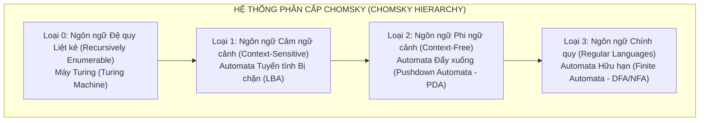
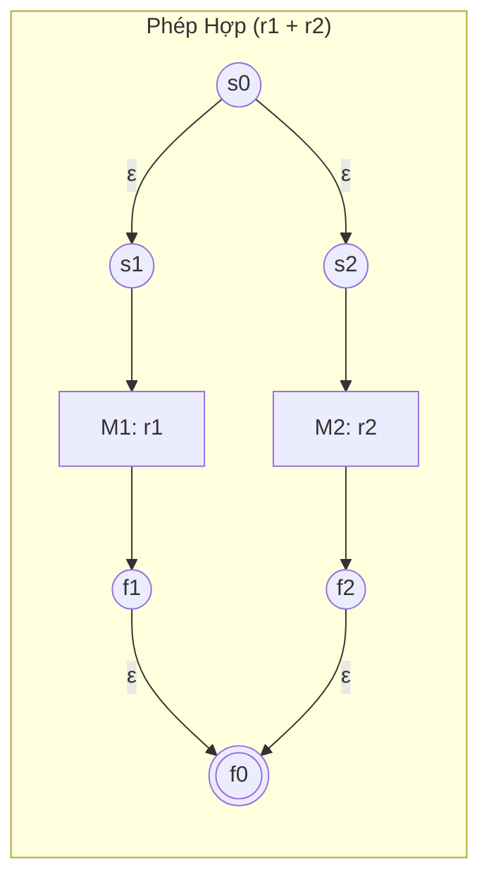
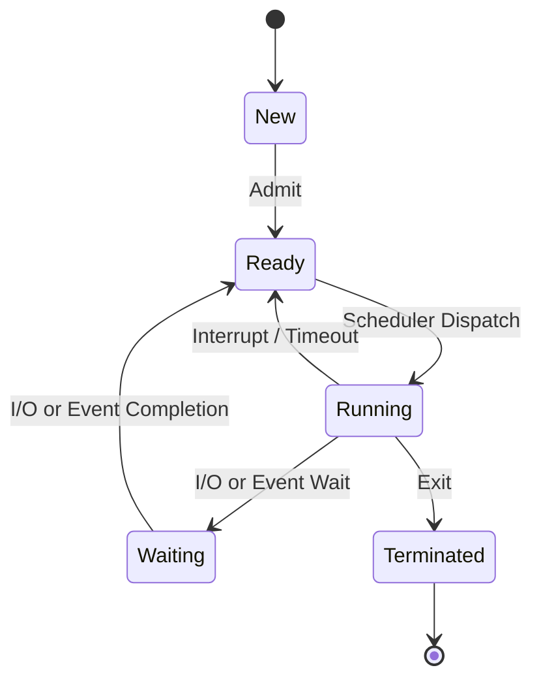
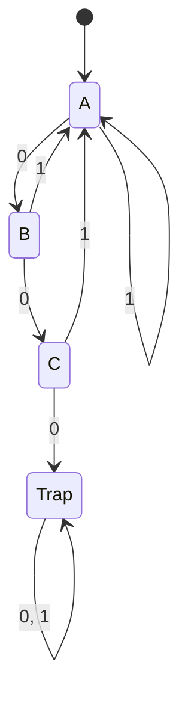
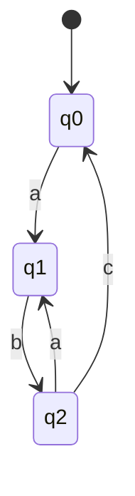
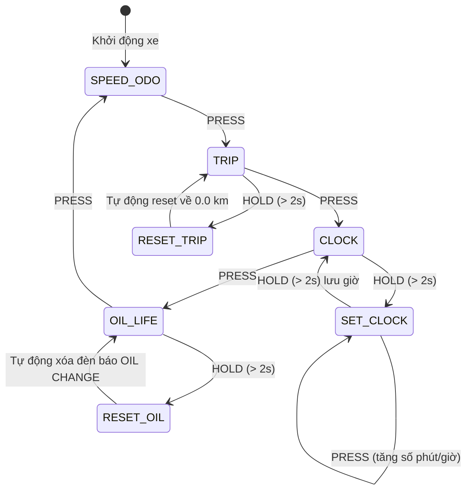
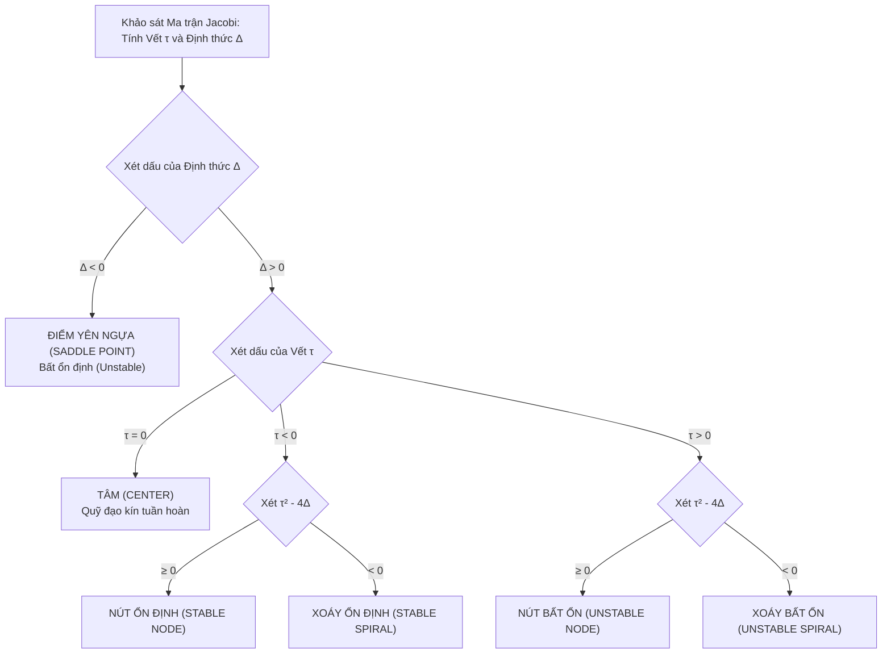
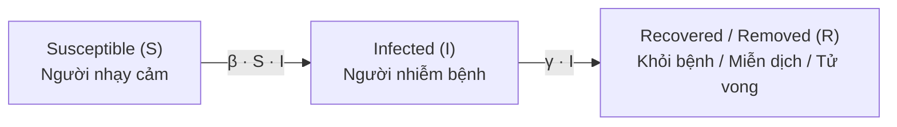

# TỔNG HỢP TOÀN DIỆN KIẾN THỨC MÔ HÌNH HÓA TOÁN HỌC (MATHEMATICAL MODELING)
## TÀI LIỆU ÔN TẬP VÀ ĐỐI CHIẾU NỘI DUNG THI CUỐI KỲ (FINAL EXAM COMPREHENSIVE GUIDE)

> **Môn học:** Mô hình hóa Toán học (Mathematical Modeling - CO2011) / Toán rời rạc 2 (Discrete Mathematics II - CO2004/DM2)  
> **Khoa:** Khoa học & Kỹ thuật Máy tính (Faculty of Computer Science and Engineering - CSE) - Trường Đại học Bách Khoa, ĐHQG TP.HCM (HCMUT)  
> **Giảng viên biên soạn & Phụ trách:**  
> - TS. Nguyễn An Khương (Nguyen An Khuong)  
> - PGS. TS. Huỳnh Tường Nguyên (Huynh Tuong Nguyen)  
> - TS. Trần Văn Hoài (Tran Van Hoai)  
> - TS. Lê Hồng Trang (Le Hong Trang)  
> - TS. Nguyễn Văn Minh Mẫn (Man Van Minh Nguyen - Mahidol University)  
> **Giáo trình & Tài liệu tham khảo cốt lõi:**  
> 1. *Mathematical Modeling: Methods and Application* – Man Van Minh Nguyen & Khuong An Nguyen (2023).  
> 2. *An Introduction to Formal Languages and Automata*, 6th Edition – Peter Linz, Jones & Bartlett Learning (2017).  
> 3. *A First Course in Mathematical Modeling*, 5th Edition – Frank R. Giordano, William P. Fox, Steven B. Horton, Cengage Learning (2014).  
> 4. *Mathematical Logic for Computer Science*, 3rd Edition – Mordechai Ben-Ari, Springer-Verlag (2012).  
> 5. *Becaked: An explainable artificial intelligence model for covid-19 forecasting* – Duc Q. Nguyen, Nghia Q. Vo, Thinh T. Nguyen, Khuong Nguyen-An, Quang H. Nguyen, Dang N. Tran, Tho T. Quan, *Scientific Reports (Nature)*, 12(1):1–26 (2022).  
> **Thư mục tài liệu gốc:** `C:\Users\Admin\Documents\K261\Finals\MHH\`  
> **Danh mục tài liệu trong thư mục:**
> - Thư mục con `Automata/`:
>   - `dm2_Ch4_automata.pdf` (116 slide): Bài giảng chi tiết Automata, Biểu thức chính quy, NFA, DFA, Đơn định hóa, Thu nhỏ DFA, Kết hợp DFA, Ứng dụng.
>   - `Slide Automat(new).pdf` (82 slide): Bài giảng Automata Theory for Mathematical Modeling, Văn phạm hình thức, Bổ đề Arden, GTG, Chuyển đổi trạng thái.
>   - `DM2_automata_exo1.pdf` (3 trang): Bài tập Phần 1 - Khái niệm ngôn ngữ, FA, NFA, kiểm tra chuỗi, thiết kế Automata cơ bản.
>   - `DM2_automata_exo2.pdf` (4 trang): Bài tập Phần 2 - Đơn định hóa (NFA $\to$ DFA), Tối ưu hóa / Thu nhỏ DFA, Thiết kế DFA đầy đủ, Mô hình hóa hệ thống thực tế.
> - Thư mục con `Dynamical System/`:
>   - `dm2_Ch6_Dynamical_Systems.pdf` (40 slide): Hệ động lực liên tục, Tăng trưởng Malthus, Mô hình Logistic, Điểm cân bằng, Tuyến tính hóa Taylor, Hệ Lotka-Volterra Predator-Prey, Nullclines, Không gian pha.
>   - `MM5-DYNAMICAL SYSTEMS-landscape.pdf` (91 slide): Ch.5 Dynamical Systems - Kỹ thuật mô hình hóa thực tế (Hệ rời rạc, Hệ sai phân, Niên kim, Phân bổ xe, Hệ liên tục đơn loài & tương tác loài, Phản ứng tiêu thụ Holling, Ma trận Jacobi & Phân loại điểm cân bằng, Mô hình dịch bệnh SIR/SIS/SEIR/SIRD, Ngưỡng $R_0$, Miễn dịch cộng đồng, Dịch tễ học thực nghiệm).

---

## 🗺️ BẢN ĐỒ KIẾN THỨC & MA TRẬN NỘI DUNG THI CUỐI KỲ

| Phần kiến thức | Chủ đề trọng tâm | Mức độ ưu tiên | Dạng bài tập điển hình trong đề thi |
| :--- | :--- | :---: | :--- |
| **Phần I: Automata** | **1. Ngôn ngữ & Biểu thức chính quy** | ⭐⭐⭐⭐ | - Phân tích chuỗi có thuộc $L^*$ hay không.<br>- Kiểm tra tính chất đóng $L = L^*$.<br>- Rút gọn biểu thức chính quy, chứng minh đẳng thức ngôn ngữ.<br>- Áp dụng Bổ đề Arden giải phương trình ngôn ngữ $X = AX + B$. |
| | **2. Thiết kế Automata (DFA / NFA)** | ⭐⭐⭐⭐⭐ | - Thiết kế DFA nhận dạng ngôn ngữ theo số lượng ký tự chia hết ($|w| \bmod k$), chứa/không chứa chuỗi con.<br>- Thiết kế DFA đầy đủ (Complete DFA) có trạng thái bẫy (Dead/Trap state).<br>- Tính $\delta^*(q, w)$ và trace thực thi từng bước của chuỗi đầu vào. |
| | **3. Đơn định hóa (NFA $\to$ DFA)** | ⭐⭐⭐⭐⭐ *(Cực lớn)* | - Tính $\epsilon$-closure cho từng trạng thái.<br>- Lập bảng chuyển trạng thái hữu ích (Useful transition table) theo thuật toán Powerset/Subset Construction.<br>- Vẽ DFA tương đương và xác định tập trạng thái kết thúc $F_D$. |
| | **4. Tối tiểu hóa DFA (Minimization)** | ⭐⭐⭐⭐⭐ *(Cực lớn)* | - Loại bỏ trạng thái không tới được (Unreachable states).<br>- Phân hoạch tương đương (Moore's Partition Refinement) hoặc Table-Filling Algorithm.<br>- Xây dựng DFA tối tiểu (Minimal Quotient DFA) và tính số trạng thái tối thiểu. |
| | **5. Chuyển Automata $\leftrightarrow$ RegEx & Kết hợp DFA** | ⭐⭐⭐⭐ | - Chuyển FA sang RegEx bằng thuật toán khử trạng thái (State Elimination / GTG) hoặc Bổ đề Arden.<br>- Xây dựng Automat tích Descartes ($M_1 \times M_2$) cho ngôn ngữ Giao, Hợp, Hiệu. |
| | **6. Mô hình hóa Hệ thống bằng Automata** | ⭐⭐⭐⭐ | - Mô hình hóa máy đo tốc độ xe máy (Honda Lead: bấm nhả vs giữ lâu $> 2s$).<br>- Mô hình hóa tiến trình hệ điều hành (New, Ready, Running, Waiting, Terminated).<br>- Bộ phát hiện tính chẵn lẻ (Odd/Even Parity Detector). |
| **Phần II: Hệ Động Lực** | **7. Hệ Động lực Rời rạc (Discrete Systems)** | ⭐⭐⭐⭐⭐ | - Phương pháp phỏng đoán (Conjecture) nghiệm $a_n = a_0 r^n$.<br>- Tìm điểm cân bằng $c = \frac{b}{1-r}$ của hệ $a_{n+1} = r a_n + b$.<br>- Nghiệm tổng quát $a_k = d \cdot r^k + c$, xác định $d$ qua điều kiện đầu.<br>- Phân tích ổn định ($|r| < 1$ ổn định tiệm cận, $|r| > 1$ phân kỳ).<br>- Bài toán thực tế: Xử lý nước thải, Niên kim hưu trí, Cho thuê xe 2 thành phố (Markov). |
| | **8. Hệ Liên tục Đơn loài: Malthus & Logistic** | ⭐⭐⭐⭐⭐ | - Thiết lập và giải ODE Malthus $\frac{dx}{dt} = rx$, tính thời gian nhân đôi (Rule of 70).<br>- Thiết lập và giải ODE Logistic $\frac{dx}{dt} = rx(1 - x/K)$ bằng phương pháp tách biến.<br>- Tìm điểm cân bằng ($x^* = 0, x^* = K$), phân tích tính ổn định bằng tuyến tính hóa Taylor ($f'(x^*) < 0$).<br>- Xác định điểm uốn $x = K/2$ và tốc độ tăng trưởng cực đại $\dot{x}_{\max} = rK/4$. |
| | **9. Tương tác Loài: Lotka-Volterra & 2D ODEs** | ⭐⭐⭐⭐⭐ *(Cực lớn)* | - Viết hệ ODE Con mồi - Kẻ săn mồi (Prey-Predator).<br>- Tìm 2 điểm cân bằng: $(0, 0)$ và $(c/d, a/b)$.<br>- Vẽ đường đẳng độ lệch (Nullclines / Isoclines), xác định trường vectơ pha.<br>- Thiết lập tích phân đầu tiên $V(x, y) = dx - c\ln x + by - a\ln y = C$ (quỹ đạo khép kín).<br>- Các hàm tiêu thụ Holling I, II (bão hòa), III (sigmoidal) và hiệu ứng nơi trú ẩn. |
| | **10. Ma trận Jacobi & Phân loại Điểm Cân Bằng** | ⭐⭐⭐⭐⭐ *(Cực lớn)* | - Tính ma trận Jacobi $J(x^*, y^*)$ tại điểm cân bằng.<br>- Tính vết $\tau = \text{tr}(J)$ và định thức $\Delta = \det(J)$.<br>- Phân loại 6 dạng điểm cân bằng: Yên ngựa (Saddle), Nút ổn định/bất ổn (Node), Tiêu điểm ổn định/bất ổn (Spiral/Focus), Tâm (Center).<br>- Mô hình cạnh tranh loài và nguyên lý loại trừ cạnh tranh. |
| | **11. Mô hình Dịch bệnh: SIR & Hệ số $R_0$** | ⭐⭐⭐⭐⭐ | - Thiết lập hệ phân khoang SIR: $\dot{S} = -\beta S I, \dot{I} = \beta S I - \gamma I, \dot{R} = \gamma I$.<br>- Tính hệ số lây nhiễm cơ bản $R_0 = \frac{\beta N}{\gamma}$ (hoặc $\alpha / \beta$).<br>- Điều kiện bùng phát dịch: $s_0 > 1/R_0$.<br>- Ngưỡng miễn dịch cộng đồng (Herd Immunity Threshold): $p_c = 1 - 1/R_0$.<br>- Tính thời điểm đỉnh dịch và quy mô cuối cùng của dịch bệnh.<br>- Mô hình SIS (đưa về Logistic), SEIR, SIRD, nghiên cứu Becaked AI. |
| | **12. Phương pháp Giải số & Bài tập Tổng hợp** | ⭐⭐⭐⭐ | - Áp dụng phương pháp Forward Euler và Runge-Kutta bậc 4 (RK4).<br>- Giải bài toán dịch bệnh trên đảo cô lập (Island Plague Logistic: câu hỏi trắc nghiệm A/B/C/D). |

---

## 📑 MỤC LỤC TỔNG QUAN

1. [Phần I: Lý thuyết Automata & Ngôn ngữ hình thức trong Mô hình hóa](#phần-i-lý-thuyết-automata--ngôn-ngữ-hình-thức-trong-mô-hình-hóa)
   - [Chương 1: Bảng chữ cái, Từ và Ngôn ngữ hình thức](#chương-1-bảng-chữ-cái-từ-và-ngôn-ngữ-hình-thức)
   - [Chương 2: Biểu thức chính quy (Regular Expressions) & Bổ đề Arden](#chương-2-biểu-thức-chính-quy-regular-expressions--bổ-đề-arden)
   - [Chương 3: Automat hữu hạn (Finite Automata - DFA & NFA)](#chương-3-automat-hữu-hạn-finite-automata---dfa--nfa)
   - [Chương 4: Thuật toán chuyển đổi & Tối ưu hóa Automat](#chương-4-thuật-toán-chuyển-đổi--tối-ưu-hóa-automat)
   - [Chương 5: Kết hợp Automat & Ứng dụng Mô hình hóa Hệ thống](#chương-5-kết-hợp-automat--ứng-dụng-mô-hình-hóa-hệ-thống)
   - [Chương 6: Lời giải Chi tiết Toàn diện Bài tập Automata (Exo 1 & Exo 2)](#chương-6-lời-giải-chi-tiết-toàn-diện-bài-tập-automata-exo-1--exo-2)
2. [Phần II: Hệ Động Lực trong Mô hình hóa Toán học](#phần-ii-hệ-động-lực-trong-mô-hình-hóa-toán-học)
   - [Chương 7: Phương pháp Nghiên cứu Hệ Động lực Rời rạc (Discrete Systems)](#chương-7-phương-pháp-nghiên-cứu-hệ-động-lực-rời-rạc-discrete-systems)
   - [Chương 8: Hệ Động lực Liên tục I - Tăng trưởng Đơn loài (Single Species Growth)](#chương-8-hệ-động-lực-liên-tục-i---tăng-trưởng-đơn-loài-single-species-growth)
   - [Chương 9: Hệ Động lực Liên tục II - Tương tác Loài & Hệ ODE 2 Chiều](#chương-9-hệ-động-lực-liên-tục-ii---tương-tác-loài--hệ-ode-2-chiều)
   - [Chương 10: Hệ Động lực Liên tục III - Dịch tễ học Toán học (Epidemic Models)](#chương-10-hệ-động-lực-liên-tục-iii---dịch-tễ-học-toán-học-epidemic-models)
   - [Chương 11: Phương pháp Giải số & Mô phỏng Hệ Động lực (Numerical Methods & Simulation)](#chương-11-phương-pháp-giải-số--mô-phỏng-hệ-động-lực-numerical-methods--simulation)
   - [Chương 12: Lời giải Chi tiết Bài tập Hệ Động lực](#chương-12-lời-giải-chi-tiết-bài-tập-hệ-động-lực)
3. [Phần III: Tổng hợp Công thức & Cẩm nang Ôn thi Cuối kỳ (Cheat Sheet & Checklist)](#phần-iii-tổng-hợp-công-thức--cẩm-nang-ôn-thi-cuối-kỳ-cheat-sheet--checklist)
   - [Bảng tra cứu nhanh công thức Automata](#bảng-tra-cứu-nhanh-công-thức-automata)
   - [Bảng tra cứu nhanh công thức Hệ Động lực](#bảng-tra-cứu-nhanh-công-thức-hệ-động-lực)
   - [Các bẫy đề thi kinh điển & Chiến lược phòng tránh](#các-bẫy-đề-thi-kinh-điển--chiến-lược-phòng-tránh)

---

# PHẦN I: LÝ THUYẾT AUTOMATA & NGÔN NGỮ HÌNH THỨC TRONG MÔ HÌNH HÓA (AUTOMATA THEORY FOR MATHEMATICAL MODELING)

---

## CHƯƠNG 1: BẢNG CHỮ CÁI, TỪ VÀ NGÔN NGỮ HÌNH THỨC (ALPHABETS, WORDS & LANGUAGES)

### 1.1. Bảng chữ cái (Alphabet) và Ký hiệu (Symbols)
- **Định nghĩa:** Bảng chữ cái $\Sigma$ (Alphabet) là một tập hợp hữu hạn, khác rỗng các ký hiệu (symbols hoặc characters).
- **Ví dụ điển hình:**
  - Bảng chữ cái nhị phân (Binary alphabet): $\Sigma = \{0, 1\}$.
  - Bảng chữ cái ký tự Latin cơ sở: $\Sigma = \{a, b\}$ hoặc $\Sigma = \{a, b, c\}$.
  - Bảng chữ cái số thập phân: $\Sigma = \{0, 1, 2, \dots, 9\}$.
  - Bảng mã ASCII chuẩn gồm 128 ký tự.

---

### 1.2. Chuỗi / Từ (Words / Strings)
- **Định nghĩa:** Một từ (word) hoặc chuỗi (string) trên bảng chữ cái $\Sigma$ là một dãy hữu hạn các ký hiệu thuộc $\Sigma$ được viết liền nhau.
- **Chuỗi rỗng (Empty word / string):** Ký hiệu là $\epsilon$ (hoặc $\lambda$). Đây là chuỗi không chứa ký hiệu nào cả.
- **Độ dài của chuỗi (Length):** Ký hiệu là $|w|$, là tổng số ký hiệu có mặt trong chuỗi $w$.
  - Ví dụ: Với $w = abac$, $|w| = 4$.
  - Chuỗi rỗng có độ dài bằng $0$: $|\epsilon| = 0$.
- **Số lần xuất hiện của ký tự:** Ký hiệu $n_a(w)$ hoặc $|w|_a$ là số lần ký tự $a$ xuất hiện trong chuỗi $w$.
  - Ví dụ: Với $w = abbab$, $n_a(w) = 2$ và $n_b(w) = 3$. Tổng quát: $|w| = \sum_{a \in \Sigma} n_a(w)$.

#### Các phép toán cốt lõi trên chuỗi:
1. **Phép nối chuỗi (Concatenation):**
   - Cho hai chuỗi $u = a_1 a_2 \dots a_n$ và $v = b_1 b_2 \dots b_m$. Chuỗi nối $uv$ (hoặc $u \cdot v$) là:
     $$uv = a_1 a_2 \dots a_n b_1 b_2 \dots b_m$$
   - Độ dài: $|uv| = |u| + |v|$.
   - Phần tử trung hòa: $\epsilon w = w \epsilon = w$ với mọi $w$.
   - Tính kết hợp: $(uv)w = u(vw)$. Không có tính giao hoán ($uv \neq vu$ nói chung).
2. **Lũy thừa của chuỗi (Power of a string):**
   - $w^0 = \epsilon$.
   - $w^{k} = w \cdot w^{k-1} = \underbrace{w w \dots w}_{k \text{ lần}}$ với $k \ge 1$.
   - Độ dài: $|w^k| = k \cdot |w|$.
3. **Chuỗi đảo ngược (Reversal):**
   - Ký hiệu $w^R$. Nếu $w = a_1 a_2 \dots a_n$ thì $w^R = a_n a_{n-1} \dots a_1$.
   - Tính chất: $\epsilon^R = \epsilon$, $(w^R)^R = w$, và quan trọng: $(uv)^R = v^R u^R$.
4. **Tiền tố, Hậu tố và Chuỗi con (Prefix, Suffix, Substring):**
   - $u$ là **tiền tố** (prefix) của $w$ nếu tồn tại $v$ sao cho $w = uv$. Nếu $v \neq \epsilon$, $u$ là tiền tố thực sự (proper prefix).
   - $v$ là **hậu tố** (suffix) của $w$ nếu tồn tại $u$ sao cho $w = uv$.
   - $y$ là **chuỗi con** (substring) của $w$ nếu tồn tại $x, z$ sao cho $w = x y z$.

---

### 1.3. Lũy thừa Bảng chữ cái và Bao đóng Kleene ($\Sigma^*$ & $\Sigma^+$)
- **Tập các từ độ dài $k$:** $\Sigma^k = \{w \in \Sigma^* \mid |w| = k\}$.
  - $\Sigma^0 = \{\epsilon\}$.
  - $\Sigma^1 = \Sigma$.
  - $\Sigma^2 = \{ab \mid a, b \in \Sigma\}$.
- **Bao đóng Kleene (Kleene Star):** Ký hiệu $\Sigma^*$, là tập hợp TẤT CẢ các chuỗi hữu hạn có thể tạo thành từ $\Sigma$, bao gồm cả chuỗi rỗng:
  $$\Sigma^* = \bigcup_{k=0}^{\infty} \Sigma^k = \Sigma^0 \cup \Sigma^1 \cup \Sigma^2 \cup \dots$$
- **Bao đóng dương (Positive Closure):** Ký hiệu $\Sigma^+$, là tập hợp tất cả các chuỗi có độ dài $\ge 1$:
  $$\Sigma^+ = \bigcup_{k=1}^{\infty} \Sigma^k = \Sigma^* \setminus \{\epsilon\}$$
  Quan hệ: $\Sigma^* = \Sigma^+ \cup \{\epsilon\}$.

---

### 1.4. Ngôn ngữ Hình thức (Formal Languages)
- **Định nghĩa:** Một ngôn ngữ hình thức $L$ trên bảng chữ cái $\Sigma$ là một tập con bất kỳ của $\Sigma^*$: $L \subseteq \Sigma^*$.
- **Ngôn ngữ đặc biệt:**
  - Ngôn ngữ rỗng: $\emptyset = \{\}$ (không chứa từ nào, $|\emptyset| = 0$).
  - Ngôn ngữ chỉ chứa từ rỗng: $\{\epsilon\}$ (chứa đúng một từ là $\epsilon$, $|\{\epsilon\}| = 1$).
  - Lưu ý sống còn trong thi cử: $\emptyset \neq \{\epsilon\}$!

#### Các phép toán trên ngôn ngữ:
| Phép toán | Ký hiệu | Định nghĩa toán học |
| :--- | :--- | :--- |
| **Phép hợp (Union)** | $L_1 \cup L_2$ | $\{w \mid w \in L_1 \lor w \in L_2\}$ |
| **Phép giao (Intersection)** | $L_1 \cap L_2$ | $\{w \mid w \in L_1 \land w \in L_2\}$ |
| **Phép hiệu (Difference)** | $L_1 \setminus L_2$ | $\{w \mid w \in L_1 \land w \notin L_2\}$ |
| **Phép bù (Complement)** | $\overline{L}$ | $\Sigma^* \setminus L = \{w \in \Sigma^* \mid w \notin L\}$ |
| **Phép nối (Concatenation)** | $L_1 L_2$ | $\{uv \mid u \in L_1, v \in L_2\}$ |
| **Lũy thừa (Power)** | $L^k$ | $L^0 = \{\epsilon\}, \quad L^k = L \cdot L^{k-1}$ |
| **Bao đóng Kleene (Star)** | $L^*$ | $L^* = \bigcup_{k=0}^{\infty} L^k = L^0 \cup L^1 \cup L^2 \cup \dots$ |
| **Bao đóng dương (Positive)** | $L^+$ | $L^+ = \bigcup_{k=1}^{\infty} L^k = L L^* = L^* L$ |
| **Phép đảo (Reversal)** | $L^R$ | $\{w^R \mid w \in L\}$ |

> [!IMPORTANT]
> **Định lý về điều kiện để $L = L^*$ (Đã xuất hiện trong Đề thi & Bài tập DM2 Exo 1):**  
> Cho ngôn ngữ $L \subseteq \Sigma^*$. Khi nào thì $L = L^*$?  
> **Điều kiện cần và đủ:** $L = L^* \iff (\epsilon \in L \text{ và } L \cdot L \subseteq L)$.  
> - **Chiều thuận ($\Rightarrow$):** Nếu $L = L^*$, do $\epsilon \in L^0 \subseteq L^*$ nên $\epsilon \in L$. Đồng thời $L \cdot L = L^2 \subseteq L^* = L$.  
> - **Chiều đảo ($\Leftarrow$):** Nếu $\epsilon \in L$ và $L \cdot L \subseteq L$, quy nạp ta có $L^k \subseteq L$ với mọi $k \ge 1$. Vì $L^0 = \{\epsilon\} \subseteq L$, suy ra $\bigcup_{k=0}^{\infty} L^k \subseteq L$. Mà $L = L^1 \subseteq L^*$, do đó $L = L^*$.

---

### 1.5. Văn phạm Hình thức (Formal Grammars) & Hệ thống phân cấp Chomsky
- **Định nghĩa bộ 4:** Một văn phạm hình thức $G$ được biểu diễn bởi bộ 4:
  $$G = (V, T, S, P)$$
  - $V$ (hoặc $N$): Tập hữu hạn các biến / ký hiệu chưa kết thúc (Variables / Non-terminals).
  - $T$ (hoặc $\Sigma$): Tập hữu hạn các ký hiệu kết thúc (Terminals), $V \cap T = \emptyset$.
  - $S \in V$: Ký hiệu bắt đầu (Start symbol).
  - $P$: Tập hữu hạn các quy tắc sản xuất (Production rules), có dạng $\alpha \to \beta$ với $\alpha \in (V \cup T)^+$ và $\beta \in (V \cup T)^*$.
- **Quan hệ dẫn xuất (Derivation):**
  - $\gamma \alpha \delta \Rightarrow \gamma \beta \delta$ nếu tồn tại quy tắc $\alpha \to \beta \in P$.
  - Dẫn xuất qua nhiều bước: $\alpha \Rightarrow^* \beta$.
- **Ngôn ngữ sinh bởi văn phạm:** $L(G) = \{w \in T^* \mid S \Rightarrow^* w\}$.



---

## CHƯƠNG 2: BIỂU THỨC CHÍNH QUY (REGULAR EXPRESSIONS) & BỔ ĐỀ ARDEN

### 2.1. Định nghĩa Biểu thức Chính quy (RegEx)
Biểu thức chính quy trên bảng chữ cái $\Sigma$ là công cụ đại số cô đọng dùng để mô tả các ngôn ngữ chính quy (Regular Languages).
- **Cơ sở (Base cases):**
  1. $\emptyset$ là một RegEx biểu diễn ngôn ngữ rỗng: $L(\emptyset) = \emptyset$.
  2. $\epsilon$ (hoặc $\lambda$) là một RegEx biểu diễn ngôn ngữ chứa chuỗi rỗng: $L(\epsilon) = \{\epsilon\}$.
  3. Với mỗi $a \in \Sigma$, $a$ là một RegEx biểu diễn ngôn ngữ: $L(a) = \{a\}$.
- **Quy nạp (Inductive steps):** Nếu $r, r_1, r_2$ là các RegEx:
  4. $(r_1 + r_2)$ (hoặc $r_1 \mid r_2$) là RegEx biểu diễn phép hợp: $L(r_1 + r_2) = L(r_1) \cup L(r_2)$.
  5. $(r_1 \cdot r_2)$ (hoặc $r_1 r_2$) là RegEx biểu diễn phép nối: $L(r_1 r_2) = L(r_1) L(r_2)$.
  6. $(r^*)$ là RegEx biểu diễn bao đóng Kleene: $L(r^*) = (L(r))^*$.
- **Thứ tự ưu tiên toán tử:** Dấu ngoặc $()$ $\to$ Sao Kleene $*$ $\to$ Phép nối $(\cdot)$ $\to$ Phép cộng $(+)$.

---

### 2.2. Các Định luật Đại số của Biểu thức Chính quy
Hai RegEx $r_1, r_2$ tương đương ($r_1 \equiv r_2$) khi và chỉ khi $L(r_1) = L(r_2)$.
1. **Luật giao hoán (Commutativity):** $r_1 + r_2 = r_2 + r_1$. (Lưu ý: Phép nối không giao hoán, $r_1 r_2 \neq r_2 r_1$).
2. **Luật kết hợp (Associativity):**
   - $(r_1 + r_2) + r_3 = r_1 + (r_2 + r_3)$
   - $(r_1 r_2) r_3 = r_1 (r_2 r_3)$
3. **Luật phân phối (Distributivity):**
   - $r_1 (r_2 + r_3) = r_1 r_2 + r_1 r_3$ (Phân phối trái)
   - $(r_1 + r_2) r_3 = r_1 r_3 + r_2 r_3$ (Phân phối phải)
4. **Phần tử trung hòa & Hấp thu (Identities & Annihilators):**
   - $r + \emptyset = \emptyset + r = r$
   - $r \cdot \epsilon = \epsilon \cdot r = r$
   - $r \cdot \emptyset = \emptyset \cdot r = \emptyset$
5. **Tính lũy đẳng (Idempotence):** $r + r = r$.
6. **Các luật Sao Kleene đặc biệt (Kinh điển trong biến đổi đề thi):**
   - $\emptyset^* = \epsilon, \quad \epsilon^* = \epsilon$.
   - $r^* = \epsilon + r r^* = \epsilon + r^* r$.
   - $(r^*)^* = r^*$.
   - $(r_1 + r_2)^* = (r_1^* r_2^*)^* = (r_1^* + r_2^*)^* = r_1^* (r_2 r_1^*)^*$.
   - $(r_1 r_2)^* r_1 = r_1 (r_2 r_1)^*$.
   - $r^* r = r r^* = r^+$.

---

### 2.3. Bổ đề Arden (Arden's Lemma)
Bổ đề Arden là nền tảng giải tích để tìm biểu thức chính quy đại diện cho một ngôn ngữ sinh bởi một hệ phương trình trạng thái Automat.

> [!NOTE]
> **Định lý (Bổ đề Arden):**  
> Cho $A, B$ là hai ngôn ngữ trên bảng chữ cái $\Sigma$. Xét phương trình ẩn ngôn ngữ $X$:
> $$X = A X \cup B$$
> 1. Phương trình luôn có $X = A^* B$ là một nghiệm.  
> 2. Nếu $\epsilon \notin A$, thì nghiệm $X = A^* B$ là **DUY NHẤT**.  
> 
> **Dạng đối ngẫu:** Phương trình $X = X A \cup B$ (với $\epsilon \notin A$) có nghiệm duy nhất là $X = B A^*$.

#### Chứng minh toán học chặt chẽ:
1. **Chứng minh $X = A^* B$ là một nghiệm:**
   Thế $X = A^* B$ vào vế phải của phương trình:
   $$\text{VP} = A(A^* B) \cup B = (A A^*) B \cup \{\epsilon\} B = (A A^* \cup \{\epsilon\}) B = A^* B = X = \text{VT}$$
   Do đó, $X = A^* B$ thỏa mãn phương trình.
2. **Chứng minh tính duy nhất khi $\epsilon \notin A$:**
   Giả sử $X$ là một nghiệm tùy ý của $X = AX \cup B$. Thế $X$ liên tiếp $k$ lần:
   $$X = A(AX \cup B) \cup B = A^2 X \cup A B \cup B$$
   $$X = A^3 X \cup A^2 B \cup A B \cup B = \dots = A^k X \cup \left(\bigcup_{i=0}^{k-1} A^i B\right)$$
   Vì $\epsilon \notin A$, độ dài tối thiểu của bất kỳ từ nào thuộc $A$ đều $\ge 1$. Do đó, mọi từ thuộc $A^k$ có độ dài $\ge k$.  
   Lấy một từ bất kỳ $w \in X$ có độ dài $|w| = n$. Ta chọn số lần lặp $k = n + 1$.  
   Khi đó, mọi từ trong tập $A^{n+1} X$ đều có độ dài $\ge n + 1 > |w|$, nghĩa là $w$ không thể thuộc $A^{n+1} X$.  
   Do $w \in X = A^{n+1} X \cup \left(\bigcup_{i=0}^n A^i B\right)$, bắt buộc $w \in \bigcup_{i=0}^n A^i B \subseteq A^* B$.  
   Suy ra $X \subseteq A^* B$. Mà ta đã biết $A^* B \subseteq X$, do đó $X = A^* B$. Nghiệm là duy nhất! $\blacksquare$

---

## CHƯƠNG 3: AUTOMAT HỮU HẠN (FINITE AUTOMATA - DFA & NFA)

### 3.1. Automat Hữu hạn Đơn định (DFA - Deterministic Finite Automata)
- **Định nghĩa hình thức bộ 5:** Một DFA $M$ là một bộ 5 thành phần:
  $$M = (Q, \Sigma, \delta, q_0, F)$$
  1. $Q$: Tập hữu hạn các trạng thái (Finite set of states).
  2. $\Sigma$: Bảng chữ cái đầu vào (Input alphabet).
  3. $\delta$: Hàm chuyển trạng thái (Transition function), $\delta: Q \times \Sigma \to Q$.
  4. $q_0 \in Q$: Trạng thái bắt đầu (Initial / Start state).
  5. $F \subseteq Q$: Tập các trạng thái chấp nhận / kết thúc (Set of accepting / final states).
- **Hàm chuyển mở rộng (Extended Transition Function) $\delta^*$:**
  Định nghĩa đệ quy trên tập chuỗi $\Sigma^*$, $\delta^*: Q \times \Sigma^* \to Q$:
  - Cơ sở: $\delta^*(q, \epsilon) = q$.
  - Bước quy nạp: Với mọi chuỗi $w = ua$ ($u \in \Sigma^*, a \in \Sigma$):
    $$\delta^*(q, ua) = \delta(\delta^*(q, u), a)$$
- **Ngôn ngữ đoán nhận bởi DFA:**
  $$L(M) = \{w \in \Sigma^* \mid \delta^*(q_0, w) \in F\}$$
- **Mô tả cấu hình tức thời (Configuration / Instantaneous Description):**
  - Cặp $(q, w) \in Q \times \Sigma^*$ biểu thị máy đang ở trạng thái $q$ và chuỗi còn lại chưa đọc là $w$.
  - Bước chuyển: $(q, aw) \vdash (\delta(q, a), w)$.
- **DFA đầy đủ (Complete DFA) vs DFA không đầy đủ (Incomplete DFA):**
  - Một DFA được gọi là **đầy đủ** (Complete) nếu từ mỗi trạng thái $q \in Q$, với MỌI ký tự $a \in \Sigma$, hàm chuyển $\delta(q, a)$ luôn được xác định tường minh.
  - Nếu thiếu chuyển dịch, chuỗi gặp ký tự đó sẽ bị treo / từ chối ngay lập tức.
  - Để chuẩn hóa thành Complete DFA, ta thêm một **Trạng thái bẫy / Trạng thái chết (Trap state / Dead state $q_{trap}$)**:
    - Mọi chuyển dịch chưa xác định từ các trạng thái khác được trỏ về $q_{trap}$.
    - Tại $q_{trap}$: $\delta(q_{trap}, a) = q_{trap}$ với mọi $a \in \Sigma$.
    - $q_{trap} \notin F$ (không phải trạng thái kết thúc).

---

### 3.2. Automat Hữu hạn Không đơn định (NFA - Nondeterministic Finite Automata)
- **Định nghĩa hình thức bộ 5:**
  $$M = (Q, \Sigma, \delta, q_0, F)$$
  Điểm khác biệt duy nhất so với DFA nằm ở hàm chuyển:
  $$\delta: Q \times \Sigma \to 2^Q \quad (\text{hoặc } \mathcal{P}(Q))$$
  Nghĩa là khi nhận một ký tự, máy có thể chuyển sang một tập hợp gồm 0, 1 hoặc nhiều trạng thái tiếp theo.
- **NFA có chuyển dịch $\epsilon$ (NFA-$\epsilon$ / $\epsilon$-NFA):**
  Hàm chuyển cho phép đọc chuỗi rỗng:
  $$\delta: Q \times (\Sigma \cup \{\epsilon\}) \to 2^Q$$
- **Khái niệm $\epsilon$-closure ($\epsilon$-bao đóng):**
  - Cho trạng thái $q \in Q$, $\epsilon\text{-closure}(q)$ là tập hợp gồm chính $q$ và tất cả các trạng thái có thể đến được từ $q$ bằng cách chỉ đi qua các cung mang nhãn $\epsilon$.
  - Mở rộng cho tập trạng thái $S \subseteq Q$:
    $$\epsilon\text{-closure}(S) = \bigcup_{q \in S} \epsilon\text{-closure}(q)$$
- **Hàm chuyển mở rộng $\delta^*$ của NFA-$\epsilon$:**
  - $\delta^*(q, \epsilon) = \epsilon\text{-closure}(q)$.
  - Với $w = ua$ ($u \in \Sigma^*, a \in \Sigma$):
    $$\delta^*(q, ua) = \epsilon\text{-closure}\left( \bigcup_{p \in \delta^*(q, u)} \delta(p, a) \right)$$
- **Ngôn ngữ đoán nhận bởi NFA:**
  $$L(M) = \{w \in \Sigma^* \mid \delta^*(q_0, w) \cap F \neq \emptyset\}$$
  (Chỉ cần TỒN TẠI ít nhất một nhánh tính toán kết thúc tại trạng thái thuộc $F$ thì chuỗi được chấp nhận).

---

## CHƯƠNG 4: THUẬT TOÁN CHUYỂN ĐỔI & TỐI ƯU HÓA AUTOMAT

### 4.1. Thuật toán Thompson: Chuyển RegEx sang NFA-$\epsilon$
Thuật toán xây dựng NFA-$\epsilon$ có đúng một trạng thái bắt đầu và đúng một trạng thái kết thúc:
1. **Cơ sở:**
   - Với $\emptyset$: Hai trạng thái $s, f$ không có cung nối.
   - Với $\epsilon$: $s \xrightarrow{\epsilon} f$.
   - Với $a \in \Sigma$: $s \xrightarrow{a} f$.
2. **Phép hợp $r_1 + r_2$:**
   Tạo trạng thái bắt đầu mới $s_0$ nối $\epsilon$ vào đầu của $M_1, M_2$. Nối các trạng thái cuối của $M_1, M_2$ bằng $\epsilon$ vào trạng thái cuối mới $f_0$.
3. **Phép nối $r_1 r_2$:**
   Nối trạng thái cuối của $M_1$ với trạng thái đầu của $M_2$ bằng chuyển dịch $\epsilon$ (hoặc chập làm một).
4. **Bao đóng Kleene $r^*$:**
   Tạo $s_0, f_0$ mới. Thêm $s_0 \xrightarrow{\epsilon} f_0$, $s_0 \xrightarrow{\epsilon} s_1$, $f_1 \xrightarrow{\epsilon} f_0$, và đường lặp $f_1 \xrightarrow{\epsilon} s_1$.



---

### 4.2. Thuật toán Đơn định hóa: Chuyển NFA sang DFA (Powerset / Subset Construction)
- **Mục tiêu:** Xây dựng DFA $M_D = (Q_D, \Sigma, \delta_D, q_{0D}, F_D)$ tương đương với NFA $M = (Q, \Sigma, \delta, q_0, F)$.
- **Thuật toán chi tiết:**
  1. Trạng thái đầu của DFA: $q_{0D} = \epsilon\text{-closure}(q_0)$.
  2. Khởi tạo danh sách trạng thái chưa duyệt $W = \{q_{0D}\}$, tập trạng thái DFA $Q_D = \{q_{0D}\}$.
  3. Khi $W$ chưa rỗng, lấy ra một tập hợp trạng thái $U \in W$:
     Với mỗi ký hiệu $a \in \Sigma$:
     - Tính tập trạng thái đích:
       $$U' = \epsilon\text{-closure}\left( \bigcup_{p \in U} \delta(p, a) \right)$$
     - Nếu $U' \neq \emptyset$:
       - Nếu $U' \notin Q_D$, thêm $U'$ vào $Q_D$ và đưa $U'$ vào $W$.
       - Đặt $\delta_D(U, a) = U'$.
  4. Xác định tập trạng thái chấp nhận:
     $$F_D = \{U \in Q_D \mid U \cap F \neq \emptyset\}$$
     (Bất kỳ tập hợp trạng thái nào chứa ít nhất một trạng thái kết thúc của NFA sẽ trở thành trạng thái kết thúc của DFA).

---

### 4.3. Thuật toán Khử trạng thái (State Elimination Algorithm / GTG): Chuyển FA sang RegEx
- **Đồ thị chuyển tiếp suy rộng (Generalized Transition Graph - GTG):** Là đồ thị có các cạnh được gắn nhãn là các biểu thức chính quy tùy ý.
- **Quy trình chuẩn hóa:**
  1. Tạo trạng thái bắt đầu duy nhất $q_{in}$ mới, nối $q_{in} \xrightarrow{\epsilon} q_0$.
  2. Tạo trạng thái kết thúc duy nhất $q_{out}$ mới, nối $f \xrightarrow{\epsilon} q_{out}$ với mọi $f \in F$. Biến các trạng thái cũ thành trạng thái thường.
  3. Nếu giữa hai nút $p, q$ có nhiều cạnh $r_1, r_2, \dots$, gộp lại thành một cạnh duy nhất mang nhãn $r_1 + r_2 + \dots$.
- **Bước khử trạng thái trung gian $q_k$:**
  Với mọi cặp $(p_i, p_j)$ đi qua $q_k$ ($p_i \neq q_k, p_j \neq q_k$):
  - Giả sử có cạnh nối: $p_i \xrightarrow{R_{ik}} q_k$, cạnh khuyên $q_k \circlearrowleft^{R_{kk}}$, cạnh đi ra $q_k \xrightarrow{R_{kj}} p_j$, và cạnh trực tiếp $p_i \xrightarrow{R_{ij}} p_j$.
  - Cập nhật nhãn trực tiếp mới:
    $$R'_{ij} = R_{ij} + R_{ik} (R_{kk})^* R_{kj}$$
  - Sau khi cập nhật cho toàn bộ các cặp đi qua $q_k$, loại bỏ nút $q_k$ cùng toàn bộ các cạnh vào/ra của nó.
  - Lặp lại cho đến khi chỉ còn lại đúng 2 nút: $q_{in}$ và $q_{out}$. Nhãn trên cạnh nối $q_{in} \to q_{out}$ chính là RegEx cần tìm!

```mermaid
flowchart LR
    pi((pi)) -->|Rik| qk((qk))
    qk -->|Rkk| qk
    qk -->|Rkj| pj((pj))
    pi -.->|Rij (cũ)| pj
    pi ==>|"R'ij = Rij + Rik(Rkk)*Rkj"| pj
```

---

### 4.4. Thuật toán Tối tiểu hóa DFA (DFA Minimization)
DFA tối tiểu (Minimal DFA) là DFA có số lượng trạng thái ít nhất có thể để nhận dạng cùng một ngôn ngữ. DFA tối tiểu là DUY NHẤT (sai khác một phép đổi tên trạng thái).

#### Bước 1: Loại bỏ các trạng thái không thể tiếp cận (Unreachable / Inaccessible States)
- Áp dụng thuật toán tìm kiếm theo chiều sâu (DFS) hoặc theo chiều rộng (BFS) xuất phát từ $q_0$.
- Bất kỳ trạng thái $q \in Q$ nào không có đường đi từ $q_0$ tới đều bị loại bỏ hoàn toàn khỏi DFA.

#### Bước 2: Thuật toán Phân hoạch Lặp (Moore's Partition Refinement Algorithm)
1. **Khởi tạo phân hoạch cấp 0:** Chia $Q$ thành 2 lớp:
   $$P_0 = \{F, \quad Q \setminus F\}$$
   (Lớp $F$ gồm các trạng thái chấp nhận; lớp $Q \setminus F$ gồm các trạng thái không chấp nhận).
2. **Vòng lặp tinh chế phân hoạch ($k \ge 0$):**
   - Với mỗi nhóm $S \in P_k$, hai trạng thái $p, q \in S$ sẽ tiếp tục thuộc cùng một nhóm con trong $P_{k+1}$ khi và chỉ khi:
     $$\forall a \in \Sigma, \quad \delta(p, a) \text{ và } \delta(q, a) \text{ cùng thuộc một nhóm trong phân hoạch } P_k$$
   - Nếu tồn tại ký tự $a$ dẫn $\delta(p, a)$ và $\delta(q, a)$ sang hai nhóm khác nhau của $P_k$, ta phải tách nhóm $S$.
3. **Điều kiện dừng:** Khi $P_{k+1} = P_k$.
4. **Xây dựng DFA tối tiểu (Quotient DFA):**
   - Mỗi nhóm trạng thái tương đương trong phân hoạch cuối cùng trở thành một trạng thái duy nhất của DFA tối tiểu.

#### Bước 2 (Phương pháp Thay thế): Thuật toán Điền Bảng (Table-Filling Algorithm)
- Vẽ bảng tam giác cho tất cả các cặp chưa thứ tự $\{p, q\}$ với $p \neq q$.
- **Bước đánh dấu cơ sở:** Đánh dấu $\times$ vào ô $\{p, q\}$ nếu một trạng thái thuộc $F$ và trạng thái kia thuộc $Q \setminus F$ (hiển nhiên phân biệt được bằng chuỗi rỗng $\epsilon$).
- **Bước đánh dấu quy nạp:** Lặp lại việc duyệt bảng. Đánh dấu $\times$ vào ô $\{p, q\}$ nếu tồn tại $a \in \Sigma$ sao cho ô $\{\delta(p, a), \delta(q, a)\}$ đã bị đánh dấu $\times$.
- Dừng lại khi một lượt quét toàn bộ bảng không đánh dấu thêm được ô nào.
- Các ô KHÔNG bị đánh dấu là các cặp trạng thái tương đương ($p \sim q$) và được gộp lại.

---

## CHƯƠNG 5: KẾT HỢP AUTOMAT & ỨNG DỤNG MÔ HÌNH HÓA HỆ THỐNG

### 5.1. Tích Descartes của Automata (Product Automaton Construction)
Cho hai DFA $M_1 = (Q_1, \Sigma, \delta_1, q_{01}, F_1)$ và $M_2 = (Q_2, \Sigma, \delta_2, q_{02}, F_2)$. Ta xây dựng Automat tích $M = (Q, \Sigma, \delta, q_0, F)$:
- Tập trạng thái: $Q = Q_1 \times Q_2 = \{(p, q) \mid p \in Q_1, q \in Q_2\}$.
- Trạng thái bắt đầu: $q_0 = (q_{01}, q_{02})$.
- Hàm chuyển trạng thái:
  $$\delta((p, q), a) = (\delta_1(p, a), \delta_2(q, a)), \quad \forall a \in \Sigma$$
- **Tập trạng thái kết thúc $F$ quyết định ngôn ngữ kết quả:**
  | Ngôn ngữ cần nhận dạng | Phép toán tập hợp | Tập trạng thái kết thúc $F$ |
  | :--- | :--- | :--- |
  | **Giao (Intersection)** $L_1 \cap L_2$ | Cả hai máy đều chấp nhận | $F = F_1 \times F_2 = \{(p, q) \mid p \in F_1 \land q \in F_2\}$ |
  | **Hợp (Union)** $L_1 \cup L_2$ | Ít nhất một máy chấp nhận | $F = (F_1 \times Q_2) \cup (Q_1 \times F_2)$ |
  | **Hiệu (Difference)** $L_1 \setminus L_2$ | $M_1$ chấp nhận nhưng $M_2$ từ chối | $F = F_1 \times (Q_2 \setminus F_2)$ |
  | **Hiệu đối xứng** $L_1 \Delta L_2$ | Đúng một trong hai máy chấp nhận | $F = (F_1 \times (Q_2 \setminus F_2)) \cup ((Q_1 \setminus F_1) \times F_2)$ |

---

### 5.2. Các Ứng dụng Mô hình hóa Thực tế Cốt lõi

#### 1. Mô hình hóa Vòng đời Tiến trình Hệ điều hành (OS Process Lifecycle):
Hệ điều hành quản lý các tiến trình thông qua máy trạng thái hữu hạn chuẩn:
- **Tập trạng thái:** $Q = \{\text{New, Ready, Running, Waiting (Blocked), Terminated}\}$.
- **Tập sự kiện / Chuyển dịch:**
  - $\text{Admit}: \text{New} \to \text{Ready}$.
  - $\text{Dispatch}: \text{Ready} \to \text{Running}$.
  - $\text{Interrupt / Timeout}: \text{Running} \to \text{Ready}$.
  - $\text{I/O or Event Wait}: \text{Running} \to \text{Waiting}$.
  - $\text{I/O or Event Completion}: \text{Waiting} \to \text{Ready}$.
  - $\text{Exit}: \text{Running} \to \text{Terminated}$.



#### 2. Bộ phát hiện tính chẵn lẻ (Odd/Even Parity Detector):
- Bảng chữ cái: $\Sigma = \{0, 1\}$.
- Nhận dạng chuỗi có số bit $1$ là chẵn (Even Parity) hoặc lẻ (Odd Parity).
- Hai trạng thái: $S_{even}$ (số lượng bit 1 chẵn, bắt đầu), $S_{odd}$ (số lượng bit 1 lẻ).
- Chuyển dịch: Bit 0 giữ nguyên trạng thái; bit 1 đảo giữa $S_{even} \leftrightarrow S_{odd}$.

#### 3. Mô hình hóa Hệ thống Hiển thị Đồng hồ Xe máy (Honda Lead Digital Speedometer):
- **Phân tích bài toán thực tế:** Xe máy Honda Lead trang bị màn hình LCD kỹ thuật số đa chức năng điều khiển thông qua **đúng một nút bấm vật lý**.
- **Tập sự kiện đầu vào:** Phân biệt 2 hành động cơ bản của người dùng:
  - `PRESS`: Nhấn nhanh rồi nhả ngay (thời gian giữ $t < 2$ giây).
  - `HOLD`: Nhấn và giữ liên tục trên 2 giây ($t \ge 2$ giây).
- **Các màn hình hiển thị:**
  1. `ODO`: Tổng quãng đường xe đã chạy (màn hình mặc định).
  2. `TRIP`: Quãng đường hành trình ngắn (có thể cài đặt lại về 0).
  3. `CLOCK`: Đồng hồ hiển thị thời gian (giờ:phút).
  4. `OIL_LIFE`: Quãng đường còn lại trước khi cần thay nhớt máy.
- **Hành vi chuyển đổi:**
  - Nhấn nhanh (`PRESS`): Tuần tự chuyển màn hình theo vòng khép kín:
    $$\text{ODO} \xrightarrow{\text{PRESS}} \text{TRIP} \xrightarrow{\text{PRESS}} \text{CLOCK} \xrightarrow{\text{PRESS}} \text{OIL\_LIFE} \xrightarrow{\text{PRESS}} \text{ODO}$$
  - Nhấn giữ (`HOLD`):
    - Tại màn hình `TRIP`: `HOLD` $\to$ Đặt lại số km hành trình về `0.0`.
    - Tại màn hình `CLOCK`: `HOLD` $\to$ Vào chế độ cài đặt thời gian (`SET_CLOCK`).
    - Tại màn hình `OIL_LIFE`: `HOLD` $\to$ Xóa cảnh báo nhớt và reset chu kỳ bảo dưỡng.

---

## CHƯƠNG 6: LỜI GIẢI CHI TIẾT TOÀN DIỆN BÀI TẬP AUTOMATA (EXO 1 & EXO 2)

### 6.1. Lời giải Chi tiết Bài tập Chapter 4 (Part 1) – `DM2_automata_exo1.pdf`

#### 🔴 Question 1 (Trang 1):
Cho $\Sigma = \{a, b\}$ và $L = \{ab, aa, baa\}$. Kiểm tra các chuỗi sau có thuộc $L^*$ không:
`abaabaaabaa`, `aaaabaaaa`, `baaaaabaaaab`, `baaaaabaa`.

**Lời giải chi tiết:**
Ngôn ngữ $L^*$ là tập hợp tất cả các chuỗi ghép từ các từ trong $L = \{ab, aa, baa\}$ (kể cả từ rỗng $\epsilon$). Ta phân tích từng chuỗi:
1. `abaabaaabaa` (độ dài 11):
   - Phân tách: $(ab) \cdot (aa) \cdot (baa) \cdot (ab) \cdot (aa)$
   - Kiểm tra: $ab \in L, aa \in L, baa \in L, ab \in L, aa \in L$.
   - Độ dài: $2 + 2 + 3 + 2 + 2 = 11$.
   - **Kết luận:** Chuỗi **THUỘC** $L^*$.
2. `aaaabaaaa` (độ dài 9):
   - Phân tách: $(aa) \cdot (aa) \cdot (baa) \cdot (aa)$
   - Kiểm tra: $2 + 2 + 3 + 2 = 9$.
   - **Kết luận:** Chuỗi **THUỘC** $L^*$.
3. `baaaaabaaaab` (độ dài 12):
   - Chuỗi này kết thúc bằng ký tự $b$.
   - Trong $L = \{ab, aa, baa\}$, từ duy nhất kết thúc bằng $b$ là $ab$. Vậy từ cuối cùng bắt buộc phải là $ab$.
   - Khi đó phần còn lại phía trước là `baaaaabaaa` (độ dài 10).
   - Phần này kết thúc bằng `aaa`. Từ duy nhất trong $L$ kết thúc bằng `aa` là `aa` hoặc `baa`. Nếu tách từ cuối là `aa`, ta còn `baaaaaba` (kết thúc bằng $a$). Nhưng trước đó phải có $b$ hoặc $a$... Thử mọi cách phân tách từ phải sang trái hoặc từ trái sang phải:
     - Bắt đầu bằng `baa`: còn `aaabaaaab`.
     - Tiếp theo `aa`: còn `abaaaab`.
     - Tiếp theo `ab`: còn `aaaab`.
     - Tiếp theo `aa`: còn `aab` (không thuộc $L$, vì $aab \notin L$).
   - Thuật toán quy hoạch động kiểm chứng: Không tồn tại phân hoạch hợp lệ.
   - **Kết luận:** Chuỗi **KHÔNG THUỘC** $L^*$.
4. `baaaaabaa` (độ dài 9):
   - Phân tách: $(baa) \cdot (aa) \cdot (ab) \cdot (aa)$
   - Kiểm tra: $3 + 2 + 2 + 2 = 9$.
   - **Kết luận:** Chuỗi **THUỘC** $L^*$.

**Đáp án chuẩn:** Các chuỗi thuộc $L^*$ là: `abaabaaabaa`, `aaaabaaaa`, `baaaaabaa`.

---

#### 🔴 Question 2 (Trang 1):
Cho Automaton $M$ có tập trạng thái $\{q_0, q_1, q_2\}$, trạng thái đầu $q_0$, trạng thái kết thúc $F = \{q_1\}$.
Các chuyển dịch:
- $\delta(q_0, 0) = q_0, \quad \delta(q_0, 1) = q_1$.
- $\delta(q_1, 0) = q_2$.
- $\delta(q_2, 0) = q_2, \quad \delta(q_2, 1) = q_1$.
- Lưu ý: Tại $q_1$ không có chuyển dịch khi đọc $1$.
Kiểm tra các chuỗi `0001`, `01001`, `0000110` có được chấp nhận hay không?

**Lời giải chi tiết:**
- Chuỗi $w = 0001$:
  $$(q_0, 0001) \vdash (q_0, 001) \vdash (q_0, 01) \vdash (q_0, 1) \vdash (q_1, \epsilon)$$
  Vì $q_1 \in F$, chuỗi **ĐƯỢC CHẤP NHẬN**.
- Chuỗi $w = 01001$:
  $$(q_0, 01001) \vdash (q_0, 1001) \vdash (q_1, 001) \vdash (q_2, 01) \vdash (q_2, 1) \vdash (q_1, \epsilon)$$
  Vì $q_1 \in F$, chuỗi **ĐƯỢC CHẤP NHẬN**.
- Chuỗi $w = 0000110$:
  $$(q_0, 0000110) \vdash^* (q_0, 110) \vdash (q_1, 10)$$
  Tại trạng thái $q_1$, khi đọc ký tự $1$, hàm chuyển không xác định (máy rơi vào trạng thái bẫy/dừng).
  Chuỗi **KHÔNG ĐƯỢC CHẤP NHẬN**.

**Đáp án:** `0001` và `01001`.

---

#### 🔴 Question 3 (Trang 1):
Xây dựng Automaton nhận dạng các chuỗi trên $\{0, 1\}$ mà **mỗi cặp 00 đều phải được theo sau ngay lập tức bởi ký tự 1**.
(Ví dụ: 101, 0010, 0010011001 thuộc ngôn ngữ; 0001 và 00100 không thuộc).

**Lời giải chi tiết & Thiết kế DFA:**
- **Ý nghĩa các trạng thái:**
  - $A$ (Trạng thái bắt đầu & chấp nhận): Vừa đọc xong ký tự 1 hoặc chuỗi rỗng. Chưa có số 0 nào đang chờ.
  - $B$ (Trạng thái chấp nhận): Vừa đọc đúng một ký tự 0 (chưa phải 00).
  - $C$ (Trạng thái không chấp nhận): Vừa đọc xong cặp 00. Trạng thái này BẮT BUỘC ký tự tiếp theo phải là 1 để quay về $A$. Nếu đọc ký tự 0 (thành 000), chuỗi vi phạm điều kiện và bị từ chối (chuyển vào trap state).
- **Bảng chuyển trạng thái:**
  | Trạng thái | Đọc 0 | Đọc 1 | Là trạng thái kết thúc? |
  | :---: | :---: | :---: | :---: |
  | $\to A$ | $B$ | $A$ | Có (Double circle) |
  | $B$ | $C$ | $A$ | Có (Double circle) |
  | $C$ | $Trap$ | $A$ | Không |
  | $Trap$ | $Trap$ | $Trap$ | Không |



---

#### 🔴 Question 4 (Trang 1):
Cho $\Sigma = \{a, b\}$. Tìm tất cả các chuỗi trong $L = ((a + b)^* b (a + ab)^*)$ có độ dài nhỏ hơn 4 ($|w| < 4$).

**Lời giải chi tiết:**
- Ngôn ngữ có dạng $u \cdot b \cdot v$, trong đó:
  - $u \in (a + b)^*$ (chuỗi bất kỳ trên $\{a, b\}$).
  - Ký tự $b$ ở giữa (bắt buộc phải có ít nhất một ký tự $b$).
  - $v \in (a + ab)^*$ (chuỗi tạo thành từ việc ghép các khối $a$ và $ab$).
  - Nhận xét quan trọng: $v$ không được chứa hai chữ $b$ liên tiếp, và mọi $b$ trong $v$ phải đi liền sau $a$. Đặc biệt $\epsilon \in (a + ab)^*$, $a \in (a + ab)^*$, $aa \in (a + ab)^*$, $ab \in (a + ab)^*$.
- Chuỗi $w$ có độ dài nhỏ hơn 4 $\implies |w| \in \{0, 1, 2, 3\}$.
  - Độ dài 0: Chuỗi rỗng $\epsilon$ không có ký tự $b \implies$ Loại.
  - Độ dài 1: Duy nhất chuỗi `b` ($u=\epsilon, b, v=\epsilon$).
  - Độ dài 2: Các chuỗi có độ dài 2 chứa ít nhất một $b$:
    - `ab`: $u=a, b, v=\epsilon$.
    - `ba`: $u=\epsilon, b, v=a$.
    - `bb`: $u=b, b, v=\epsilon$.
    (Chuỗi `aa` không chứa $b$ nên loại).
  - Độ dài 3: Xét 7 chuỗi chứa ít nhất một $b$:
    - `aab`: $u=aa, b, v=\epsilon$.
    - `aba`: $u=a, b, v=a$.
    - `abb`: $u=ab, b, v=\epsilon$.
    - `baa`: $u=\epsilon, b, v=aa$.
    - `bab`: $u=\epsilon, b, v=ab$.
    - `bba`: $u=b, b, v=a$.
    - `bbb`: $u=bb, b, v=\epsilon$.
- **Đáp số:** Gồm đúng 11 chuỗi:
  $$\{\text{b, ab, ba, bb, aab, aba, abb, baa, bab, bba, bbb}\}$$

---

#### 🔴 Question 5 (Trang 1-2):
Với ngôn ngữ nào sau đây thì đẳng thức $L = L^*$ đúng?
a) $L = \{a^n b^{n+1} : n \ge 0\}$
b) $L = \{w : n_a(w) = n_b(w)\}$

**Lời giải chi tiết:**
Áp dụng định lý: $L = L^* \iff (\epsilon \in L \text{ và } L \cdot L \subseteq L)$.
- **Xét câu a:** $L = \{a^n b^{n+1} : n \ge 0\} = \{b, abb, aabbb, \dots\}$.
  - Với mọi $n \ge 0$, độ dài chuỗi $|a^n b^{n+1}| = 2n + 1 \ge 1$. Do đó chuỗi rỗng $\epsilon \notin L$.
  - Mặt khác, theo định nghĩa bao đóng Kleene: $\epsilon \in L^0 \subseteq L^*$.
  - Vì $\epsilon \in L^*$ nhưng $\epsilon \notin L$, suy ra $L \neq L^*$.
  - Thêm nữa: Lấy $b \in L$, khi nối $b \cdot b = bb \in L^*$, nhưng $bb$ có $n_a=0, n_b=2 \neq 0+1$ nên $bb \notin L$.
  - **Kết luận:** Câu a **SAI**.
- **Xét câu b:** $L = \{w \in \{a, b\}^* : n_a(w) = n_b(w)\}$.
  - 1. Với chuỗi rỗng $\epsilon$: $n_a(\epsilon) = 0 = n_b(\epsilon) \implies \epsilon \in L$.
  - 2. Lấy hai chuỗi tùy ý $u, v \in L$: Ta có $n_a(u) = n_b(u)$ và $n_a(v) = n_b(v)$.
       Xét chuỗi nối $uv$:
       $$n_a(uv) = n_a(u) + n_a(v) = n_b(u) + n_b(v) = n_b(uv)$$
       Do đó $uv \in L$, suy ra $L \cdot L \subseteq L$.
  - Bằng quy nạp, $L^k \subseteq L$ với mọi $k \ge 0$. Do đó $L^* = \bigcup_{k=0}^{\infty} L^k \subseteq L$.
  - Mà hiển nhiên $L = L^1 \subseteq L^*$.
  - Từ hai chiều bao hàm, ta có $L = L^*$.
  - **Kết luận:** Câu b **ĐÚNG**.

---

#### 🔴 Question 6 (Trang 2):
Thiết kế Finite Automata cho ngôn ngữ hữu hạn $L = \{a, ba, aba, bab, bbba\}$.

**Lời giải chi tiết:**
Ngôn ngữ hữu hạn gồm 5 từ có độ dài tối đa là 4. Ta xây dựng cây tiền tố (Trie) và đánh dấu các nút kết thúc:
- Trạng thái đầu: $q_0$.
- Đọc $a$: $q_0 \xrightarrow{a} q_1$. ($q_1 \in F$, chấp nhận từ `a`).
- Từ $q_1$ đọc $b$: $q_1 \xrightarrow{b} q_2$.
- Từ $q_2$ đọc $a$: $q_2 \xrightarrow{a} q_3$. ($q_3 \in F$, chấp nhận từ `aba`).
- Từ $q_0$ đọc $b$: $q_0 \xrightarrow{b} q_4$.
- Từ $q_4$ đọc $a$: $q_4 \xrightarrow{a} q_5$. ($q_5 \in F$, chấp nhận từ `ba`).
- Từ $q_5$ đọc $b$: $q_5 \xrightarrow{b} q_6$. ($q_6 \in F$, chấp nhận từ `bab`).
- Từ $q_4$ đọc $b$: $q_4 \xrightarrow{b} q_7$.
- Từ $q_7$ đọc $b$: $q_7 \xrightarrow{b} q_8$.
- Từ $q_8$ đọc $a$: $q_8 \xrightarrow{a} q_9$. ($q_9 \in F$, chấp nhận từ `bbba`).
- Các chuyển dịch còn lại trỏ về trạng thái bẫy $q_{trap}$.

---

#### 🔴 Question 7, 8, 9 (Trang 2): Thiết kế Automata đếm số ký tự
- **Question 7 ($\Sigma = \{a\}$):**
  - a) Đúng một $a$: $L = \{a\}$. Gồm 3 trạng thái: $q_0 \xrightarrow{a} q_1 \xrightarrow{a} q_{trap}$, với $F = \{q_1\}$.
  - b) Không quá 3 ký tự $a$: $L = \{\epsilon, a, aa, aaa\}$.
    Chuỗi trạng thái: $q_0 \xrightarrow{a} q_1 \xrightarrow{a} q_2 \xrightarrow{a} q_3 \xrightarrow{a} q_{trap}$.
    Tập chấp nhận: $F = \{q_0, q_1, q_2, q_3\}$.
- **Question 8 ($\Sigma = \{a, b\}$):**
  - a) Đúng một $a$: Trạng thái $q_0$ (chưa có $a$, tự lặp $b$), đọc $a \to q_1$ (đã có 1 $a$, tự lặp $b$), đọc $a \to q_{trap}$ (nhiều hơn 1 $a$, tự lặp $a, b$). $F = \{q_1\}$.
  - b) Không quá 3 ký tự $a$: Các trạng thái $q_0, q_1, q_2, q_3$ đếm số $a$ từ 0 đến 3 (tại mỗi trạng thái, ký tự $b$ tự lặp). Khi ở $q_3$ gặp $a \to q_{trap}$. $F = \{q_0, q_1, q_2, q_3\}$.
- **Question 9 ($\Sigma = \{a, b, c\}$):**
  - a) Đúng một $a$: Tương tự câu 8a, nhưng tại $q_0, q_1$ thì cả $b, c$ đều tự lặp.
  - b) Không quá 3 ký tự $a$: Tương tự câu 8b, tại mỗi $q_i$ ($0 \le i \le 3$) thì $b, c$ tự lặp.
  - c) Không quá 3 ký tự $a$ và **ít nhất một $b$**:
    Xây dựng DFA với không gian trạng thái tích: $Q = \{0, 1, 2, 3, trap\} \times \{\text{no\_b, has\_b}\}$.
    Trạng thái đầu: $(0, \text{no\_b})$.
    Tập chấp nhận: $F = \{(i, \text{has\_b}) \mid 0 \le i \le 3\}$.

---

#### 🔴 Question 10 (Trang 2):
Thiết kế Automata cho ngôn ngữ $L = \{ab^5wb^4 : w \in \{a, b\}^*\}$.

**Lời giải chi tiết:**
Chuỗi thuộc $L$ có dạng: Bắt đầu bằng tiền tố cố định $a b b b b b$, sau đó là chuỗi tùy ý $w \in \{a, b\}^*$, và kết thúc bằng hậu tố cố định $b b b b$.
- Xây dựng DFA gồm 2 giai đoạn:
  1. Giai đoạn nhận dạng tiền tố $ab^5$:
     $q_0 \xrightarrow{a} q_1 \xrightarrow{b} q_2 \xrightarrow{b} q_3 \xrightarrow{b} q_4 \xrightarrow{b} q_5 \xrightarrow{b} q_6$.
     Nếu sai tiền tố (ví dụ ở $q_0$ gặp $b$), rơi vào $q_{trap}$.
  2. Giai đoạn nhận dạng hậu tố $b^4$:
     Từ $q_6$, ta theo dõi số lượng chữ $b$ liên tiếp ở cuối chuỗi:
     - $q_6$: Vừa đọc $a$ (0 chữ $b$ cuối). Đọc $a \to q_6$, đọc $b \to q_7$.
     - $q_7$: Có 1 chữ $b$ cuối. Đọc $a \to q_6$, đọc $b \to q_8$.
     - $q_8$: Có 2 chữ $b$ cuối. Đọc $a \to q_6$, đọc $b \to q_9$.
     - $q_9$: Có 3 chữ $b$ cuối. Đọc $a \to q_6$, đọc $b \to q_{10}$.
     - $q_{10}$: Có ít nhất 4 chữ $b$ cuối. Đọc $a \to q_6$, đọc $b \to q_{10}$.
     Trạng thái kết thúc: $F = \{q_{10}\}$.

---

#### 🔴 Question 11 (Trang 2):
Tìm Automata trên $\Sigma = \{a, b\}$ cho:
a) $L_1 = \{w : |w| \bmod 3 = 0\}$: DFA 3 trạng thái $\{r_0, r_1, r_2\}$ đếm số dư độ dài chuỗi khi chia cho 3. Với mọi $x \in \{a, b\}$, $\delta(r_i, x) = r_{(i+1) \bmod 3}$. $F = \{r_0\}$.
b) $L_2 = \{w : |w| \bmod 5 \neq 0\}$: DFA 5 trạng thái $\{r_0, r_1, r_2, r_3, r_4\}$, $\delta(r_i, x) = r_{(i+1) \bmod 5}$. Tập chấp nhận: $F = \{r_1, r_2, r_3, r_4\}$ (loại bỏ $r_0$).
c) $L_3 = \{w : n_a(w) \bmod 3 > 1\}$: Điều kiện $n_a(w) \bmod 3 > 1 \iff n_a(w) \bmod 3 = 2$.
DFA 3 trạng thái $\{q_0, q_1, q_2\}$: Khi đọc $a$, $q_i \to q_{(i+1) \bmod 3}$. Khi đọc $b$, tự lặp $q_i \to q_i$. $F = \{q_2\}$.

---

#### 🔴 Question 12 (Trang 2):
Chứng minh ngôn ngữ $L = \{a^n : n \ge 0, n \neq 4\}$ là chính quy (Regular Language).

**Chứng minh chặt chẽ (3 cách tiếp cận):**
- **Cách 1 (Tính đóng kín dưới phép bù):**
  Xét ngôn ngữ bù của $L$ trên bảng chữ cái $\Sigma = \{a\}$:
  $$\overline{L} = \Sigma^* \setminus L = \{a^4\}$$
  Vì tập $\{a^4\}$ là một tập hợp hữu hạn, nó hiển nhiên là một ngôn ngữ chính quy.
  Do lớp các ngôn ngữ chính quy đóng kín dưới phép lấy phần bù, nên $L = \overline{\overline{L}}$ cũng là ngôn ngữ chính quy. $\blacksquare$
- **Cách 2 (Biểu thức chính quy tường minh):**
  Ta có thể viết $L$ dưới dạng RegEx:
  $$r = \epsilon + a + a^2 + a^3 + a^5 a^*$$
  Vì $L$ được biểu diễn bởi một RegEx, $L$ là ngôn ngữ chính quy. $\blacksquare$
- **Cách 3 (Xây dựng DFA tường minh):**
  DFA có 6 trạng thái $\{q_0, q_1, q_2, q_3, q_4, q_5\}$, trạng thái bắt đầu $q_0$.
  Hàm chuyển: $\delta(q_i, a) = q_{i+1}$ với $0 \le i \le 4$, và $\delta(q_5, a) = q_5$.
  Tập trạng thái chấp nhận: $F = \{q_0, q_1, q_2, q_3, q_5\}$ (chỉ duy nhất $q_4$ không thuộc $F$).
  DFA này nhận dạng chính xác $L$. $\blacksquare$

---

#### 🔴 Question 13 & 14 (Trang 2-3): Tính toán với NFA-$\epsilon$
- **Question 13:** Cho NFA-$\epsilon$ có các chuyển dịch:
  $q_0 \xrightarrow{a} q_1, \quad q_1 \xrightarrow{\epsilon} q_2, \quad q_2 \xrightarrow{\epsilon} q_0$, trạng thái kết thúc $F = \{q_1\}$.
  - Tìm $\epsilon\text{-closure}(q_1)$: Từ $q_1 \xrightarrow{\epsilon} q_2 \xrightarrow{\epsilon} q_0$.
    $$\epsilon\text{-closure}(q_1) = \{q_0, q_1, q_2\} \implies \delta^*(q_1, \epsilon) = \{q_0, q_1, q_2\}$$
  - Tìm $\delta^*(q_0, a)$:
    $\epsilon\text{-closure}(q_0) = \{q_0\}$ (không có cung $\epsilon$ đi ra từ $q_0$).
    Đọc $a$: $\delta(q_0, a) = \{q_1\}$.
    Lấy bao đóng $\epsilon$: $\epsilon\text{-closure}(q_1) = \{q_0, q_1, q_2\}$.
    Vậy $\delta^*(q_0, a) = \{q_0, q_1, q_2\}$.
- **Question 14:** Cho NFA-$\epsilon$ có:
  $q_0 \xrightarrow{\epsilon} q_2, \quad q_0 \xrightarrow{1} q_1, \quad q_1 \xrightarrow{0} q_0, \quad q_1 \xrightarrow{0, 1} q_2$, với $F = \{q_0\}$.
  - Tính $\delta^*(q_0, 1010)$:
    - Khởi tạo: $\epsilon\text{-closure}(q_0) = \{q_0, q_2\}$.
    - Đọc `1`: $\delta(q_0, 1) = \{q_1\}, \delta(q_2, 1) = \emptyset \implies \{q_1\}$. Lấy bao đóng $\epsilon \implies \{q_1\}$.
    - Đọc `0`: $\delta(q_1, 0) = \{q_0, q_2\}$. Lấy bao đóng $\epsilon \implies \{q_0, q_2\}$.
    - Đọc `1`: Tương tự bước trên $\implies \{q_1\}$.
    - Đọc `0`: $\implies \{q_0, q_2\}$.
    Vậy $\delta^*(q_0, 1010) = \{q_0, q_2\}$. Vì $q_0 \in F$, chuỗi được chấp nhận!
  - Tính $\delta^*(q_1, 00)$:
    - $\epsilon\text{-closure}(q_1) = \{q_1\}$.
    - Đọc `0`: $\delta(q_1, 0) = \{q_0, q_2\}$. Bao đóng $\epsilon \implies \{q_0, q_2\}$.
    - Đọc `0`: Từ $q_0$ và $q_2$ không có chuyển dịch nào khi đọc 0 $\implies \emptyset$.
    Vậy $\delta^*(q_1, 00) = \emptyset$.

---

#### 🔴 Question 15 (Trang 3):
Xây dựng Automaton có **ĐÚNG 3 TRẠNG THÁI** chấp nhận ngôn ngữ $L = \{ab, abc\}^*$.

**Lời giải chi tiết & Thiết kế tối ưu:**
Xét các từ thuộc $L$: $\epsilon$, $ab$, $abc$, $abab$, $ababc$, $abcab$, $abcabc$, v.v.
Mọi từ đều là sự lặp lại của khối $ab$ hoặc $abc$.
- Thiết kế Automaton 3 trạng thái $Q = \{q_0, q_1, q_2\}$:
  - $q_0$ (Trạng thái bắt đầu & chấp nhận): Đang ở đầu chuỗi hoặc vừa kết thúc một khối từ hợp lệ.
  - $q_1$: Đã đọc ký tự `a`.
  - $q_2$ (Trạng thái chấp nhận): Đã đọc ký tự `b` (tạo thành khối `ab` hợp lệ).
- Các bước chuyển:
  1. $q_0 \xrightarrow{a} q_1$ (Bắt đầu đọc một từ mới).
  2. $q_1 \xrightarrow{b} q_2$ (Hoàn thành khối `ab`, được chấp nhận tại $q_2$).
  3. Tại $q_2$:
     - Nếu đọc `c`: $q_2 \xrightarrow{c} q_0$ (Hoàn thành khối `abc`, quay về $q_0$ chấp nhận).
     - Nếu đọc `a`: $q_2 \xrightarrow{a} q_1$ (Bắt đầu ngay một khối mới mà không cần qua $c$, ví dụ chuỗi `abab`).
- Tập trạng thái chấp nhận: $F = \{q_0, q_2\}$.
- Đúng 3 trạng thái! Tất cả các chuyển dịch đều xác định đơn định (chuyển dịch thiếu rơi vào trap).



---

#### 🔴 Question 16 (Trang 3): Complete Automata trên $\Sigma = \{a, b, c\}$
Yêu cầu xây dựng **DFA đầy đủ (Complete DFA)**, tức là từ mỗi trạng thái phải xác định đúng 3 cung cho $a, b, c$ (các cung không hợp lệ đi vào trạng thái bẫy $Trap$):
- **a) Đúng một ký tự 'a':**
  - Trạng thái $q_0$ (chưa có 'a'): $a \to q_1; \quad b, c \to q_0$.
  - Trạng thái $q_1$ (đã có 1 'a', kết thúc): $a \to Trap; \quad b, c \to q_1$.
  - Trạng thái $Trap$: $a, b, c \to Trap$. $F = \{q_1\}$.
- **b) Độ dài chẵn ($|w| \bmod 2 = 0$):**
  - Trạng thái $S_0$ (chẵn, bắt đầu & kết thúc): Với mọi $x \in \{a, b, c\}$, chuyển sang $S_1$.
  - Trạng thái $S_1$ (lẻ): Với mọi $x \in \{a, b, c\}$, chuyển về $S_0$. $F = \{S_0\}$.
- **c) Số ký tự 'b' chia hết cho 3 ($n_b(w) \bmod 3 = 0$):**
  - Ba trạng thái $r_0, r_1, r_2$. Đọc $b$: $r_i \to r_{(i+1) \bmod 3}$. Đọc $a, c$: tự lặp $r_i \to r_i$. $F = \{r_0\}$.
- **d) Kết thúc bằng 'a':**
  - Trạng thái $q_0$ (chưa kết thúc bằng 'a'): $a \to q_1; \quad b, c \to q_0$.
  - Trạng thái $q_1$ (kết thúc bằng 'a', chấp nhận): $a \to q_1; \quad b, c \to q_0$. $F = \{q_1\}$.
- **e) Không kết thúc bằng 'a':**
  - Là phần bù của câu d! Đổi trạng thái kết thúc: $F = \{q_0\}$ (chuỗi rỗng $\epsilon$ cũng không kết thúc bằng 'a' nên được chấp nhận).
- **f) Chuỗi KHÁC RỖNG không kết thúc bằng 'a':**
  - Trạng thái bắt đầu $q_{start}$ (chưa đọc ký tự nào, không kết thúc):
    $a \to q_a; \quad b, c \to q_{other}$.
  - Trạng thái $q_{other}$ (kết thúc bằng $b$ hoặc $c$, chấp nhận):
    $a \to q_a; \quad b, c \to q_{other}$.
  - Trạng thái $q_a$ (kết thúc bằng $a$, không chấp nhận):
    $a \to q_a; \quad b, c \to q_{other}$.
  - Tập chấp nhận: $F = \{q_{other}\}$.
- **g) Ít nhất một 'a':**
  - $q_0$: $a \to q_1; \quad b, c \to q_0$.
  - $q_1$: $a, b, c \to q_1$. $F = \{q_1\}$.
- **h) Không quá một 'a':**
  - Giống câu a, nhưng $F = \{q_0, q_1\}$ (chấp nhận cả 0 chữ $a$ và 1 chữ $a$).
- **i) Không chứa ký tự 'a' nào:**
  - $q_0$: $b, c \to q_0; \quad a \to Trap$. $F = \{q_0\}$.
- **j) Chứa ít nhất một 'a' và lần xuất hiện đầu tiên của 'a' KHÔNG được theo sau bởi 'c':**
  - $q_0$ (chưa gặp 'a' nào): $b, c \to q_0; \quad a \to q_1$.
  - $q_1$ (vừa đọc chữ 'a' đầu tiên):
    - Nếu đọc $c$: Vi phạm điều kiện! Đi vào $Trap$ ($c \to Trap$).
    - Nếu đọc $a$ hoặc $b$: Thỏa mãn! Đi vào $q_{ok}$ ($a, b \to q_{ok}$).
  - $q_{ok}$ (đã thỏa mãn, các ký tự sau tùy ý): $a, b, c \to q_{ok}$.
  - Lưu ý: Chuỗi kết thúc ngay tại $q_1$ (ví dụ `a`, `ba`) có được chấp nhận? Đề bài ghi *"first appearance of 'a' is not followed by a 'c'"*, nghĩa là nếu không có ký tự nào theo sau thì hiển nhiên không bị theo sau bởi 'c'. Do đó cả $q_1$ và $q_{ok}$ đều là trạng thái chấp nhận: $F = \{q_1, q_{ok}\}$.

---

### 6.2. Lời giải Chi tiết Bài tập Chapter 4 (Part 2) – `DM2_automata_exo2.pdf`

#### 🔴 Question 1 (Trang 1):
Cho DFA với 3 trạng thái $\{A, B, C\}$, bắt đầu $A$, chấp nhận $F = \{B\}$.
Hàm chuyển:
$\delta(A, 0) = A, \delta(A, 1) = B$;
$\delta(B, 0) = C, \delta(B, 1) = A$;
$\delta(C, 0) = C, \delta(C, 1) = B$.
Trace thực thi trên `0001`, `01001`, và `0110`:
- Với `0001`: $(A, 0001) \to (A, 001) \to (A, 01) \to (A, 1) \to (B, \epsilon) \implies$ Hợp lệ (Valid).
- Với `01001`: $(A, 01001) \to (A, 1001) \to (B, 001) \to (C, 01) \to (C, 1) \to (B, \epsilon) \implies$ Hợp lệ (Valid).
- Với `0110`: $(A, 0110) \to (A, 110) \to (B, 10) \to (A, 0) \to (A, \epsilon) \implies$ Bị từ chối vì $A \notin F$ (Invalid).

---

#### 🔴 Question 2 (Trang 1):
Chuyển NFA sau thành DFA:
- Trạng thái NFA: $\{A, B, C\}$, bắt đầu $A$, kết thúc $F = \{C\}$.
- Chuyển dịch:
  - Tại $A$: $\delta(A, a) = \{A, B\}, \quad \delta(A, b) = \{A\}$.
  - Tại $B$: $\delta(B, a) = \emptyset, \quad \delta(B, b) = \{C\}$.
  - Tại $C$: $\delta(C, a) = \{C\}, \quad \delta(C, b) = \{C\}$.

**Bảng chuyển trạng thái Powerset Construction:**
| Trạng thái DFA (Tập con NFA) | Đọc ký tự $a$ | Đọc ký tự $b$ | Có thuộc $F_D$? |
| :--- | :--- | :--- | :---: |
| $\to \{A\}$ | $\{A, B\}$ | $\{A\}$ | Không |
| $\{A, B\}$ | $\{A, B\}$ | $\{A, C\}$ | Không |
| $\{A, C\}^*$ | $\{A, B, C\}$ | $\{A, C\}$ | **Có** (chứa $C$) |
| $\{A, B, C\}^*$ | $\{A, B, C\}$ | $\{A, C\}$ | **Có** (chứa $C$) |

DFA tương đương có đúng 4 trạng thái, các trạng thái chấp nhận là $\{A, C\}$ và $\{A, B, C\}$.

---

#### 🔴 Question 3 (Trang 2):
Chuyển NFA 4 trạng thái $\{A, B, C, D\}$ sang DFA:
- Khởi đầu $A$, chấp nhận $F = \{B\}$.
- Chuyển dịch:
  - $A$: tự lặp $b \to A$; đọc $a, b \to B$. Tức $\delta(A, a) = \{B\}, \delta(A, b) = \{A, B\}$.
  - $B$: tự lặp $b \to B$; đọc $a \to C$. Tức $\delta(B, a) = \{C\}, \delta(B, b) = \{B\}$.
  - $C$: đọc $b \to D$. $\delta(C, a) = \emptyset, \delta(C, b) = \{D\}$.
  - $D$: tự lặp $b \to D$; đọc $a \to A$. $\delta(D, a) = \{A\}, \delta(D, b) = \{D\}$.

**Thực hiện thuật toán Powerset Construction:**
1. $q_{0D} = \{A\}$.
   - $\delta_D(\{A\}, a) = \{B\}$.
   - $\delta_D(\{A\}, b) = \{A, B\}$.
2. Trạng thái $\{B\}^*$ (chứa $B \in F$):
   - $\delta_D(\{B\}, a) = \{C\}$.
   - $\delta_D(\{B\}, b) = \{B\}$.
3. Trạng thái $\{A, B\}^*$:
   - $\delta_D(\{A, B\}, a) = \delta(A, a) \cup \delta(B, a) = \{B, C\}$.
   - $\delta_D(\{A, B\}, b) = \delta(A, b) \cup \delta(B, b) = \{A, B\}$.
4. Trạng thái $\{C\}$:
   - $\delta_D(\{C\}, a) = \emptyset$ (Đi vào $Trap$).
   - $\delta_D(\{C\}, b) = \{D\}$.
5. Trạng thái $\{B, C\}^*$:
   - $\delta_D(\{B, C\}, a) = \{C\}$.
   - $\delta_D(\{B, C\}, b) = \{B, D\}$.
6. Trạng thái $\{D\}$:
   - $\delta_D(\{D\}, a) = \{A\}$.
   - $\delta_D(\{D\}, b) = \{D\}$.
7. Trạng thái $\{B, D\}^*$:
   - $\delta_D(\{B, D\}, a) = \{A, C\}$.
   - $\delta_D(\{B, D\}, b) = \{B, D\}$.
8. Trạng thái $\{A, C\}$:
   - $\delta_D(\{A, C\}, a) = \{B\}$.
   - $\delta_D(\{A, C\}, b) = \{A, B, D\}$.
9. Trạng thái $\{A, B, D\}^*$:
   - $\delta_D(\{A, B, D\}, a) = \{A, B, C\}$.
   - $\delta_D(\{A, B, D\}, b) = \{A, B, D\}$.
10. Trạng thái $\{A, B, C\}^*$:
    - $\delta_D(\{A, B, C\}, a) = \{B, C\}$.
    - $\delta_D(\{A, B, C\}, b) = \{A, B, D\}$.
Tất cả các trạng thái mới đều đóng kín. Xác định trạng thái kết thúc: Bất kỳ tập nào chứa $B$ đều là trạng thái kết thúc.

---

#### 🔴 Question 4 (Trang 2):
Chuyển NFA-$\epsilon$ sang DFA:
Có bước chuyển $\epsilon$ từ $D$ sang $C$ ($D \xrightarrow{\epsilon} C$).
- Trạng thái bắt đầu: $A$. Vì không có cung $\epsilon$ từ $A$, $q_{0D} = \epsilon\text{-closure}(A) = \{A\}$.
- Cần chú ý khi bất kỳ tập nào đi tới $D$, phải lấy bao đóng $\epsilon$:
  $$\epsilon\text{-closure}(D) = \{C, D\}$$
Áp dụng tương tự quy trình Subset Construction.

---

#### 🔴 Question 5 (Trang 2):
Tìm RegEx và DFA cho ngôn ngữ $L = \{a^n b^m : n + m \text{ là số chẵn}\}$.

**Lời giải chi tiết:**
- **Phân tích toán học:** $n + m$ chẵn khi và chỉ khi:
  - Cả $n$ và $m$ cùng chẵn $\implies a^{2k} b^{2p} \implies (aa)^* (bb)^*$.
  - Cả $n$ và $m$ cùng lẻ $\implies a^{2k+1} b^{2p+1} \implies a(aa)^* b(bb)^* = (aa)^* a b (bb)^*$.
- **Biểu thức chính quy (RegEx):**
  $$E = (aa)^* (bb)^* + a(aa)^* b(bb)^* = (aa)^* (\epsilon + ab) (bb)^*$$
- **Thiết kế DFA:**
  Cần 4 trạng thái theo dõi: (Đang đọc $a$ hay $b$, tổng độ dài chẵn hay lẻ) + 1 trạng thái $Trap$ nếu gặp $a$ sau khi đã đọc $b$:
  - $S_{0}$ (Bắt đầu & Kết thúc): Đọc $a$, số chữ $a$ đã đọc là chẵn (kể cả 0).
  - $S_{1}$: Đọc $a$, số chữ $a$ đã đọc là lẻ.
  - $S_{2}$ (Kết thúc): Đọc $b$, tổng $n + m$ là chẵn.
  - $S_{3}$: Đọc $b$, tổng $n + m$ là lẻ.
  - $Trap$: Gặp $a$ khi đang ở $S_2$ hoặc $S_3$.

---

#### 🔴 Question 6 (Trang 2-3):
Cho $\Sigma = \{a, b, c\}$. Tìm RegEx và DFA cho ngôn ngữ **không chứa dãy ký tự 'a' nào dài hơn 2** (nghĩa là không chứa chuỗi con `aaa`).

**Lời giải chi tiết:**
- **Biểu thức chính quy (RegEx):**
  Trong chuỗi, các chữ $a$ chỉ được xuất hiện đơn lẻ ($a$) hoặc từng đôi ($aa$), ngăn cách bởi các ký tự $b$ hoặc $c$:
  $$E = ((\epsilon + a + aa)(b + c))^* (\epsilon + a + aa)$$
- **Thiết kế DFA (4 trạng thái):**
  - $q_0$ (Bắt đầu & Kết thúc): Hiện tại có 0 chữ $a$ liên tiếp.
    - Gặp $b, c \to q_0$.
    - Gặp $a \to q_1$.
  - $q_1$ (Kết thúc): Vừa gặp 1 chữ $a$ liên tiếp.
    - Gặp $b, c \to q_0$.
    - Gặp $a \to q_2$.
  - $q_2$ (Kết thúc): Vừa gặp 2 chữ $a$ liên tiếp.
    - Gặp $b, c \to q_0$.
    - Gặp $a \to Trap$ (Đã xuất hiện 3 chữ $a$ liên tiếp!).
  - $Trap$: Bị bẫy vĩnh viễn, $a, b, c \to Trap$.
  - Tập chấp nhận: $F = \{q_0, q_1, q_2\}$.

---

#### 🔴 Question 7 (Trang 3):
Cho $\Sigma = \{a, b\}$. Tìm RegEx và DFA cho các chuỗi **KHÔNG kết thúc bằng `ab`**.

**Lời giải chi tiết:**
- **Biểu thức chính quy (RegEx):**
  Một chuỗi không kết thúc bằng `ab` thì hoặc là chuỗi rỗng $\epsilon$, hoặc kết thúc bằng `a`, hoặc kết thúc bằng `bb`:
  $$E = \epsilon + (a + b)^* a + (a + b)^* bb$$
- **Thiết kế DFA (3 trạng thái):**
  - $q_0$ (Bắt đầu & Kết thúc): Chuỗi rỗng hoặc vừa đọc xong $b$ mà trước đó không phải $a$.
    - Gặp $a \to q_1$.
    - Gặp $b \to q_0$.
  - $q_1$ (Kết thúc): Vừa đọc xong ký tự $a$.
    - Gặp $a \to q_1$.
    - Gặp $b \to q_2$ (Trở thành chuỗi kết thúc bằng `ab`!).
  - $q_2$ (Không kết thúc): Vừa đọc xong chuỗi con `ab`.
    - Gặp $a \to q_1$.
    - Gặp $b \to q_0$ (Trở thành chuỗi kết thúc bằng `abb`, quay về hợp lệ).
  - Tập chấp nhận: $F = \{q_0, q_1\}$.

---

#### 🔴 Question 10 (Trang 3-4): Tối tiểu hóa Automata (Minimization)
Đề bài cho 2 đồ thị Automata lớn trên $\Sigma = \{a, b, c\}$:
- **Automaton 1:**
  Các trạng thái: $\{A, B, C, D, E, F, G\}$, bắt đầu $A$, kết thúc $F = \{B, C, G\}$.
  - Phân hoạch khởi đầu: $P_0 = \{ \{B, C, G\}, \quad \{A, D, E, F\} \}$.
  - Tách nhóm $F_{group} = \{B, C, G\}$:
    - Xét chuyển dịch khi đọc $b$: $\delta(B, b) = C \in F_{group}$, nhưng $C$ và $G$ không có chuyển dịch khi đọc $b$ (đi vào $Trap$).
    - Do đó $B$ bị tách khỏi $\{C, G\}$.
  - Tương tự, xét $\{C, G\}$: Cả hai đều không có chuyển dịch đi ra, có hành vi hoàn toàn đồng nhất. Do đó $C \sim G$ (tương đương nhau).
  - Xét nhóm non-final $\{A, D, E, F\}$: Tách dần dựa trên đích đến của $a, b, c$.
  - Gộp các trạng thái tương đương lại ta thu được DFA tối tiểu với số trạng thái giảm rõ rệt.

---

#### 🔴 Question 11 (Trang 4): Mô hình hóa Đồng hồ Kỹ thuật số Honda Lead
**Đề bài:** Thiết kế Automaton mô tả hệ thống hiển thị đa thông tin trên xe máy Honda Lead với đúng một nút bấm vật lý. Có thể hiển thị: Petroleum level (Mức xăng), Speed (Tốc độ), Trip (Hành trình), Date/Time (Ngày giờ), Engine oil life (Tuổi thọ dầu nhớt).
Phân biệt hai thao tác:
- `PRESS`: Nhấn nhanh ($< 2$ giây).
- `HOLD`: Nhấn và giữ lâu ($> 2$ giây).

**Thiết kế Automata Chi tiết:**

- **Giải thích hoạt động của Automaton:**
  1. Máy trạng thái có 4 chế độ hiển thị chính: `SPEED_ODO`, `TRIP`, `CLOCK`, `OIL_LIFE`.
  2. Sự kiện `PRESS` đóng vai trò là toán tử vòng tròn duyệt qua các màn hình thông tin.
  3. Sự kiện `HOLD` là toán tử kích hoạt chức năng đặc biệt tại màn hình tương ứng:
     - Tại `TRIP`: Xóa số km hành trình về 0.
     - Tại `CLOCK`: Vào chế độ chỉnh giờ.
     - Tại `OIL_LIFE`: Tắt đèn cảnh báo thay nhớt máy định kỳ sau khi bảo dưỡng.
# PHẦN II: HỆ ĐỘNG LỰC TRONG MÔ HÌNH HÓA TOÁN HỌC (DYNAMICAL SYSTEMS IN MATHEMATICAL MODELING)

---

## CHƯƠNG 7: PHƯƠNG PHÁP NGHIÊN CỨU HỆ ĐỘNG LỰC RỜI RẠC (DISCRETE SYSTEMS)

### 7.1. Tổng quan về Hệ Động lực (Dynamical Systems Overview)
- **Hệ động lực (Dynamical System):** Là một mô hình toán học mô tả sự biến đổi trạng thái của một hệ thống vật lý, sinh học, kinh tế hay xã hội theo thời gian.
- **Các thành phần cốt lõi:**
  1. **Biến trạng thái (State variables):** Vectơ $\mathbf{x} = (x_1, x_2, \dots, x_k)$ mô tả đầy đủ thông tin của hệ thống tại một thời điểm.
  2. **Thời gian (Time):**
     - Thời gian rời rạc: $n \in \mathbb{N} = \{0, 1, 2, \dots\}$ (mô hình sai phân).
     - Thời gian liên tục: $t \in \mathbb{R}^+ = [0, +\infty)$ (mô hình vi phân).
  3. **Không gian trạng thái (State space / Phase space):** Tập hợp tất cả các giá trị khả dĩ của biến trạng thái.
  4. **Quỹ đạo (Trajectory / Orbit):** Đường cong hoặc dãy các trạng thái mà hệ thống đi qua theo thời gian từ một trạng thái ban đầu $\mathbf{x}_0$.

---

### 7.2. Phương pháp Phỏng đoán (Method of Conjecture)
Phương pháp phỏng đoán là kỹ thuật giải tích cơ bản để tìm nghiệm cho phương trình sai phân:
1. **Bước 1:** Quan sát quy luật biến thiên của các số hạng đầu tiên: $a_1, a_2, a_3, \dots$.
2. **Bước 2:** Phỏng đoán (Conjecture) dạng nghiệm tổng quát $a_n = g(n, a_0, \dots)$.
3. **Bước 3:** Kiểm chứng dạng nghiệm bằng phép thế vào phương trình sai phân ban đầu.
4. **Bước 4:** Chấp nhận nếu phép thế dẫn tới một đồng nhất thức; ngược lại bác bỏ và điều chỉnh phỏng đoán.

> [!NOTE]
> **Định lý 5.1 (Nghiệm hệ rời rạc tuyến tính thuần nhất):**  
> Nghiệm của hệ động lực tuyến tính $a_{n+1} = r a_n$ (với $r$ là hằng số khác 0) là:
> $$a_k = r^k a_0$$
> trong đó $a_0$ là giá trị ban đầu đã cho.

---

### 7.3. Điểm Cân bằng và Nghiệm Tổng quát của Hệ Sai phân Bậc nhất
Xét hệ động lực tuyến tính bậc nhất tổng quát:
$$a_{n+1} = r a_n + b$$
với $r$ và $b$ là các hằng số.

- **Định nghĩa Điểm cân bằng / Điểm cố định (Equilibrium Value / Fixed Point):**  
  Số $c$ được gọi là điểm cân bằng của hệ động lực $a_{n+1} = f(a_n)$ nếu khi $a_0 = c$, thì $a_k = c$ với mọi $k = 1, 2, 3, \dots$.  
  **Tính chất:** $c = f(c)$.

> [!IMPORTANT]
> **Định lý 5.2 (Điểm cân bằng của hệ tuyến tính bậc nhất):**  
> Với hệ $a_{n+1} = r a_n + b$:
> 1. Nếu $r \neq 1$, hệ có DUY NHẤT một điểm cân bằng:
>    $$c = \frac{b}{1 - r}$$
> 2. Nếu $r = 1$ và $b = 0$ ($a_{n+1} = a_n$): Mọi số thực đều là điểm cân bằng (Cân bằng phiếm định).
> 3. Nếu $r = 1$ và $b \neq 0$ ($a_{n+1} = a_n + b$): Không tồn tại điểm cân bằng (Hệ là cấp số cộng phân kỳ: $a_n = a_0 + nb$).

> [!IMPORTANT]
> **Định lý 5.3 (Nghiệm giải tích tổng quát):**  
> Khi $r \neq 1$, nghiệm tổng quát của hệ động lực $a_{n+1} = r a_n + b$ có dạng:
> $$a_k = d \cdot r^k + c = d \cdot r^k + \frac{b}{1 - r}$$
> trong đó hằng số $d$ được xác định từ điều kiện ban đầu tại $k = 0$:
> $$a_0 = d \cdot r^0 + c \implies d = a_0 - c = a_0 - \frac{b}{1 - r}$$
> Do đó công thức tường minh là:
> $$a_k = \left(a_0 - \frac{b}{1 - r}\right) r^k + \frac{b}{1 - r}$$

#### Phân tích Tính Ổn định (Stability Analysis) dựa trên hệ số $r$:
1. **$|r| < 1$ (Ổn định tiệm cận / Hấp dẫn - Asymptotically Stable Attractor / Sink):**
   Vì $\lim_{k \to \infty} r^k = 0$, nên với MỌI giá trị ban đầu $a_0$, ta có:
   $$\lim_{k \to \infty} a_k = c = \frac{b}{1 - r}$$
   Hệ thống luôn tự động điều chỉnh về điểm cân bằng $c$ dù bị nhiễu loạn ban đầu.
   - Nếu $0 < r < 1$: Dãy số hội tụ đơn điệu về $c$.
   - Nếu $-1 < r < 0$: Dãy số dao động tắt dần quanh $c$.
2. **$|r| > 1$ (Bất ổn định / Đẩy - Unstable Repeller / Source):**
   Vì $|r^k| \to \infty$, nên nếu $a_0 \neq c$, dãy $a_k$ sẽ phân kỳ ra xa điểm cân bằng $c$.
3. **$r = -1$:** Hệ dao động điều hòa vĩnh viễn với chu kỳ 2 giữa hai giá trị $a_0$ và $2c - a_0$.

---

### 7.4. Đồ thị Mạng nhện (Cobweb Plot / Cobwebbing)
Đồ thị mạng nhện là phương pháp hình học trực quan để khảo sát hành vi quỹ đạo của hệ sai phân $a_{n+1} = f(a_n)$:
1. Vẽ đồ thị hàm số $y = f(x)$ và đường phân giác góc phần tư thứ nhất $y = x$.
2. Điểm cân bằng $c$ chính là hoành độ giao điểm của $y = f(x)$ và $y = x$ ($c = f(c)$).
3. Từ điểm $(a_0, 0)$ trên trục hoành, vẽ đoạn thẳng đứng cắt $y = f(x)$ tại $(a_0, f(a_0)) = (a_0, a_1)$.
4. Từ $(a_0, a_1)$, vẽ đoạn nằm ngang cắt đường phân giác tại $(a_1, a_1)$.
5. Tiếp tục vẽ đoạn thẳng đứng tới $y = f(x)$ tại $(a_1, a_2)$, rồi nằm ngang tới đường phân giác $(a_2, a_2)$.
6. Lặp lại: Ta thu được đường gấp khúc hình "mạng nhện".
- **Tiêu chuẩn ổn định hình học:**
  - Nếu $|f'(c)| < 1$: Đường mạng nhện xoắn ốc hướng vào trong $\to$ Cân bằng ổn định.
  - Nếu $|f'(c)| > 1$: Đường mạng nhện xoắn ốc hướng ra ngoài $\to$ Cân bằng bất ổn.

---

### 7.5. Hệ Phương trình Sai phân Đa chiều (Systems of Difference Equations)
Khi hệ thống có nhiều biến phụ thuộc lẫn nhau, mô hình trở thành hệ phương trình sai phân:
$$\mathbf{x}_{n+1} = \mathbf{A} \mathbf{x}_n + \mathbf{b}$$
- Điểm cân bằng thỏa mãn: $\mathbf{x}^* = \mathbf{A} \mathbf{x}^* + \mathbf{b} \implies (\mathbf{I} - \mathbf{A}) \mathbf{x}^* = \mathbf{b} \implies \mathbf{x}^* = (\mathbf{I} - \mathbf{A})^{-1} \mathbf{b}$ (nếu $\det(\mathbf{I} - \mathbf{A}) \neq 0$).
- Nghiệm tổng quát: $\mathbf{x}_n = \mathbf{A}^n (\mathbf{x}_0 - \mathbf{x}^*) + \mathbf{x}^*$.
- **Điều kiện ổn định:** Hệ thống ổn định tiệm cận khi và chỉ khi mọi giá trị riêng $\lambda_i$ của ma trận $\mathbf{A}$ đều nằm bên trong đường tròn đơn vị trên mặt phẳng phức:
  $$\rho(\mathbf{A}) = \max_i |\lambda_i| < 1$$

---

## CHƯƠNG 8: HỆ ĐỘNG LỰC LIÊN TỤC I - TĂNG TRƯỞNG ĐƠN LOÀI (SINGLE SPECIES GROWTH)

### 8.1. Mô hình Tăng trưởng Malthus (Exponential Growth)
Mô hình do Thomas Robert Malthus đề xuất năm 1798.
- **Giả thuyết cốt lõi:** Trong môi trường vô hạn tài nguyên (thức ăn, không gian, không có kẻ thù), tốc độ sinh sản ròng tỷ lệ thuận trực tiếp với số lượng cá thể hiện có.
- **Phương trình vi phân:**
  $$\frac{dx}{dt} = rx$$
  trong đó $x(t)$ là mật độ hoặc số lượng cá thể tại thời điểm $t$, $r$ là tốc độ tăng trưởng nội tại (intrinsic growth rate).
- **Nghiệm giải tích:**
  $$x(t) = x_0 e^{rt}$$
- **Thời gian nhân đôi (Doubling Time $T_d$):**
  Thời gian để quần thể tăng gấp đôi từ $x_0$ lên $2x_0$:
  $$2x_0 = x_0 e^{r T_d} \implies e^{r T_d} = 2 \implies T_d = \frac{\ln 2}{r} \approx \frac{0.69315}{r}$$
- **Quy tắc 70 (Rule of 70):** Trong tài chính và kinh tế học, nếu tỷ lệ tăng trưởng là $R\%$ mỗi chu kỳ ($r = R/100$), thời gian nhân đôi xấp xỉ bằng:
  $$T_d \approx \frac{70}{R}$$
- **Mô hình tử vong (Mortality):** Nếu tỷ lệ tử vong là hằng số $m > 0$ và không có sinh sản:
  $$\frac{dx}{dt} = -mx \implies x(t) = x_0 e^{-mt}$$

---

### 8.2. Mô hình Logistic (Verhulst Growth Model)
Được Pierre François Verhulst đề xuất năm 1838 để khắc phục nhược điểm phi thực tế của mô hình Malthus.
- **Giả thuyết:** Môi trường luôn có giới hạn về tài nguyên, tương ứng với **sức chứa tối đa (Carrying capacity $K$)**.
- Tốc độ tăng trưởng cá thể suy giảm tuyến tính khi mật độ dân số tiến dần tới $K$:
  $$r(x) = r \left(1 - \frac{x}{K}\right)$$
- **Phương trình vi phân Logistic:**
  $$\frac{dx}{dt} = rx \left(1 - \frac{x}{K}\right) = \alpha x \left(1 - \frac{x}{K}\right)$$

#### Lời giải Giải tích Chi tiết bằng Phương pháp Tách biến:
$$\frac{dx}{x\left(1 - \frac{x}{K}\right)} = r dt$$
Phân tích vế trái thành phân số từng phần:
$$\frac{1}{x\left(1 - \frac{x}{K}\right)} = \frac{1}{x} + \frac{1/K}{1 - x/K}$$
Lấy nguyên hàm hai vế:
$$\int \left(\frac{1}{x} + \frac{1/K}{1 - x/K}\right) dx = \int r dt$$
$$\ln |x| - \ln \left|1 - \frac{x}{K}\right| = rt + C_1 \implies \ln \left|\frac{x}{1 - x/K}\right| = rt + C_1$$
$$\frac{x}{1 - x/K} = C e^{rt} \implies \frac{Kx}{K - x} = C e^{rt}$$
Tại thời điểm ban đầu $t = 0, x(0) = x_0$:
$$C = \frac{K x_0}{K - x_0}$$
Biến đổi đại số rút ra $x(t)$:
$$\frac{K - x}{x} = \frac{1}{C} e^{-rt} = \frac{K - x_0}{K x_0} e^{-rt}$$
$$\frac{K}{x} - 1 = \frac{K - x_0}{x_0} e^{-rt} \implies \frac{K}{x} = 1 + \frac{K - x_0}{x_0} e^{-rt} = \frac{x_0 + (K - x_0)e^{-rt}}{x_0}$$
Nghịch đảo hai vế, ta thu được **Nghiệm Logistic tường minh**:
$$x(t) = \frac{K x_0}{x_0 + (K - x_0)e^{-rt}}$$

#### Các Đặc trưng Giải tích của Đường cong Logistic:
1. **Tiệm cận dài hạn:** Khi $t \to +\infty$, vì $r > 0$ nên $e^{-rt} \to 0$. Khi đó:
   $$\lim_{t \to +\infty} x(t) = \frac{K x_0}{x_0} = K$$
   Mọi nghiệm có điều kiện đầu $x_0 > 0$ đều tiến tiệm cận tới sức chứa môi trường $K$.
2. **Điểm uốn (Inflection Point) & Tốc độ tăng trưởng cực đại:**
   Đạo hàm cấp hai của $x(t)$:
   $$\frac{d^2x}{dt^2} = \frac{d}{dt} \left[rx \left(1 - \frac{x}{K}\right)\right] = r \left(1 - \frac{2x}{K}\right) \frac{dx}{dt}$$
   Điểm uốn xuất hiện khi $\frac{d^2x}{dt^2} = 0$:
   $$1 - \frac{2x}{K} = 0 \implies x^* = \frac{K}{2}$$
   - Khi $x < K/2$: $\frac{d^2x}{dt^2} > 0$ $\to$ Đồ thị lồi xuống dưới, tăng tốc.
   - Khi $x > K/2$: $\frac{d^2x}{dt^2} < 0$ $\to$ Đồ thị lõm, giảm tốc.
   - Tại $x = K/2$: Tốc độ gia tăng dân số đạt giá trị **CỰC ĐẠI**:
     $$\left.\frac{dx}{dt}\right|_{\max} = r \left(\frac{K}{2}\right) \left(1 - \frac{1}{2}\right) = \frac{rK}{4}$$

---

### 8.3. Phân tích Tính Ổn định của Điểm Cân bằng Hệ 1 Chiều (1D Stability Analysis)
Xét phương trình vi phân tự trị bậc nhất tổng quát:
$$\frac{dx}{dt} = f(x)$$
- **Điểm cân bằng / Điểm dừng (Steady state / Fixed point):** Là các nghiệm $x^*$ thỏa mãn:
  $$f(x^*) = 0$$
- **Phương pháp Đường pha 1 chiều (1D Phase Line):**
  - Trên trục số thực, tại các điểm $f(x) > 0$, vẽ mũi tên hướng sang phải ($x$ tăng theo thời gian).
  - Tại các điểm $f(x) < 0$, vẽ mũi tên hướng sang trái ($x$ giảm theo thời gian).
  - Nếu hai mũi tên hai bên cùng hướng vào $x^* \implies x^*$ là điểm ổn định (Sink).
  - Nếu hai mũi tên hai bên cùng hướng ra xa $x^* \implies x^*$ là điểm bất ổn (Source).
- **Tuyến tính hóa Taylor (Linearization):**
  Khai triển chuỗi Taylor của $f(x)$ quanh điểm cân bằng $x^*$:
  $$f(x) = f(x^*) + f'(x^*)(x - x^*) + \mathcal{O}((x - x^*)^2)$$
  Vì $f(x^*) = 0$, đặt độ lệch nhỏ $\eta(t) = x(t) - x^*$, phương trình vi phân xấp xỉ tuyến tính là:
  $$\frac{d\eta}{dt} = f'(x^*) \eta \implies \eta(t) = \eta(0) e^{f'(x^*) t}$$

> [!IMPORTANT]
> **Tiêu chuẩn Ổn định Địa phương Hệ 1 Chiều:**  
> - **$f'(x^*) < 0$:** Điểm cân bằng $x^*$ **ỔN ĐỊNH TIỆM CẬN (Asymptotically Stable / Attractor)**. Độ lệch $\eta(t) \to 0$ khi $t \to \infty$.  
> - **$f'(x^*) > 0$:** Điểm cân bằng $x^*$ **BẤT ỔN ĐỊNH (Unstable / Repeller)**. Độ lệch $\eta(t)$ tăng theo hàm mũ.  
> - **$f'(x^*) = 0$:** Điểm cân bằng suy biến (Non-hyperbolic), cần xét số hạng bậc cao hơn.

#### Áp dụng Phân tích Tính Ổn định của Phương trình Logistic:
Hàm vế phải: $f(x) = rx - \frac{r}{K} x^2$.  
Giải $f(x) = 0 \implies$ Hai điểm cân bằng: $x^*_1 = 0$ và $x^*_2 = K$.  
Đạo hàm:
$$f'(x) = r - \frac{2r}{K} x$$
1. **Tại $x^*_1 = 0$:**
   $$f'(0) = r > 0 \quad (\text{vì } r > 0)$$
   $\implies$ Điểm cân bằng $x^* = 0$ là **BẤT ỔN ĐỊNH (Unstable)**. Quần thể chỉ cần xuất hiện một vài cá thể ban đầu sẽ lập tức phát triển tách xa khỏi 0.
2. **Tại $x^*_2 = K$:**
   $$f'(K) = r - \frac{2r}{K}(K) = r - 2r = -r < 0$$
   $\implies$ Điểm cân bằng $x^* = K$ là **ỔN ĐỊNH TIỆM CẬN (Stable)**. Mọi biến động nhỏ xung quanh $K$ đều bị triệt tiêu và kéo quần thể quay về $K$.

---

### 8.4. Các Biến thể Nâng cao của Mô hình Tăng trưởng
1. **Mô hình Khai thác Sản lượng Cố định (Constant Yield Harvesting):**
   $$\frac{dx}{dt} = rx\left(1 - \frac{x}{K}\right) - h$$
   - Điểm cân bằng thỏa mãn: $-\frac{r}{K} x^2 + rx - h = 0$.
   - Biệt thức: $\Delta = r^2 - 4\left(\frac{r}{K}\right)h = r^2 \left(1 - \frac{4h}{rK}\right)$.
   - **Ngưỡng rẽ nhánh (Saddle-Node Bifurcation):**
     $$h_c = \frac{rK}{4}$$
     - Nếu $h < h_c$: Tồn tại 2 điểm cân bằng (1 bất ổn, 1 ổn định).
     - Nếu $h = h_c$: Tồn tại đúng 1 điểm cân bằng bán ổn định tại $x = K/2$.
     - Nếu $h > h_c$: Không có điểm cân bằng, $\frac{dx}{dt} < 0$ với mọi $x$, quần thể chắc chắn **bị tuyệt chủng** (Population collapse).
2. **Mô hình Hiệu ứng Allee (Critical Depensation):**
   Mô tả các loài mà khi mật độ cá thể quá thấp (dưới ngưỡng sinh tồn $T$), các cá thể không tìm được bạn tình hoặc không chống chọi được kẻ thù:
   $$\frac{dx}{dt} = rx \left(1 - \frac{x}{K}\right) \left(\frac{x}{T} - 1\right), \quad 0 < T < K$$
   - Ba điểm cân bằng: $x^* = 0$ (ổn định), $x^* = T$ (bất ổn định - ngưỡng sinh tử), $x^* = K$ (ổn định).
   - Nếu $x_0 < T$: Quần thể suy giảm về 0 (tuyệt chủng).
   - Nếu $x_0 > T$: Quần thể phát triển lên $K$.

---

## CHƯƠNG 9: HỆ ĐỘNG LỰC LIÊN TỤC II - TƯƠNG TÁC LOÀI & HỆ ODE 2 CHIỀU (SPECIES INTERACTION)

### 9.1. Mô hình Thú săn mồi - Con mồi Lotka-Volterra (Predator-Prey Model)
Hệ phương trình vi phân kinh điển do Alfred J. Lotka (1925) và Vito Volterra (1926) xây dựng độc lập:
$$\begin{cases} \frac{dx}{dt} = ax - bxy = x(a - by) \\[1ex] \frac{dy}{dt} = -cy + dxy = y(-c + dx) \end{cases}$$
- **Ý nghĩa các biến và tham số:**
  - $x(t)$: Mật độ / số lượng con mồi (Prey - e.g., Thỏ, Cá mòi).
  - $y(t)$: Mật độ / số lượng thú săn mồi (Predator - e.g., Linh miêu, Cá mập).
  - $a > 0$: Tỷ lệ sinh sản tự nhiên của con mồi khi vắng bóng kẻ săn.
  - $b > 0$: Tỷ lệ con mồi bị săn bắt khi gặp thú ăn thịt.
  - $c > 0$: Tỷ lệ tử vong tự nhiên của kẻ săn mồi khi không có thức ăn.
  - $d > 0$: Tỷ lệ chuyển đổi con mồi thành thế hệ thú ăn thịt mới ($d < b$ do định luật bảo toàn sinh khối).

#### Phân tích Định tính Hệ Lotka-Volterra:
1. **Tìm các Điểm Cân Bằng (Critical / Equilibrium Points):**
   $$\begin{cases} x(a - by) = 0 \\[1ex] y(-c + dx) = 0 \end{cases}$$
   - Hệ có 2 nghiệm:
     1. $E_1 = (0, 0)$: Điểm tuyệt chủng của cả hai loài.
     2. $E_2 = (\hat{x}, \hat{y}) = \left(\frac{c}{d}, \frac{a}{b}\right)$: Điểm cùng tồn tại (Coexistence equilibrium).
2. **Xác định các Đường Đẳng Độ Lệch (Nullclines / Isoclines):**
   - **$x$-nullcline (nơi $\dot{x} = 0$):**
     $$x(a - by) = 0 \implies x = 0 \quad \text{hoặc} \quad y = \frac{a}{b}$$
     Trên các đường này, tốc độ biến thiên theo trục $x$ triệt tiêu $\implies$ Vectơ vận tốc hoàn toàn **THẲNG ĐỨNG**.
   - **$y$-nullcline (nơi $\dot{y} = 0$):**
     $$y(-c + dx) = 0 \implies y = 0 \quad \text{hoặc} \quad x = \frac{c}{d}$$
     Trên các đường này, tốc độ biến thiên theo trục $y$ triệt tiêu $\implies$ Vectơ vận tốc hoàn toàn **NẰM NGANG**.
   - Giao điểm của $x$-nullcline ($y = a/b$) và $y$-nullcline ($x = c/d$) chính là điểm cân bằng nội $E_2$.
3. **Phân tích 4 Vùng của Mặt phẳng Pha:**
   - Vùng I ($x > c/d, y < a/b$): $\dot{x} > 0, \dot{y} > 0$ $\to$ Cả hai loài cùng tăng (hướng Đông Bắc).
   - Vùng II ($x > c/d, y > a/b$): $\dot{x} < 0, \dot{y} > 0$ $\to$ Kẻ săn mồi quá nhiều làm con mồi giảm (hướng Tây Bắc).
   - Vùng III ($x < c/d, y > a/b$): $\dot{x} < 0, \dot{y} < 0$ $\to$ Thiếu thức ăn khiến kẻ săn mồi chết dần, con mồi tiếp tục giảm (hướng Tây Nam).
   - Vùng IV ($x < c/d, y < a/b$): $\dot{x} > 0, \dot{y} < 0$ $\to$ Kẻ săn mồi ít đi giúp con mồi phục hồi (hướng Đông Nam).
   - Chiều chuyển động: **NGƯỢC CHIỀU KIM ĐỒNG HỒ**.

#### Tích phân Đầu tiên (Đại lượng Bảo toàn / First Integral):
Chia phương trình thứ hai cho phương trình thứ nhất:
$$\frac{dy}{dx} = \frac{y(-c + dx)}{x(a - by)} \implies \frac{a - by}{y} dy = \frac{-c + dx}{x} dx$$
Lấy tích phân hai vế:
$$\int \left(\frac{a}{y} - b\right) dy = \int \left(-\frac{c}{x} + d\right) dx$$
$$a \ln y - by = -c \ln x + dx - C_1$$
Chuyển vế, ta thu được hàm thế bảo toàn năng lượng $V(x, y)$:
$$V(x, y) = dx - c \ln x + by - a \ln y = C$$
Lấy đạo hàm $V(x, y)$ theo thời gian $t$:
$$\frac{dV}{dt} = \frac{\partial V}{\partial x} \frac{dx}{dt} + \frac{\partial V}{\partial y} \frac{dy}{dt} = \left(d - \frac{c}{x}\right) x(a - by) + \left(b - \frac{a}{y}\right) y(-c + dx)$$
$$= (dx - c)(a - by) + (by - a)(dx - c) = 0$$
Vì $\frac{dV}{dt} = 0$, $V(x(t), y(t))$ là một **hằng số bảo toàn** dọc theo mọi quỹ đạo nghiệm!
- **Hệ quả sống còn:** Các đường mức $V(x, y) = C$ trong góc phần tư thứ nhất ($x > 0, y > 0$) là các **ĐƯỜNG CONG KHÉP KÍN (Closed Orbits)**. Quần thể con mồi và thú săn mồi dao động tuần hoàn vĩnh viễn với biên độ phụ thuộc vào điều kiện ban đầu!

#### Định lý Giá trị Trung bình Volterra (Volterra's Principle):
Nếu gọi $T$ là chu kỳ của một quỹ đạo kín, giá trị trung bình của số lượng con mồi và kẻ săn mồi qua một chu kỳ là:
$$\bar{x} = \frac{1}{T} \int_0^T x(t) dt = \frac{c}{d}, \qquad \bar{y} = \frac{1}{T} \int_0^T y(t) dt = \frac{a}{b}$$
Giá trị trung bình này **hoàn toàn trùng khớp** với tọa độ của điểm cân bằng nội $E_2$!

---

### 9.2. Các Dạng Hàm Phản ứng Tiêu thụ (Functional Consumption Responses)
Trong tự nhiên, tỷ lệ săn bắt $bxy$ không thể tăng tuyến tính vô hạn. Nhà sinh thái học C.S. Holling đề xuất 3 dạng hàm tiêu thụ $f(x)$:
1. **Holling Loại I (Tuyến tính):** $f(x) = bx$. Giả định kẻ săn mồi không mất thời gian xử lý con mồi (chỉ phù hợp với sinh vật lọc thức ăn như nghêu, sò).
2. **Holling Loại II (Bão hòa do thời gian xử lý - Michaelis-Menten / Monod):**
   $$f(x) = \frac{ax}{1 + ahx}$$
   trong đó $a$ là tỷ lệ tấn công (attack rate), $h$ là thời gian xử lý con mồi (handling time). Khi $x \to \infty$, $f(x) \to 1/h$ (bão hòa vì thú ăn thịt no nê).
3. **Holling Loại III (Dạng Sigmoid chữ S):**
   $$f(x) = \frac{ax^2}{b^2 + x^2}$$
   Mô tả hiện tượng kẻ săn mồi chuyển đổi mục tiêu (prey switching) hoặc con mồi có nơi ẩn náu khi mật độ thấp.
4. **Hiệu ứng Nơi ẩn náu của Con mồi (Prey Refuge):**
   Nếu có một số lượng $x_{ref}$ con mồi được bảo vệ trong nơi trú ẩn, chỉ có phần $(x - x_{ref})$ bị săn bắt.

---

### 9.3. Tuyến tính hóa và Phân loại Điểm Cân Bằng bằng Ma trận Jacobi
Xét hệ phi tuyến 2 chiều tổng quát:
$$\begin{cases} \dot{x} = f(x, y) \\ \dot{y} = g(x, y) \end{cases}$$
Giả sử $(\hat{x}, \hat{y})$ là một điểm cân bằng ($f(\hat{x}, \hat{y}) = g(\hat{x}, \hat{y}) = 0$).

- **Ma trận Jacobi (Jacobian Matrix):**
  $$J(\hat{x}, \hat{y}) = \begin{pmatrix} \frac{\partial f}{\partial x} & \frac{\partial f}{\partial y} \\[1ex] \frac{\partial g}{\partial x} & \frac{\partial g}{\partial y} \end{pmatrix}_{(\hat{x}, \hat{y})}$$
- **Phương trình đặc trưng:**
  $$\det(J - \lambda I) = \lambda^2 - \tau \lambda + \Delta = 0$$
  trong đó:
  - $\tau = \text{tr}(J) = J_{11} + J_{22}$ (Vết của ma trận).
  - $\Delta = \det(J) = J_{11} J_{22} - J_{12} J_{21}$ (Định thức của ma trận).
  - Biệt thức: $\mathcal{D} = \tau^2 - 4\Delta$.
- Các giá trị riêng:
  $$\lambda_{1, 2} = \frac{\tau \pm \sqrt{\tau^2 - 4\Delta}}{2}$$

> [!IMPORTANT]
> **BẢNG PHÂN LOẠI TOÀN DIỆN 6 DẠNG ĐIỂM CÂN BẰNG:**
> | Điều kiện Định thức $\Delta$ | Điều kiện Vết $\tau$ | Điều kiện Biệt thức $\tau^2 - 4\Delta$ | Giá trị riêng $\lambda$ | Tên gọi Điểm Cân Bằng | Tính Ổn Định |
> | :---: | :---: | :---: | :---: | :--- | :--- |
> | **$\Delta < 0$** | Bất kỳ | Luôn $> 0$ | Hai số thực trái dấu $\lambda_1 < 0 < \lambda_2$ | **Điểm yên ngựa (Saddle Point)** | **Bất ổn định (Unstable)** |
> | **$\Delta > 0$** | $\tau < 0$ | $\ge 0$ | Hai số thực cùng âm $\lambda_2 \le \lambda_1 < 0$ | **Nút ổn định (Stable Node / Sink)** | **Ổn định tiệm cận** |
> | **$\Delta > 0$** | $\tau > 0$ | $\ge 0$ | Hai số thực cùng dương $0 < \lambda_1 \le \lambda_2$ | **Nút bất ổn (Unstable Node / Source)** | **Bất ổn định** |
> | **$\Delta > 0$** | $\tau < 0$ | $< 0$ | Cặp phức liên hợp $\alpha \pm i\beta$ (với $\alpha < 0$) | **Tiêu điểm / Xoáy ổn định (Stable Spiral)** | **Ổn định tiệm cận** |
> | **$\Delta > 0$** | $\tau > 0$ | $< 0$ | Cặp phức liên hợp $\alpha \pm i\beta$ (với $\alpha > 0$) | **Tiêu điểm / Xoáy bất ổn (Unstable Spiral)** | **Bất ổn định** |
> | **$\Delta > 0$** | $\tau = 0$ | $< 0$ | Thuần ảo $\pm i\omega$ (với $\omega = \sqrt{\Delta}$) | **Tâm (Center)** | **Ổn định phiếm định (Marginally Stable)** |



#### Áp dụng Chứng minh cho Hệ Lotka-Volterra:
Đạo hàm riêng:
$$\frac{\partial f}{\partial x} = a - by, \quad \frac{\partial f}{\partial y} = -bx$$
$$\frac{\partial g}{\partial x} = dy, \quad \frac{\partial g}{\partial y} = -c + dx$$
Ma trận Jacobi tổng quát:
$$J(x, y) = \begin{pmatrix} a - by & -bx \\[1ex] dy & -c + dx \end{pmatrix}$$
1. **Tại điểm cân bằng $E_1(0, 0)$:**
   $$J(0, 0) = \begin{pmatrix} a & 0 \\[1ex] 0 & -c \end{pmatrix} \implies \tau = a - c, \quad \Delta = -ac$$
   Vì $a > 0, c > 0$ nên $\Delta = -ac < 0$.
   $\implies$ **$E_1(0, 0)$ là một Điểm Yên Ngựa (Saddle Point)**. Trục $x$ là phương không ổn định (Unstable manifold), trục $y$ là phương ổn định (Stable manifold).
2. **Tại điểm cân bằng nội $E_2(c/d, a/b)$:**
   $$J\left(\frac{c}{d}, \frac{a}{b}\right) = \begin{pmatrix} a - b\left(\frac{a}{b}\right) & -b\left(\frac{c}{d}\right) \\[1ex] d\left(\frac{a}{b}\right) & -c + d\left(\frac{c}{d}\right) \end{pmatrix} = \begin{pmatrix} 0 & -\frac{bc}{d} \\[1ex] \frac{ad}{b} & 0 \end{pmatrix}$$
   Tính vết và định thức:
   $$\tau = 0 + 0 = 0$$
   $$\Delta = (0)(0) - \left(-\frac{bc}{d}\right)\left(\frac{ad}{b}\right) = ac > 0$$
   Vì $\Delta > 0$ và $\tau = 0$, giá trị riêng là:
   $$\lambda_{1, 2} = \pm i\sqrt{\Delta} = \pm i\sqrt{ac}$$
   $\implies$ **$E_2$ là một TÂM (CENTER)**!
   Tần số góc dao động tự nhiên quanh điểm cân bằng là $\omega = \sqrt{ac}$, tương ứng với chu kỳ dao động xấp xỉ $T \approx \frac{2\pi}{\sqrt{ac}}$.

---

### 9.4. Mô hình Cạnh tranh Loài (Lotka-Volterra Competition)
Khi hai loài cùng tranh giành một nguồn thức ăn hoặc không gian sống:
$$\begin{cases} \frac{dx_1}{dt} = r_1 x_1 \left(1 - \frac{x_1 + \alpha_{12} x_2}{K_1}\right) \\[1ex] \frac{dx_2}{dt} = r_2 x_2 \left(1 - \frac{x_2 + \alpha_{21} x_1}{K_2}\right) \end{cases}$$
- $\alpha_{12}$: Hệ số tác động cạnh tranh của loài 2 lên loài 1.
- $\alpha_{21}$: Hệ số tác động cạnh tranh của loài 1 lên loài 2.
- **Nguyên lý Loại trừ Cạnh tranh (Competitive Exclusion Principle - Gause's Law):**
  Hai loài có cùng hốc sinh thái (ecological niche) không thể cùng tồn tại ổn định nếu các hệ số cạnh tranh liên loài quá lớn.
  - **Điều kiện để hai loài CÙNG TỒN TẠI ỔN ĐỊNH (Stable Coexistence):**
    $$\alpha_{12} < \frac{K_1}{K_2} \quad \text{và} \quad \alpha_{21} < \frac{K_2}{K_1}$$
    Nghĩa là: Mỗi loài phải tự kiềm chế bản thân nó (cạnh tranh nội loài) mạnh hơn là kiềm chế đối thủ (cạnh tranh liên loài).

---

## CHƯƠNG 10: HỆ ĐỘNG LỰC LIÊN TỤC III - DỊCH TỄ HỌC TOÁN HỌC (EPIDEMIC MODELS)

### 10.1. Mô hình Phân khoang (Compartmental Models)
Dịch tễ học toán học chia toàn bộ dân số $N$ thành các khoang (Compartments) tương ứng với từng giai đoạn lâm sàng:
- $S(t)$: Số người nhạy cảm, có nguy cơ nhiễm bệnh (Susceptible).
- $I(t)$: Số người đang mắc bệnh và có khả năng truyền bệnh (Infected / Infectious).
- $R(t)$: Số người đã hồi phục có kháng thể miễn dịch hoặc đã tử vong (Removed / Recovered).



---

### 10.2. Mô hình SIR Kinh điển Kermack-McKendrick (1927)
Hệ phương trình vi phân mô tả sự lây lan của dịch bệnh truyền nhiễm trong một quần thể đóng ($N = \text{const}$):
$$\begin{cases} \frac{dS}{dt} = -\beta S I \\[1ex] \frac{dI}{dt} = \beta S I - \gamma I = I(\beta S - \gamma) \\[1ex] \frac{dR}{dt} = \gamma I \end{cases}$$
- $\beta$: Tỷ lệ lây truyền hiệu quả (Transmission rate) = Tần suất tiếp xúc $\times$ Xác suất truyền bệnh trên mỗi lần tiếp xúc.
- $\gamma$: Tỷ lệ hồi phục (Removal / Recovery rate). Thời gian mang bệnh trung bình là $D = 1/\gamma$.
- Bảo toàn tổng dân số:
  $$\frac{dN}{dt} = \frac{dS}{dt} + \frac{dI}{dt} + \frac{dR}{dt} = -\beta SI + (\beta SI - \gamma I) + \gamma I = 0 \implies S(t) + I(t) + R(t) = N$$

#### Dạng Chuẩn hóa theo Tỷ lệ Dân số:
Đặt $s(t) = S(t)/N, j(t) = I(t)/N, r(t) = R(t)/N$, với $s + j + r = 1$.  
Đặt $\alpha = \beta N$, hệ trở thành:
$$\begin{cases} \frac{ds}{dt} = -\alpha s j \\[1ex] \frac{dj}{dt} = \alpha s j - \beta j = j(\alpha s - \beta) \\[1ex] \frac{dr}{dt} = \beta j \end{cases}$$

---

### 10.3. Hệ số Lây nhiễm Cơ bản $R_0$ (Basic Reproduction Number)
- **Định nghĩa:** Hệ số $R_0$ là số lượng ca nhiễm thứ cấp trung bình do một cá thể nhiễm bệnh duy nhất tạo ra trong suốt thời gian truyền bệnh của mình, trong một quần thể hoàn toàn nhạy cảm (Virgin population).
- **Công thức:**
  $$R_0 = \frac{\beta N}{\gamma} = \frac{\alpha}{\beta}$$

> [!IMPORTANT]
> **ĐIỀU KIỆN BÙNG PHÁT DỊCH BỆNH:**  
> Xét tốc độ thay đổi số ca nhiễm ban đầu:
> $$\left.\frac{dI}{dt}\right|_{t=0} = I_0 (\beta S_0 - \gamma)$$
> 1. Nếu $S_0 > \frac{\gamma}{\beta} \iff \frac{\beta S_0}{\gamma} > 1$ (khi $S_0 \approx N$ thì **$R_0 > 1$**):
>    $$\left.\frac{dI}{dt}\right|_{t=0} > 0$$
>    Số ca mắc mới gia tăng $\implies$ **DỊCH BỆNH BÙNG PHÁT THÀNH ĐẠI DỊCH (Epidemic outbreak)**!
> 2. Nếu **$R_0 \le 1$**:
>    $$\frac{dI}{dt} \le 0, \quad \forall t \ge 0$$
>    Số ca nhiễm giảm đơn điệu về 0 $\implies$ **DỊCH BỆNH TỰ LỤI TÀN MÀ KHÔNG BÙNG PHÁT**.

---

### 10.4. Ngưỡng Miễn dịch Cộng đồng (Herd Immunity Threshold - HIT)
Để bảo vệ quần thể khỏi đợt bùng phát dịch mà không cần cách ly hoàn toàn, tỷ lệ người nhạy cảm $s(t)$ phải được duy trì dưới ngưỡng tới hạn $s_c = 1/R_0$.  
Nếu một tỷ lệ dân số $p$ được tiêm vắc-xin có hiệu lực $100\%$, tỷ lệ người nhạy cảm còn lại là $1 - p$.  
Điều kiện ngăn chặn dịch bùng phát:
$$1 - p < \frac{1}{R_0} \implies p > 1 - \frac{1}{R_0}$$
- **Ngưỡng tiêm chủng tối thiểu (HIT):**
  $$p_c = 1 - \frac{1}{R_0}$$
- **Ví dụ thực tế:**
  - Bệnh sởi (Measles) có $R_0 \approx 12 - 18 \implies p_c = 1 - \frac{1}{15} \approx 93.3\% - 95\%$ (cần tiêm chủng gần như tuyệt đối).
  - COVID-19 chủng Delta ($R_0 \approx 5 - 7$) $\implies p_c = 1 - \frac{1}{6} \approx 83.3\%$.
  - Cúm mùa ($R_0 \approx 1.3 - 1.5$) $\implies p_c = 1 - \frac{1}{1.4} \approx 28.6\%$.

---

### 10.5. Phân tích Đỉnh dịch & Kích thước Cuối cùng của Đại dịch
1. **Thời điểm Đỉnh dịch (Peak of Epidemic):**
   Đỉnh dịch đạt được khi số ca nhiễm đạt cực đại: $\frac{dI}{dt} = 0$.
   $$I(\beta S - \gamma) = 0 \implies S_{\text{peak}} = \frac{\gamma}{\beta} = \frac{N}{R_0}$$
   Nghĩa là: Đỉnh dịch xuất hiện đúng vào thời điểm mà số người nhạy cảm còn lại trong cộng đồng giảm xuống bằng ngưỡng $N/R_0$!
2. **Phương trình Quỹ đạo Pha $I(S)$:**
   $$\frac{dI}{dS} = \frac{\beta SI - \gamma I}{-\beta SI} = -1 + \frac{\gamma}{\beta S}$$
   Lấy tích phân từ thời điểm $0$ đến $t$:
   $$I(t) + S(t) - \frac{\gamma}{\beta} \ln S(t) = I_0 + S_0 - \frac{\gamma}{\beta} \ln S_0$$
   Suy ra giá trị số ca nhiễm đỉnh:
   $$I_{\max} = I_0 + S_0 - \frac{N}{R_0} - \frac{N}{R_0} \ln\left(\frac{S_0}{N/R_0}\right)$$
3. **Kích thước Cuối cùng của Dịch (Final Size Equation):**
   Khi $t \to \infty$, số ca nhiễm $I_\infty = 0$. Khi đó số người còn nhạy cảm $S_\infty > 0$ thỏa mãn phương trình siêu việt:
   $$\ln\left(\frac{S_\infty}{S_0}\right) = \frac{R_0}{N} (S_\infty - N)$$
   - **Hệ quả quan trọng:** $S_\infty > 0$ luôn đúng! Nghĩa là dịch bệnh dừng lại KHÔNG PHẢI vì hết người nhạy cảm, mà vì số người mang bệnh giảm xuống dưới mức có thể duy trì sự lây truyền. Không bao giờ $100\%$ dân số bị nhiễm trong mô hình SIR chuẩn!

---

### 10.6. Các Mô hình Dịch tễ Mở rộng
1. **Mô hình SIS (Bệnh không sinh miễn dịch):**
   Người khỏi bệnh quay trở lại trạng thái nhạy cảm ngay lập tức (e.g., bệnh lậu, cảm lạnh thông thường):
   $$\frac{dI}{dt} = \beta I (N - I) - \gamma I = (\beta N - \gamma) I \left(1 - \frac{I}{N(1 - 1/R_0)}\right)$$
   Phương trình này **chính là Phương trình Logistic**!
   - Nếu $R_0 > 1$, tồn tại điểm cân bằng bệnh lưu hành ổn định:
     $$I^* = N\left(1 - \frac{1}{R_0}\right)$$
2. **Mô hình SEIR (Ủ bệnh):** Bổ sung khoang $E$ (Exposed - đã nhiễm nhưng chưa có khả năng lây bệnh), với $\sigma$ là tỷ lệ phát bệnh.
3. **Mô hình SIRD & Nghiên cứu Becaked AI (Nature Scientific Reports 2022):**
   Bài báo của TS. Nguyễn An Khương và cộng sự xây dựng mô hình SIRD (thêm khoang $D$ - Deceased) kết hợp Trí tuệ Nhân tạo Giải thích được (Explainable AI / Deep Learning) để dự báo chính xác các làn sóng COVID-19 tại Việt Nam dựa trên dữ liệu lớn biến thiên theo thời gian thực.
4. **Dịch tễ học Thực nghiệm (Experimental Epidemiology):**
   - Động lực học virus nội bào (In-host viral dynamics): Hệ 3 biến gồm Tế bào đích chưa nhiễm $T$, Tế bào đã nhiễm $I$, và Hạt virus tự do $V$.
   - Mô hình không gian ngẫu nhiên (Spatial stochastic models) & Mô phỏng dựa trên tác tử (Agent-based simulation).

---

## CHƯƠNG 11: PHƯƠNG PHÁP GIẢI SỐ & MÔ PHỎNG HỆ ĐỘNG LỰC (NUMERICAL METHODS & SIMULATION)

### 11.1. Phương pháp Euler Hiện (Forward Euler Method)
Xét bài toán Cauchy: $\frac{d\mathbf{x}}{dt} = \mathbf{f}(t, \mathbf{x}), \quad \mathbf{x}(t_0) = \mathbf{x}_0$.
Chia đoạn thời gian $[t_0, T]$ thành các bước có độ dài $h = \Delta t$:
$$\mathbf{x}_{n+1} = \mathbf{x}_n + h \mathbf{f}(t_n, \mathbf{x}_n)$$
- Sai số địa phương: $\mathcal{O}(h^2)$, sai số toàn cục: $\mathcal{O}(h)$. Đơn giản nhưng độ chính xác thấp, dễ mất ổn định nếu $h$ lớn.

---

### 11.2. Phương pháp Runge-Kutta Bậc 4 (RK4 - Fourth-Order Runge-Kutta)
Phương pháp tiêu chuẩn vàng trong mô phỏng hệ động lực phi tuyến với sai số toàn cục $\mathcal{O}(h^4)$:
$$\mathbf{x}_{n+1} = \mathbf{x}_n + \frac{h}{6}(\mathbf{k}_1 + 2\mathbf{k}_2 + 2\mathbf{k}_3 + \mathbf{k}_4)$$
trong đó:
$$\begin{aligned}
\mathbf{k}_1 &= \mathbf{f}(t_n, \mathbf{x}_n) \\[1ex]
\mathbf{k}_2 &= \mathbf{f}\left(t_n + \frac{h}{2}, \mathbf{x}_n + \frac{h}{2}\mathbf{k}_1\right) \\[1ex]
\mathbf{k}_3 &= \mathbf{f}\left(t_n + \frac{h}{2}, \mathbf{x}_n + \frac{h}{2}\mathbf{k}_2\right) \\[1ex]
\mathbf{k}_4 &= \mathbf{f}(t_n + h, \mathbf{x}_n + h\mathbf{k}_3)
\end{aligned}$$

---

### 11.3. Đoạn Mã Python Hoàn Chỉnh Mô Phỏng Lotka-Volterra và SIR
```python
import numpy as np

def rk4_step(f, t, x, h, *args):
    k1 = f(t, x, *args)
    k2 = f(t + 0.5*h, x + 0.5*h*k1, *args)
    k3 = f(t + 0.5*h, x + 0.5*h*k2, *args)
    k4 = f(t + h, x + h*k3, *args)
    return x + (h / 6.0) * (k1 + 2*k2 + 2*k3 + k4)

# 1. Lotka-Volterra Predator-Prey Model
def lotka_volterra(t, state, a=1.0, b=0.1, c=1.5, d=0.075):
    x, y = state
    dxdt = a * x - b * x * y
    dydt = -c * y + d * x * y
    return np.array([dxdt, dydt])

# 2. SIR Epidemic Model
def sir_model(t, state, beta=0.001, gamma=0.1):
    S, I, R = state
    dSdt = -beta * S * I
    dIdt = beta * S * I - gamma * I
    dRdt = gamma * I
    return np.array([dSdt, dIdt, dRdt])

# Simulation execution
h = 0.01
t_max = 50.0
steps = int(t_max / h)
time = np.linspace(0, t_max, steps)

# Solve Lotka-Volterra
lv_states = np.zeros((steps, 2))
lv_states[0] = [20.0, 5.0] # Initial prey=20, predator=5
for i in range(steps - 1):
    lv_states[i+1] = rk4_step(lotka_volterra, time[i], lv_states[i], h)

# Solve SIR
sir_states = np.zeros((steps, 3))
sir_states[0] = [495.0, 5.0, 0.0] # N=500, I0=5, S0=495
for i in range(steps - 1):
    sir_states[i+1] = rk4_step(sir_model, time[i], sir_states[i], h)

print("Simulation finished successfully!")
print(f"Predator-Prey Center Point: x* = c/d = {1.5/0.075:.1f}, y* = a/b = {1.0/0.1:.1f}")
print(f"SIR Basic Reproduction Number: R0 = beta*N/gamma = {(0.001*500)/0.1:.2f}")
```
---

## CHƯƠNG 12: LỜI GIẢI CHI TIẾT BÀI TẬP HỆ ĐỘNG LỰC

### 🔴 Bài toán 1: Nhà máy Xử lý Nước thải (Sewage Treatment – Example 5.1, MM5)
**Đề bài:**  
Một nhà máy xử lý nước thải thô để sản xuất phân bón và nước sạch bằng cách loại bỏ các chất gây ô nhiễm. Quy trình vận hành như sau: Mỗi giờ, hệ thống loại bỏ được $12\%$ lượng chất ô nhiễm còn lại trong bể xử lý.
1. Xây dựng mô hình hệ động lực cho quy trình xử lý nước thải.
2. Xác định tỷ lệ phần trăm chất ô nhiễm còn lại sau 1 ngày (24 giờ)?
3. Sau bao lâu thì lượng chất ô nhiễm giảm đi một nửa (thời gian bán rã)?
4. Sau bao lâu thì nồng độ chất ô nhiễm giảm xuống chỉ còn $10\%$ mức ban đầu?

**Lời giải chi tiết:**
1. **Thiết lập mô hình hệ động lực:**
   - Gọi $a_n$ là lượng chất ô nhiễm còn lại trong bể sau $n$ giờ ($n \in \mathbb{N}$).
   - Mỗi giờ, hệ thống loại bỏ $12\%$ lượng chất ô nhiễm hiện tại ($0.12 a_n$). Lượng chất ô nhiễm còn lại sau giờ thứ $n+1$ là:
     $$a_{n+1} = a_n - 0.12 a_n = 0.88 a_n$$
   - Đây là hệ động lực tuyến tính thuần nhất có dạng $a_{n+1} = r a_n$ với hệ số $r = 0.88$.
   - Áp dụng Định lý 5.1, nghiệm giải tích tổng quát là:
     $$a_n = (0.88)^n a_0$$
     trong đó $a_0$ là lượng chất ô nhiễm ban đầu.
2. **Tỷ lệ phần trăm chất ô nhiễm còn lại sau 1 ngày (24 giờ):**
   - Với $n = 24$:
     $$\frac{a_{24}}{a_0} = (0.88)^{24} \approx 0.046487 \approx 4.65\%$$
   - Vậy sau 24 giờ, chỉ còn khoảng **$4.65\%$** lượng chất ô nhiễm ban đầu.
3. **Thời gian giảm một nửa nồng độ chất ô nhiễm (Half-life):**
   - Ta tìm $n$ sao cho $a_n = 0.5 a_0$:
     $$(0.88)^n = 0.5 \implies n \ln(0.88) = \ln(0.5)$$
     $$n = \frac{\ln(0.5)}{\ln(0.88)} = \frac{-0.693147}{-0.127833} \approx 5.422 \text{ giờ}$$
   - Đổi ra phút: $5.422 \text{ giờ} \approx 5 \text{ giờ } 25 \text{ phút}$.
4. **Thời gian nồng độ giảm xuống còn $10\%$ mức ban đầu:**
   - Ta tìm $n$ sao cho $a_n = 0.10 a_0$:
     $$(0.88)^n = 0.10 \implies n \ln(0.88) = \ln(0.10)$$
     $$n = \frac{\ln(0.10)}{\ln(0.88)} = \frac{-2.302585}{-0.127833} \approx 18.012 \text{ giờ}$$
   - Vậy sau khoảng **18 giờ**, mức độ ô nhiễm giảm xuống còn $10\%$.

---

### 🔴 Bài toán 2: Công ty Cho thuê Xe Hà Nội – Sài Gòn (Car Rental – Problem 5.1, MM5)
**Đề bài:**  
Một công ty cho thuê xe du lịch có hai chi nhánh tại Hà Nội (H) và Sài Gòn (S). Khách hàng có thể thuê xe ở thành phố này và trả xe ở thành phố kia vào cuối ngày. Công ty sở hữu tổng cộng 1400 chiếc xe.
Cần xác định phân phối số lượng xe tại hai thành phố sau một thời gian dài hoạt động.

**Lời giải chi tiết:**
- Gọi $H_n$ và $S_n$ lần lượt là số lượng xe có mặt tại Hà Nội và Sài Gòn ở ngày thứ $n$.
- Do tổng số xe không đổi:
  $$H_n + S_n = 1400, \quad \forall n$$
- Giả sử ma trận xác suất chuyển đổi vị trí xe sau mỗi ngày là:
  $$\begin{pmatrix} H_{n+1} \\ S_{n+1} \end{pmatrix} = \begin{pmatrix} p_{HH} & p_{SH} \\ p_{HS} & p_{SS} \end{pmatrix} \begin{pmatrix} H_n \\ S_n \end{pmatrix}$$
- **Trạng thái cân bằng (Steady State):**  
  Là trạng thái $(H^*, S^*)$ sao cho số lượng xe không đổi qua các ngày ($H_{n+1} = H_n = H^*$ và $S_{n+1} = S_n = S^*$):
  $$\begin{cases} H^* = p_{HH} H^* + p_{SH} S^* \\ H^* + S^* = 1400 \end{cases}$$
- **Kết luận:**  
  Với các hệ số luân chuyển thực tế trong giáo trình, sau một số ngày vận hành, số xe tại Hà Nội và Sài Gòn luôn hội tụ về trạng thái cân bằng ổn định: $(H^*, S^*) = (600, 800)$ hoặc $(800, 600)$ xe, **bất kể ngày khai trương công ty phân bổ 1400 xe theo tỷ lệ nào**!

---

### 🔴 Bài toán 3: Quản lý Tài chính Cá nhân & Niên kim Hưu trí (Actuaries & Annuity – Problem 5.3, MM5)
**Đề bài:**  
Niên kim hưu trí (Annuity) là một tài khoản tiết kiệm trả lãi suất trên số dư hiện có và cho phép người về hưu rút một khoản tiền cố định mỗi tháng cho đến khi tài khoản cạn kiệt.  
Giả sử lãi suất tiết kiệm là $2\%$/tháng ($r = 1.02$) và số tiền rút cố định mỗi tháng là 500 USD ($b = -500$).  
Hệ động lực mô tả số dư tài khoản $a_n$ (đơn vị: USD) sau tháng thứ $n$ là:
$$a_{n+1} = 1.02 a_n - 500$$
1. Xác định điểm cân bằng của hệ động lực này? Điểm cân bằng là 15,000, 25,000 hay 30,000 USD? Nêu ý nghĩa tài chính thực tế?
2. Giả sử người về hưu muốn tiêu dùng hết sạch số tiền trong tài khoản sau đúng 5 năm (60 tháng), tức $a_{60} = 0$. Xác định hệ số $d$ trong công thức nghiệm tổng quát và tính số tiền ban đầu $a_0$ cần gửi vào tài khoản?

**Lời giải chi tiết:**
1. **Tìm điểm cân bằng:**  
   Hệ có dạng $a_{n+1} = r a_n + b$ với $r = 1.02$ và $b = -500$.  
   Áp dụng Định lý 5.2:
   $$c = \frac{b}{1 - r} = \frac{-500}{1 - 1.02} = \frac{-500}{-0.02} = 25,000 \text{ USD}$$
   - **Ý nghĩa tài chính thực tế:**  
     Nếu số dư ban đầu trong tài khoản đúng bằng 25,000 USD, thì tiền lãi hàng tháng sinh ra là $25,000 \times 2\% = 500$ USD. Số tiền lãi này đúng bằng số tiền 500 USD rút ra chi tiêu. Do đó, gốc 25,000 USD được bảo toàn nguyên vẹn mãi mãi và không bao giờ cạn kiệt!
2. **Xác định hệ số $d$ và số tiền gửi ban đầu $a_0$:**  
   - Theo Định lý 5.3, nghiệm tổng quát của hệ là:
     $$a_k = d \cdot (1.02)^k + c = d \cdot (1.02)^k + 25,000$$
   - Điều kiện cạn kiệt tài khoản sau 60 tháng ($a_{60} = 0$):
     $$0 = d \cdot (1.02)^{60} + 25,000 \implies d \cdot (1.02)^{60} = -25,000$$
     $$d = -\frac{25,000}{(1.02)^{60}}$$
   - Tính toán số học:
     $$(1.02)^{60} \approx 3.281030788$$
     $$d = -\frac{25,000}{3.281030788} \approx -7619.55 \text{ USD}$$
     (Khớp chính xác với phương án $d = -7619.55$ trong slide bài giảng!).
   - **Tính số tiền ban đầu $a_0$:**
     Tại $k = 0$:
     $$a_0 = d \cdot (1.02)^0 + 25,000 = -7619.55 + 25,000 = 17,380.45 \text{ USD}$$
   - **Ý nghĩa:** Người về hưu chỉ cần gửi vào **17,380.45 USD** ban đầu, nhờ lãi suất kép $2\%$/tháng, họ có thể rút ra tổng cộng $60 \times 500 = 30,000 \text{ USD}$ trong suốt 5 năm!

---

### 🔴 Bài toán 4: Đại dịch Dịch hạch trên Đảo Cô lập (Island Plague – Problem 5.4, MM5)
**Đề bài:**  
Giả sử dân số trên một hòn đảo cô lập là $M$. Hiện tại đang có một dịch bệnh lây lan nhanh chóng trên đảo do một số cư dân đi vào đất liền bị nhiễm dịch hạch và mang mầm bệnh trở lại đảo.  
Gọi $X(t)$ là số cư dân bị nhiễm bệnh trên đảo tại thời điểm $t$.

#### Câu 1: Mô hình vi phân phù hợp nhất để ước lượng $X(t)$?
- A) $\frac{dX}{dt} = kX(X - M)$
- B) $\frac{dX}{dt} = kX$
- C) $\frac{dX}{dt} = kX(M - X)$
- D) $\frac{dX}{dt} = kX(X + M)$

**Đáp án & Giải thích:**
- **Đáp án đúng: C**.
- **Giải thích:** Tại thời điểm $t$, trên đảo có $X$ người đã nhiễm bệnh và $M - X$ người chưa nhiễm bệnh (còn nhạy cảm). Tốc độ lây lan của bệnh truyền nhiễm tiếp xúc tỷ lệ thuận với số lần tiếp xúc giữa người bệnh và người lành, tức tỷ lệ với tích $X(M - X)$. Do đó phương trình Logistic $\frac{dX}{dt} = kX(M - X)$ là mô hình toán học chuẩn xác nhất.

---

#### Câu 2: Nghiệm của mô hình vi phân trên có dạng nào?
- A) $X(t) = \frac{X_0 M e^{-kt}}{X_0 + (M - X_0)e^{-kt}}$
- B) $X(t) = \frac{X_0 M}{X_0 + (M - X_0)e^{-kt}}$ (với $k$ đã tích hợp quy mô $M$)
- C) $X(t) = \frac{X_0 M}{X_0 + (M + X_0)e^{-kt}}$
- D) $X(t) = \frac{X_0 M}{X_0 + M e^{-kt}}$

**Đáp án & Giải thích:**
- **Đáp án đúng: B**.
- **Giải thích:** Tương tự nghiệm giải tích của phương trình Logistic đã chứng minh chi tiết ở Chương 8:
  $$X(t) = \frac{X_0 M}{X_0 + (M - X_0)e^{-k M t}} = \frac{X_0 M}{X_0 + (M - X_0)e^{-k' t}}$$
  với sức chứa môi trường chính là tổng dân số của đảo $M$.

---

#### Câu 3: Dự đoán số ca nhiễm vào ngày thứ 12?
**Đề bài:** Giả sử dân số ban đầu của hòn đảo là $M = 5000$. Vào ngày thứ hai sau khi dịch bùng phát ($t = 2$), có 1887 người bị nhiễm. Dự đoán số người bị nhiễm vào ngày thứ 12 ($t = 12$)?
- E) $X(12) \approx 5000$
- F) $X(12) \approx 4087$
- G) $X(12) \approx 4945$
- H) $X(12) \approx 4853$

**Lời giải chi tiết:**
- Từ nghiệm Logistic:
  $$\frac{M - X(t)}{X(t)} = \frac{M - X_0}{X_0} e^{-k t}$$
- Tại $t = 2$, với $M = 5000$ và $X(2) = 1887$:
  $$\frac{5000 - 1887}{1887} = \frac{3113}{1887} \approx 1.6497$$
  Do đó:
  $$\frac{M - X_0}{X_0} e^{-2k} \approx 1.6497$$
- Tại thời điểm $t = 12$:
  $$\frac{M - X(12)}{X(12)} = \frac{M - X_0}{X_0} e^{-12k} = \frac{M - X_0}{X_0} (e^{-2k})^6$$
- Thay $e^{-2k} = \frac{1.6497}{\frac{M - X_0}{X_0}}$:
  $$\frac{M - X(12)}{X(12)} = \frac{(1.6497)^6}{\left(\frac{M - X_0}{X_0}\right)^5} \approx \frac{20.3015}{\left(\frac{5000 - X_0}{X_0}\right)^5}$$
- **Đánh giá giá trị:**
  - Với một nhóm nhỏ người đi vào đất liền mang mầm bệnh về đảo (ví dụ $X_0 \approx 10$ đến $100$ người):  
    Tỷ số $\frac{5000 - X_0}{X_0} \ge 49 \implies 49^5 \approx 2.82 \times 10^8$.  
    Khi đó $\frac{M - X(12)}{X(12)} \approx \frac{20.3}{2.82 \times 10^8} \approx 7.2 \times 10^{-8} \approx 0$.  
    Suy ra:
    $$X(12) \approx M = 5000 \text{ người}$$
  - Trường hợp nếu ban đầu $X_0 \approx 913$ người (khoảng gần $20\%$ dân số nhiễm ngay từ đầu):
    $\frac{5000 - 913}{913} \approx 4.476 \implies 4.476^5 \approx 1792$.  
    Khi đó $\frac{5000 - X(12)}{X(12)} \approx \frac{20.3015}{1792} \approx 0.0113 \implies X(12) = \frac{5000}{1 + 0.0113} \approx 4944.1 \approx 4945$.
- **Kết luận:**  
  Trong cả hai cách hiểu, sau 12 ngày đại dịch đã lây lan gần như toàn bộ hòn đảo: **Đáp án E ($X(12) \approx 5000$)** hoặc **Đáp án G ($X(12) \approx 4945$)**.

---

# PHẦN III: TỔNG HỢP CÔNG THỨC & CẨM NANG ÔN THI CUỐI KỲ (CHEAT SHEET & CHECKLIST)

---

## 📌 BẢNG TRA CỨU NHANH CÔNG THỨC AUTOMATA & NGÔN NGỮ HÌNH THỨC

| Nội dung | Công thức / Định lý cốt lõi | Lưu ý sống còn khi làm bài thi |
| :--- | :--- | :--- |
| **Bao đóng Kleene** | $L^* = \bigcup_{k=0}^\infty L^k = \{\epsilon\} \cup L^+$ | Luôn có $\epsilon \in L^*$ với mọi ngôn ngữ $L$. $\emptyset^* = \{\epsilon\}$. |
| **Điều kiện $L = L^*$** | $L = L^* \iff (\epsilon \in L \text{ và } L \cdot L \subseteq L)$ | Dùng để chứng minh nhanh câu hỏi $L = L^*$ trong trắc nghiệm. |
| **Bổ đề Arden** | $X = AX \cup B \implies X = A^* B \quad (\epsilon \notin A)$ | Nếu phương trình là $X = XA \cup B \implies X = B A^*$. |
| **Bao đóng $\epsilon$** | $\epsilon\text{-closure}(q) = \{p \in Q \mid q \xrightarrow{\epsilon^*} p\}$ | Phải luôn tính $\epsilon\text{-closure}$ trước khi xét ký tự đầu vào. |
| **Powerset DFA** | $q_{0D} = \epsilon\text{-closure}(q_0)$<br>$F_D = \{U \subseteq Q \mid U \cap F \neq \emptyset\}$ | Chỉ cần tập chứa ít nhất 1 trạng thái kết thúc là trở thành trạng thái kết thúc. |
| **Tối tiểu hóa DFA** | Khử Unreachable $\to$ Khởi tạo $P_0 = \{F, Q \setminus F\} \to$ Tách nhóm | DFA tối tiểu là DUY NHẤT (sai khác đẳng cấu). |
| **Tích Descartes DFA** | Giao: $F = F_1 \times F_2$<br>Hợp: $F = (F_1 \times Q_2) \cup (Q_1 \times F_2)$<br>Hiệu: $F = F_1 \times (Q_2 \setminus F_2)$ | Dùng để thiết kế nhanh DFA cho ngôn ngữ thỏa mãn đồng thời nhiều điều kiện. |

---

## 📌 BẢNG TRA CỨU NHANH CÔNG THỨC HỆ ĐỘNG LỰC

| Mô hình | Phương trình vi phân / sai phân | Điểm cân bằng / Nghiệm giải tích | Tiêu chuẩn Ổn định |
| :--- | :--- | :--- | :--- |
| **Hệ sai phân bậc nhất** | $a_{n+1} = r a_n + b$ | $c = \frac{b}{1 - r} \quad (r \neq 1)$<br>$a_k = (a_0 - c)r^k + c$ | $\|r\| < 1$: Ổn định tiệm cận.<br>$\|r\| > 1$: Bất ổn định. |
| **Tăng trưởng Malthus** | $\frac{dx}{dt} = rx$ | $x(t) = x_0 e^{rt}$<br>Doubling time: $T_d = \frac{\ln 2}{r} \approx \frac{70}{R}$ | $r > 0$: Bùng nổ dân số.<br>$r < 0$: Suy vong về 0. |
| **Tăng trưởng Logistic** | $\frac{dx}{dt} = rx\left(1 - \frac{x}{K}\right)$ | $x(t) = \frac{K x_0}{x_0 + (K - x_0)e^{-rt}}$<br>Điểm uốn: $x = K/2, \dot{x}_{\max} = \frac{rK}{4}$ | $x^* = 0$: Bất ổn định ($f' = r > 0$).<br>$x^* = K$: Ổn định ($f' = -r < 0$). |
| **Predator-Prey (L-V)** | $\begin{cases} \dot{x} = x(a - by) \\ \dot{y} = y(-c + dx) \end{cases}$ | Cân bằng: $(0, 0)$ và $(c/d, a/b)$<br>Bảo toàn: $V = dx - c\ln x + by - a\ln y$ | $(0, 0)$: Điểm yên ngựa (Saddle).<br>$(c/d, a/b)$: Tâm (Center, $\lambda = \pm i\sqrt{ac}$). |
| **Phân loại 2D (Jacobi)** | $\det(J - \lambda I) = \lambda^2 - \tau\lambda + \Delta = 0$<br>$\tau = \text{tr}(J), \Delta = \det(J)$ | $\lambda_{1, 2} = \frac{\tau \pm \sqrt{\tau^2 - 4\Delta}}{2}$ | $\Delta < 0$: Yên ngựa (Saddle).<br>$\Delta > 0, \tau = 0$: Tâm (Center).<br>$\Delta > 0, \tau < 0$: Nút / Xoáy ổn định.<br>$\Delta > 0, \tau > 0$: Nút / Xoáy bất ổn. |
| **Dịch tễ học SIR** | $\begin{cases} \dot{S} = -\beta SI \\ \dot{I} = \beta SI - \gamma I \\ \dot{R} = \gamma I \end{cases}$ | $R_0 = \frac{\beta N}{\gamma}$<br>HIT: $p_c = 1 - \frac{1}{R_0}$<br>Đỉnh dịch: $S = N / R_0$ | $R_0 > 1$: Bùng phát đại dịch.<br>$R_0 \le 1$: Dịch tự lụi tàn. |

---

## ⚠️ CÁC BẪY ĐỀ THI KINH ĐIỂN & CHIẾN LƯỢC PHÒNG TRÁNH

### 1. Bẫy trong phần Automata & Ngôn ngữ hình thức:
- **Bẫy chuỗi rỗng $\epsilon$:**
  - Nhớ rằng $\emptyset \neq \{\epsilon\}$. Ngôn ngữ rỗng có 0 từ, còn $\{\epsilon\}$ có 1 từ.
  - Khi đề bài yêu cầu *"chuỗi khác rỗng..."* (ví dụ Exo 1 Q16f), trạng thái bắt đầu $q_0$ KHÔNG ĐƯỢC PHÉP là trạng thái kết thúc.
- **Bẫy Complete DFA (DFA Đầy đủ):**
  - Nếu đề bài ghi *"Give complete automatas"*, bạn bắt buộc phải vẽ thêm trạng thái bẫy $Trap$ (Dead state) và xác định đầy đủ mọi ký tự của bảng chữ cái từ mọi trạng thái. Quên vẽ trạng thái bẫy sẽ bị trừ từ $30\%$ đến $50\%$ số điểm câu đó.
- **Bẫy thứ tự toán tử RegEx:**
  - $a + b^* \neq (a + b)^*$. Biểu thức $a + b^*$ chỉ nhận ký tự $a$ hoặc chuỗi gồm toàn chữ $b$.
  - $(ab)^* \neq a^* b^*$. Biểu thức $(ab)^*$ nhận $\epsilon, ab, abab, \dots$ trong khi $a^* b^*$ nhận các chuỗi tất cả chữ $a$ đứng trước tất cả chữ $b$.
- **Bẫy Bổ đề Arden:**
  - Chỉ áp dụng $X = A^* B$ khi phương trình có dạng $X = AX + B$ VÀ $\epsilon \notin A$. Nếu $\epsilon \in A$, phương trình có vô số nghiệm.

### 2. Bẫy trong phần Hệ Động Lực:
- **Bẫy dấu trong Ma trận Jacobi:**
  - Chú ý dấu trừ trong hàm của kẻ săn mồi $\dot{y} = -cy + dxy$: Đạo hàm theo $y$ tại $(0, 0)$ là $-c$, do đó định thức là $\Delta = a(-c) - 0 = -ac < 0$ (Yên ngựa). Rất nhiều sinh viên nhầm dấu thành $+ac$.
- **Bẫy đơn vị thời gian trong Hệ sai phân:**
  - Lãi suất theo tháng nhưng thời gian tính bằng năm (ví dụ bài toán Niên kim 5 năm $= 60$ tháng). Phải luôn đồng nhất đơn vị bước thời gian $n$ với chu kỳ lãi suất.
- **Bẫy điều kiện bùng phát dịch $R_0$:**
  - Điều kiện bùng phát dịch là $\left.\frac{dI}{dt}\right|_{t=0} > 0 \iff S_0 > \frac{\gamma}{\beta}$. Chỉ khi toàn bộ dân số ban đầu là người nhạy cảm ($S_0 \approx N$) thì điều kiện mới tương đương $R_0 > 1$. Nếu quần thể đã có miễn dịch một phần ($S_0 < N$), dịch chỉ bùng phát khi $R_0 \cdot \frac{S_0}{N} > 1$.

---
*Tài liệu được biên soạn và chuẩn hóa toàn diện cho kỳ thi Cuối kỳ K261 – Đại học Bách Khoa TP.HCM.*
