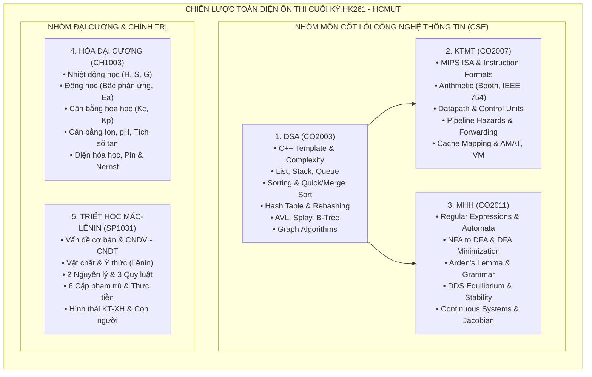

# 🎓 TRUNG TÂM TỔNG HỢP KIẾN THỨC ÔN THI CUỐI KỲ - HỌC KỲ HK261 (FINALS PORTAL)
## ĐẠI HỌC BÁCH KHOA - ĐHQG TP.HCM (HCMUT)

> **Học kỳ:** HK261 (Semester 261)  
> **Chương trình đào tạo:** Kỹ sư / Cử nhân Chất lượng cao & Đại trà – Khoa Khoa học & Kỹ thuật Máy tính (CSE) & Khoa Kỹ thuật Hóa học  
> **Mục tiêu kho lưu trữ:** Hệ thống hóa toàn bộ kiến thức, bài giảng slide, công thức cốt lõi, ma trận đề thi và hướng dẫn giải đề thi cuối kỳ cho 5 môn học trọng tâm trong học kỳ.  
> **Cập nhật lần cuối:** Tháng 11/2026  
> **Thư mục gốc:** `c:\Users\Admin\Documents\K261\Finals`

---

## 📑 BẢNG ĐIỀU HƯỚNG TỔNG QUAN CÁC MÔN HỌC (MASTER DIRECTORY)

| STT | Mã môn | Tên môn học (Tiếng Việt & English) | Khoa / Bộ môn | Số tín chỉ | Tài liệu chi tiết | Trọng tâm cốt lõi thi cuối kỳ |
|:---:|:---:|:---|:---|:---:|:---:|:---|
| **1** | **CO2003** | **Cấu trúc Dữ liệu & Giải thuật**<br>*(Data Structures & Algorithms - DSA)* | Khoa KH&KT Máy tính (CSE) | 4 TC | [📘 DSA/README.md](file:///c:/Users/Admin/Documents/K261/Finals/DSA/README.md) | Lists, Balanced Trees (AVL, Splay, B-Tree), Hashing, Heaps, Graph Algorithms (Dijkstra, MST, Topo) |
| **2** | **CO2007** | **Kiến trúc Máy tính**<br>*(Computer Architecture - KTMT)* | Khoa KH&KT Máy tính (CSE) | 3 TC | [💻 KTMT/README.md](file:///c:/Users/Admin/Documents/K261/Finals/KTMT/README.md) | MIPS ISA, Số học máy tính (Booth, Phép chia, IEEE 754), Datapath đơn/đa chu kỳ, Pipeline & Hazards, Cache & Virtual Memory |
| **3** | **CO2011 / CO2004** | **Mô hình hóa Toán học / Toán rời rạc 2**<br>*(Mathematical Modeling - MHH)* | Khoa KH&KT Máy tính (CSE) | 3 TC | [📐 MHH/README.md](file:///c:/Users/Admin/Documents/K261/Finals/MHH/README.md) | Lý thuyết Automata (DFA, NFA, Regex, Tối thiểu hóa DFA, Arden), Hệ động lực rời rạc & liên tục (DDS, ODE, Stability, Jacobian) |
| **4** | **CH1003** | **Hóa học Đại cương**<br>*(General Chemistry)* | Khoa Kỹ thuật Hóa học | 3 TC | [🧪 General Chemistry/README.md](file:///c:/Users/Admin/Documents/K261/Finals/General%20Chemistry/README.md) | Nhiệt động học hóa học ($\Delta H, \Delta S, \Delta G$), Động hóa học & $E_a$, Cân bằng hóa học ($K_c, K_p$), Dung dịch & Cân bằng ion (pH, $K_{sp}$), Điện hóa học (Nernst, Pin Galvanic, Điện phân) |
| **5** | **SP1031** | **Triết học Mác - Lênin**<br>*(Marxist-Leninist Philosophy)* | Khoa Khoa học Ứng dụng | 3 TC | [📕 MarxLenin/README.md](file:///c:/Users/Admin/Documents/K261/Finals/MarxLenin/README.md) | Vấn đề cơ bản triết học, CNDV Biện chứng (Vật chất - Ý thức, 2 nguyên lý, 3 quy luật, 6 cặp phạm trù, Nhận thức luận), CNDV Lịch sử (Hình thái KT-XH, Giai cấp - Dân tộc, Nhà nước) |

---

## 🗂️ CẤU TRÚC THƯ MỤC LƯU TRỮ CHI TIẾT (WORKSPACE STRUCTURE)

```
C:\Users\Admin\Documents\K261\Finals\
├── README.md                                  <-- Cổng thông tin & Bảng điều khiển trung tâm (Portal này)
├── EXAM_SCHEDULE_CHECKLIST.md                 <-- Kế hoạch ôn tập & Bảng kiểm tiến độ tự đánh giá
│
├── DSA/                                       <-- Môn Cấu trúc Dữ liệu & Giải thuật (CO2003)
│   ├── README.md                              <-- Đề cương & cẩm nang ôn thi toàn diện (179 KB)
│   ├── 1.Intro/                               <-- C++ OOP, Con trỏ, Độ phức tạp thời gian/không gian (Big-O, Master Theorem)
│   ├── 2.List/                                <-- ArrayList, SLinkedList, DLinkedList, Stack, Queue, Đảo danh sách
│   ├── 3.Sorting/                             <-- Insertion, Selection, Bubble, Merge, Quick Sort chuyên sâu
│   ├── 4.Hashing/                             <-- Bảng băm, Giải quyết xung đột (Open Addressing, Separate Chaining)
│   ├── 5.Tree/                                <-- Binary Tree, BST, AVL Tree (xoay cây), Splay Tree, B-Tree
│   ├── 6.Heap/                                <-- Min/Max Binary Heap, Heapify, Priority Queue
│   └── 7.Graph/                               <-- Biểu diễn đồ thị, BFS, DFS, Dijkstra, Bellman-Ford, Prim, Kruskal
│
├── KTMT/                                      <-- Môn Kiến trúc Máy tính (CO2007)
│   ├── README.md                              <-- Cẩm nang giải đề & lý thuyết chuyên sâu (86 KB)
│   ├── Chapter3.pdf                           <-- Slide gốc: Số học máy tính (Computer Arithmetic, Booth, IEEE 754)
│   ├── Chapter4.pdf                           <-- Tái hiện đề cương: Bộ xử lý, Datapath, Kỹ thuật đường ống (Pipelining)
│   └── Chapter5.pdf                           <-- Tái hiện đề cương: Hệ thống nhớ phân tầng, Bộ nhớ Cache, Virtual Memory
│
├── MHH/                                       <-- Môn Mô hình hóa Toán học (CO2011 / DM2)
│   ├── README.md                              <-- Cẩm nang ôn tập mô hình hóa toàn diện (124 KB)
│   ├── Automata/                              <-- Ngôn ngữ hình thức, NFA, DFA, Thu nhỏ DFA, Bổ đề Arden, Slide & Bài tập
│   └── Dynamical System/                      <-- Hệ động lực rời rạc DDS, Hệ liên tục, Phân tích ổn định, Mô hình dịch bệnh
│
├── General Chemistry/                         <-- Môn Hóa học Đại cương (CH1003)
│   ├── README.md                              <-- Hướng dẫn ôn tập 5 chuyên đề thi cuối kỳ HK261 (111 KB)
│   ├── Chapter 1-Electronic structure...pdf   <-- Cấu trúc electron nguyên tử (Ôn giữa kỳ / phụ lục)
│   ├── Chapter 2_periodic table-print.pdf     <-- Bảng tuần hoàn (Ôn giữa kỳ / phụ lục)
│   ├── Chapter 3-(molecular geometry)...pdf   <-- Hình học phân tử & Liên kết hóa học (Phụ lục)
│   ├── Chapter 4 (thermochemistry)-print.pdf  <-- [TRỌNG TÂM THI] Nhiệt hóa học & Nguyên lý I, II
│   ├── Chapter 5 Equilibrium-print.pdf        <-- [TRỌNG TÂM THI] Cân bằng hóa học & Le Chatelier
│   ├── Chapter 6-Kinetic-print.pdf            <-- [TRỌNG TÂM THI] Động hóa học, Năng lượng hoạt hóa Arrhenius
│   ├── Chapter 7-Solution-print.pdf           <-- [TRỌNG TÂM THI] Dung dịch, Cân bằng ion, pH, Muối, Tích số tan
│   └── extracted_text/                        <-- Văn bản thô đã trích xuất phục vụ tra cứu nhanh
│
└── MarxLenin/                                 <-- Môn Triết học Mác - Lênin (SP1031)
    ├── README.md                              <-- Đề cương trả lời câu hỏi tự luận & trắc nghiệm (51 KB)
    ├── Chương 1- P.1 đến P.3                  <-- Khái lược triết học, Vấn đề cơ bản, Sự ra đời Triết học Mác - Lênin
    ├── Chương 2 - P.1 đến P.4                 <-- Vật chất & Ý thức, Các cặp phạm trù, Phép biện chứng, Nhận thức luận
    └── CHƯƠNG 3 - P.1 đến P.5                 <-- Hình thái KT-XH, Giai cấp - Dân tộc, Nhà nước, Ý thức XH, Con người
```

---

## 🧭 BẢN ĐỒ MA TRẬN NỘI DUNG VÀ CHIẾN LƯỢC ÔN THI TỪNG MÔN



---

## ⚡ BẢNG TRA CỨU CÔNG THỨC & THUẬT TOÁN "VÀNG" (CROSS-DISCIPLINARY CHEAT-SHEET)

### 1. Cấu trúc Dữ liệu & Giải thuật (DSA - CO2003)
- **Định lý Thợ (Master Theorem) cho $T(n) = aT(n/b) + f(n)$:**
  - Nếu $f(n) = O(n^{\log_b a - \epsilon})$: $T(n) = \Theta(n^{\log_b a})$.
  - Nếu $f(n) = \Theta(n^{\log_b a} \log^k n)$: $T(n) = \Theta(n^{\log_b a} \log^{k+1} n)$.
  - Nếu $f(n) = \Omega(n^{\log_b a + \epsilon})$ và điều kiện điều chuẩn thỏa: $T(n) = \Theta(f(n))$.
- **Độ phức tạp thuật toán sắp xếp kinh điển:**
  - Quick Sort: Best/Avg $O(n \log n)$, Worst $O(n^2)$ (khi pivot lệch tối đa).
  - Merge Sort: Luôn ổn định $\Theta(n \log n)$, bộ nhớ phụ $O(n)$.
  - Heap Sort: Luôn $O(n \log n)$, In-place ($O(1)$ extra space), không ổn định.
- **Cây cân bằng AVL:** Hệ số cân bằng $BF(node) = h(Left) - h(Right) \in \{-1, 0, 1\}$.
  - Lệch LL $\to$ Xoay phải (Right Rotation).
  - Lệch RR $\to$ Xoay trái (Left Rotation).
  - Lệch LR $\to$ Xoay trái con trái rồi xoay phải tại gốc.
  - Lệch RL $\to$ Xoay phải con phải rồi xoay trái tại gốc.
- **Bảng băm (Hash Table):**
  - Hệ số tải $\alpha = \frac{n}{M}$.
  - Dò tuyến tính (Linear Probing): $h(k, i) = (h'(k) + i) \bmod M$.
  - Dò bậc hai (Quadratic Probing): $h(k, i) = (h'(k) + c_1 i + c_2 i^2) \bmod M$.
  - Băm kép (Double Hashing): $h(k, i) = (h_1(k) + i \cdot h_2(k)) \bmod M$.

---

### 2. Kiến trúc Máy tính (KTMT - CO2007)
- **Đánh giá hiệu năng:**
  $$\text{CPU Time} = \text{IC} \times \text{CPI} \times T_c = \frac{\text{IC} \times \text{CPI}}{\text{Clock Rate}}$$
  $$\text{Định luật Amdahl: } S_{\text{overall}} = \frac{1}{(1 - f) + \frac{f}{S}}$$
- **Chuẩn IEEE 754 chính xác đơn (Single Precision - 32 bit):**
  - Bit 31: Sign $S$. Bit 30..23: Exponent $E$ (8 bit, Bias = 127). Bit 22..0: Fraction $F$ (23 bit).
  - Giá trị chuẩn hóa: $V = (-1)^S \times (1.F)_2 \times 2^{E - 127}$.
- **Pipeline 5 tầng (IF, ID, EX, MEM, WB):**
  - Tăng tốc tối đa trên lý thuyết: $\text{Speedup} \approx N_{\text{stages}} = 5$.
  - Forwarding: Từ thanh ghi pipeline `EX/MEM` hoặc `MEM/WB` quay ngược về lối vào ALU (`EX`).
  - Load-Use Data Hazard: Bắt buộc dừng (stall) 1 chu kỳ máy (bong bóng) ngay cả khi có Forwarding.
- **Bộ nhớ phân tầng (Cache Memory):**
  $$\text{Kích thước địa chỉ} = \text{Tag} + \text{Index} + \text{Block Offset}$$
  $$\text{Offset} = \log_2(\text{Block Size in bytes}), \quad \text{Index} = \log_2(\text{Number of Sets})$$
  $$\text{AMAT} = \text{Hit Time} + \text{Miss Rate} \times \text{Miss Penalty}$$

---

### 3. Mô hình hóa Toán học (MHH - CO2011 / DM2)
- **Bổ đề Arden:**
  $$X = A \cdot X + B \implies X = A^* \cdot B \quad (\text{với } \varepsilon \notin A)$$
- **Quy tắc chuyển dịch trạng thái Automata:**
  - Chuyển đổi $NFA \to DFA$ bằng thuật toán vết tập con (Subset Construction / Powerset construction).
  - Thu nhỏ DFA: Bảng đánh dấu cặp trạng thái tương đương $\approx$ (Table-filling method / Myhill-Nerode).
- **Hệ động lực thời gian rời rạc (DDS) tuyến tính cấp 1:**
  $$x_{t+1} = a x_t + b \implies x^* = \frac{b}{1 - a} \quad (a \neq 1)$$
  - Điều kiện ổn định tiệm cận: $|a| < 1$.
- **Hệ phi tuyến & Tuyến tính hóa qua ma trận Jacobian $J(x^*, y^*)$:**
  - Nếu tất cả giá trị riêng $\lambda_i$ của $J$ có phần thực $\text{Re}(\lambda_i) < 0 \implies$ Điểm cân bằng **ổn định tiệm cận (Asymptotically Stable)**.
  - Nếu tồn tại $\text{Re}(\lambda_i) > 0 \implies$ Điểm cân bằng **không ổn định (Unstable)**.

---

### 4. Hóa học Đại cương (General Chemistry - CH1003)
- **Nhiệt động học hóa học:**
  $$\Delta H_{\text{pư}}^\circ = \sum \Delta H_{f,\text{sp}}^\circ - \sum \Delta H_{f,\text{cđ}}^\circ$$
  $$\Delta G^\circ = \Delta H^\circ - T \Delta S^\circ = -RT \ln K$$
  - $\Delta G < 0$: Phản ứng tự diễn biến theo chiều thuận.
  - $\Delta G = 0$: Hệ đạt trạng thái cân bằng.
- **Động hóa học & Phương trình Arrhenius:**
  $$\ln \frac{k_2}{k_1} = \frac{E_a}{R} \left( \frac{1}{T_1} - \frac{1}{T_2} \right)$$
  - Phản ứng bậc 1: $k = \frac{1}{t} \ln \frac{C_0}{C_t}, \quad t_{1/2} = \frac{\ln 2}{k} \approx \frac{0.693}{k}$.
- **Dung dịch đệm (Henderson - Hasselbalch):**
  $$\text{pH} = \text{p}K_a + \log \frac{[\text{Bazo liên hợp}]}{[\text{Axit}]}$$
- **Phương trình Nernst cho pin điện hóa ở $25^\circ\text{C}$ (298 K):**
  $$E = E^\circ - \frac{0.0592}{n} \log Q, \quad E_{\text{pin}}^\circ = E_{(+)}^\circ - E_{(-)}^\circ$$

---

### 5. Triết học Mác - Lênin (MarxLenin - SP1031)
- **Định nghĩa vật chất của V.I. Lênin:** *"Vật chất là một phạm trù triết học dùng để chỉ thực tại khách quan được đem lại cho con người trong cảm giác, được cảm giác của chúng ta chép lại, chụp lại, phản ánh, và tồn tại không lệ thuộc vào cảm giác."*
- **3 Quy luật cơ bản của Phép biện chứng duy vật:**
  1. *Quy luật chuyển hóa từ những sự thay đổi về lượng thành những thay đổi về chất và ngược lại* (Chỉ ra cách thức vận động, phát triển).
  2. *Quy luật thống nhất và đấu tranh của các mặt đối lập* (Hạt nhân của PBCDV - Chỉ ra nguồn gốc, động lực bên trong của sự phát triển).
  3. *Quy luật phủ định của phủ định* (Chỉ ra khuynh hướng đi lên theo hình xoáy ốc của sự phát triển).
- **Quy luật cốt lõi của Chủ nghĩa duy vật lịch sử:**
  - *Quan hệ biện chứng giữa Lực lượng sản xuất (LLSX) và Quan hệ sản xuất (QHSX)*: LLSX quyết định QHSX; QHSX tác động trở lại phù hợp hoặc kìm hãm LLSX.
  - *Cơ sở hạ tầng quyết định Kiến trúc thượng tầng*.

---

## 🗓️ BẢNG TỔNG HỢP LIÊN KẾT NHANH TỚI CÁC TÀI LIỆU CỐT LÕI

Dưới đây là các đường dẫn trực tiếp (Direct Links) để mở nhanh từng file tài liệu chi tiết:

1. **Cấu trúc Dữ liệu & Giải thuật:**
   - [Tài liệu ôn thi đầy đủ DSA README.md](file:///c:/Users/Admin/Documents/K261/Finals/DSA/README.md)
   - [Slide Giới thiệu & Độ phức tạp (DSA/1.Intro)](file:///c:/Users/Admin/Documents/K261/Finals/DSA/1.Intro/03-complexity.pdf)
   - [Slide Danh sách tuyến tính & Stack/Queue (DSA/2.List)](file:///c:/Users/Admin/Documents/K261/Finals/DSA/2.List/2.1.%20Lists__P_1_.pdf)
   - [Slide Sắp xếp & Quicksort (DSA/3.Sorting)](file:///c:/Users/Admin/Documents/K261/Finals/DSA/3.Sorting/quicksort.pdf)
   - [Slide Bảng băm (DSA/4.Hashing)](file:///c:/Users/Admin/Documents/K261/Finals/DSA/4.Hashing/4.%20Search-Hash.pdf)
   - [Slide Cây nhị phân & AVL/B-Tree (DSA/5.Tree)](file:///c:/Users/Admin/Documents/K261/Finals/DSA/5.Tree/5.1.Trees__P_1_.pdf)
   - [Slide Hàng đợi ưu tiên Heap (DSA/6.Heap)](file:///c:/Users/Admin/Documents/K261/Finals/DSA/6.Heap/Heap.pdf)
   - [Slide Lý thuyết đồ thị & Đường đi ngắn nhất (DSA/7.Graph)](file:///c:/Users/Admin/Documents/K261/Finals/DSA/7.Graph/Graph-P1.pdf)

2. **Kiến trúc Máy tính:**
   - [Tài liệu ôn thi đầy đủ KTMT README.md](file:///c:/Users/Admin/Documents/K261/Finals/KTMT/README.md)
   - [Slide Chương 3 - Số học máy tính (KTMT/Chapter3.pdf)](file:///c:/Users/Admin/Documents/K261/Finals/KTMT/Chapter3.pdf)

3. **Mô hình hóa Toán học:**
   - [Tài liệu ôn thi đầy đủ MHH README.md](file:///c:/Users/Admin/Documents/K261/Finals/MHH/README.md)
   - [Slide Lý thuyết Automata (MHH/Automata)](file:///c:/Users/Admin/Documents/K261/Finals/MHH/Automata/dm2_Ch4_automata.pdf)
   - [Slide Hệ động lực DDS & Liên tục (MHH/Dynamical System)](file:///c:/Users/Admin/Documents/K261/Finals/MHH/Dynamical%20System/dm2_Ch6_Dynamical_Systems.pdf)

4. **Hóa học Đại cương:**
   - [Tài liệu ôn thi đầy đủ Hóa học Đại cương README.md](file:///c:/Users/Admin/Documents/K261/Finals/General%20Chemistry/README.md)
   - [Slide Chương 4: Nhiệt hóa học](file:///c:/Users/Admin/Documents/K261/Finals/General%20Chemistry/Chapter%204%20(thermochemistry)-print.pdf)
   - [Slide Chương 5: Cân bằng hóa học](file:///c:/Users/Admin/Documents/K261/Finals/General%20Chemistry/Chapter%205%20Equilibrium-print.pdf)
   - [Slide Chương 6: Động hóa học](file:///c:/Users/Admin/Documents/K261/Finals/General%20Chemistry/Chapter%206-Kinetic-print.pdf)
   - [Slide Chương 7: Cân bằng dung dịch](file:///c:/Users/Admin/Documents/K261/Finals/General%20Chemistry/Chapter%207-Solution-print.pdf)

5. **Triết học Mác - Lênin:**
   - [Tài liệu ôn thi đầy đủ Triết học README.md](file:///c:/Users/Admin/Documents/K261/Finals/MarxLenin/README.md)
   - [Chương 1 - Khái lược triết học & CNDV](file:///c:/Users/Admin/Documents/K261/Finals/MarxLenin/Chương%201-%20P.1%20(KHÁI%20LƯỢC%20VỀ%20TRIẾT%20HỌC).pdf)
   - [Chương 2 - Vật chất & Ý thức](file:///c:/Users/Admin/Documents/K261/Finals/MarxLenin/Chương%202%20-%20P.1%20(VẬT%20CHẤT%20VÀ%20Ý%20THỨC).pdf)
   - [Chương 2 - Phép biện chứng duy vật](file:///c:/Users/Admin/Documents/K261/Finals/MarxLenin/Chương%202%20-%20P.3%20(PHÉP%20BIỆN%20CHỨNG%20DUY%20VẬT).pdf)
   - [Chương 3 - Hình thái kinh tế - xã hội](file:///c:/Users/Admin/Documents/K261/Finals/MarxLenin/CHƯƠNG%203%20-%20P.1%20(HỌC%20THUYẾT%20HÌNH%20THÁI%20KINH%20TẾ%20-%20XÃ%20HỘI).pdf)

6. **Bảng kiểm tra tiến độ ôn thi:**
   - [Bảng kiểm tiến độ tự đánh giá (EXAM_SCHEDULE_CHECKLIST.md)](file:///c:/Users/Admin/Documents/K261/Finals/EXAM_SCHEDULE_CHECKLIST.md)

---
*Chúc bạn ôn tập hiệu quả, vững vàng kiến thức và đạt kết quả xuất sắc trong kỳ thi cuối kỳ HK261!*
"# K261Finals" 
